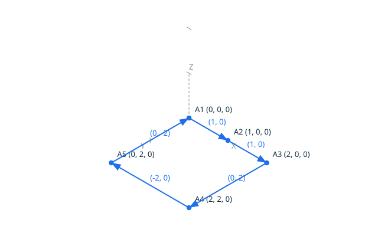

# Contours and Loops in 2D <!-- omit from toc -->

This feature introduces oriented sequences of 2D segments to form **contours**
and **loops**, with exact verification of topological properties on the
discrete grid. The operations classify and validate geometric configurations
without approximation, tolerance, or floating-point arithmetic. The scenarios
run the six contour predicates through TopoScript, the same proved operations
as the kernel, and write the canonical result with the explicit `Put` of each
classification.

## Contents <!-- omit from toc -->

- [Types and Definitions](#types-and-definitions)
  - [`Segment_Sequence_2D`](#segment_sequence_2d)
  - [Continuity](#continuity)
  - [Closure (Loop)](#closure-loop)
  - [Contour Orientation](#contour-orientation)
  - [Self-Intersection](#self-intersection)
  - [Validity and Flat Turns](#validity-and-flat-turns)
- [Scripting Interface](#scripting-interface)
- [Scenarios: Continuity](#scenarios-continuity)
  - [Scenario: a continuous sequence of two segments](#scenario-a-continuous-sequence-of-two-segments)
  - [Scenario: a discontinuous sequence](#scenario-a-discontinuous-sequence)
  - [Scenario: a single segment is trivially continuous](#scenario-a-single-segment-is-trivially-continuous)
  - [Scenario: an empty sequence is continuous](#scenario-an-empty-sequence-is-continuous)
- [Scenarios: Closure](#scenarios-closure)
  - [Scenario: a closed loop (square)](#scenario-a-closed-loop-square)
  - [Scenario: an open chain](#scenario-an-open-chain)
  - [Scenario: closure with a repeated point](#scenario-closure-with-a-repeated-point)
- [Scenarios: Contour Orientation](#scenarios-contour-orientation)
  - [Scenario: counter-clockwise square](#scenario-counter-clockwise-square)
  - [Scenario: clockwise square](#scenario-clockwise-square)
  - [Scenario: degenerate loop of zero area](#scenario-degenerate-loop-of-zero-area)
  - [Scenario: counter-clockwise triangle](#scenario-counter-clockwise-triangle)
  - [Scenario: orientation of a contour with a flat turn](#scenario-orientation-of-a-contour-with-a-flat-turn)
- [Scenarios: Self-Intersection](#scenarios-self-intersection)
  - [Scenario: a simple loop does not self-intersect](#scenario-a-simple-loop-does-not-self-intersect)
  - [Scenario: a bowtie self-intersects](#scenario-a-bowtie-self-intersects)
  - [Scenario: three segments meeting at a point is not a self-intersection](#scenario-three-segments-meeting-at-a-point-is-not-a-self-intersection)
  - [Scenario: a single segment does not self-intersect](#scenario-a-single-segment-does-not-self-intersect)
- [Scenarios: Validity and Flat Turns](#scenarios-validity-and-flat-turns)
  - [Scenario: a valid contour (non-degenerate)](#scenario-a-valid-contour-non-degenerate)
  - [Scenario: invalid due to degenerate segment](#scenario-invalid-due-to-degenerate-segment)
  - [Scenario: valid with a flat turn](#scenario-valid-with-a-flat-turn)
  - [Scenario: a contour with a flat turn is not reduced](#scenario-a-contour-with-a-flat-turn-is-not-reduced)
- [Scenarios: Grid Domain Limits](#scenarios-grid-domain-limits)
  - [Scenario: continuity at grid corners](#scenario-continuity-at-grid-corners)
  - [Scenario: orientation of extreme loop](#scenario-orientation-of-extreme-loop)
- [Proved Properties](#proved-properties)
  - [Closure](#closure)
  - [Contour Orientation](#contour-orientation-1)
  - [Numeric Safety](#numeric-safety)
  - [Self-Intersection](#self-intersection-1)
  - [Validity](#validity)
  - [Invariance of the Signed Area](#invariance-of-the-signed-area)
- [Design Notes](#design-notes)

## Types and Definitions

### `Segment_Sequence_2D`

An ordered list of 2D points representing a polygonal chain: `n` points
define the `n - 1` segments `(P1, P2), (P2, P3), ..., (Pn-1, Pn)`.
The sequence has a **length** (number of points, at most `Max_Points`) and is
either **empty**, **open**, or **closed** (see below).

A segment sequence is **non-degenerate** when no segment is degenerate
(i.e., no segment has coincident endpoints).

### Continuity

A sequence of segments is **continuous** when, for every consecutive pair
of segments `S_i` and `S_{i+1}`, the endpoint of `S_i` equals the start point
of `S_{i+1}`:

```text
S_i.End = S_{i+1}.Start
```

This property is decidable exactly by integer equality on the grid.

A `Segment_Sequence_2D` stores its points, not duplicated segment
endpoints, so a sequence built from a point chain is continuous by
construction. The property is therefore exercised through
`Contour_Continuity`, which reads the chain accumulated by `Add_Point` as
segment pairs, each segment given by its two endpoints; the scenarios below
show the chaining, and the gap when the chain is discontinuous.

### Closure (Loop)

A sequence is **closed**, that is, forms a loop, when its first and last
points coincide:

```text
P_1 = P_n
```

A single point is trivially closed; an empty sequence is not. A loop has no
distinguished "start" or "end" — it is a closed boundary.

### Contour Orientation

The **orientation** of a loop is **counter-clockwise** if the interior is on
the left when traversing the boundary, and **clockwise** otherwise. For a
loop with points `P_1, P_2, ..., P_n, P_1`, the orientation is the sign of the
**signed area** computed by the shoelace formula:

```text
(1/2) * Sum_{i=1 to n} (P_i.X * P_{i+1}.Y - P_i.Y * P_{i+1}.X)
```

The sign alone (positive, zero, or negative) classifies the orientation
**exactly** without division: the factor 1/2 is omitted as it does not
affect the sign. The classification is:

- **counter_clockwise**: positive sum
- **clockwise**: negative sum
- **degenerate**: zero sum

For a simple loop (without self-intersections), the sum is never zero. The
degenerate case can only occur for a closed, valid sequence that is not
simple. Note: the signed area is computed in a domain large enough to avoid
overflow for the whole grid at the maximum sequence length (see Numeric
Model).


### Self-Intersection

A sequence **self-intersects** when two non-consecutive segments cross,
that is, when they share a grid position that is not a common endpoint of
both. Formally, for segments `S_i` and `S_j` with `|i - j| > 1`
(non-consecutive), the exact intersection of the two segments is:

- an **overlap**: the segments are collinear and share a sub-segment of
  positive length; or
- a **single common grid position** that is not simultaneously an endpoint
  of `S_i` and an endpoint of `S_j`.

Two non-consecutive segments that meet exactly at a shared endpoint form a
valid junction, not a self-intersection. Two segments that properly cross
at a position that is not on the grid share no grid position: in the
discrete model they do not cross, and the crossing is reported by the
`Intersection` operation as `off_grid_crossing`.

Consecutive segments are never compared: they share an endpoint by
construction. This is checked using the exact `Intersection` operation of
the kernel.


### Validity and Flat Turns

A segment sequence is **valid** for contour formation when no segment is
degenerate (both endpoints differ). This is the geometric validity of the
chain: an edge exists between two consecutive points only when the two
points differ. Sequences of less than two points are vacuously valid.

An intermediate collinear point is **not** an invalidity: a valid chain
with such a point describes exactly the same geometry as the chain
without it. A chain **has no flat turns** when no three consecutive
points are collinear, so that every point has a well-defined turning
direction. The absence of flat turns is a canonical-representation
property, observable separately with `Contour_No_Flat_Turns`; it never
invalidates a contour (design decision DD-001).

## Scripting Interface

The six contour predicates run on the chain accumulated by `Add_Point`:
each script declares its points as named constants, appends them to the
chain in order, then classifies the chain and writes the canonical result
with the explicit `Put` of the classification. The scripts draw the
diagrams of this page with `Draw_Point_2D` and `Draw_Edge` or
`Draw_Segment_2D`:

```ada
A : constant Point_2D := (0, 0);
B : constant Point_2D := (2, 0);
C : constant Point_2D := (2, 2);
D : constant Point_2D := (0, 2);
K : Closure_Kind;

Add_Point (A);
Add_Point (B);
Add_Point (C);
Add_Point (D);
Add_Point (A);

Contour_Closure (K);

Put_Closure (K);
```

Classifies whether a sequence of points forms a closed loop (i.e., the
first and last points coincide). Output is `closure closed` or
`closure open`, written by `Put_Closure`.

`Contour_Continuity` classifies whether the segments, each given by its
two endpoints, form a continuous sequence: the chain is read as segment
pairs, two points per segment, and the endpoint of each segment must equal
the start point of the next. Output is `continuity continuous` or
`continuity discontinuous`, written by `Put_Continuity`.

`Contour_Orientation` returns the orientation of a closed, valid sequence
of points: `orientation counter_clockwise`, `orientation clockwise`, or
`orientation degenerate`, written by `Put_Contour_Orientation`. A
diagnostic is reported when the sequence has less than three points, is
not closed, or is not valid. A contour with intermediate collinear points
is orientable: its flat turns are a matter of representation, not of
validity.

`Contour_Self_Intersects` returns whether the sequence of points
self-intersects, `Contour_Valid` whether it is valid (non-degenerate
segments), and `Contour_No_Flat_Turns` whether no three consecutive
points of the sequence are collinear. Each writes `true` or `false`
through `Put_Bool`. An intermediate collinear point does not invalidate
the sequence: validity is geometric, not canonical.

All operations use the same grid domain as the existing operations
(`Grid_Coordinate` range), and sequences are limited to `Max_Points`
points. Out-of-range values are rejected with an error.

## Scenarios: Continuity

### Scenario: a continuous sequence of two segments

The endpoint of the first segment equals the start point of the second.


- Given the file `continuity_chain.topo`
  ```ada
  A    : constant Point_2D := (0, 0);
  B    : constant Point_2D := (1, 0);
  C    : constant Point_2D := (1, 1);
  K    : Continuity_Kind;
  Name : VString := +"../docs/features/images/contour_4.svg";

  Begin_Image (Name);
  Draw_Axes;
  Draw_Point_2D (A, Blue);
  Draw_Point_2D (B, Blue);
  Draw_Point_2D (C, Blue);
  Draw_Edge (A, B, Blue);
  Draw_Edge (B, C, Blue);
  End_Image;

  Add_Point (A);
  Add_Point (B);
  Add_Point (B);
  Add_Point (C);

  Contour_Continuity (K);

  Put_Continuity (K);
  ```
- When I successfully run `../bin/topocli run continuity_chain.topo`
- Then the output is `continuity continuous`
- And the file `../docs/features/images/contour_4.svg` contains `#1f6feb`  
  (The `#1f6feb` value is the blue of `Color_Kind`: the check ensures
  the points and segments of the chain are drawn, the two segments
  chaining at `B`.)

### Scenario: a discontinuous sequence

The endpoint `(1, 0)` of the first segment differs from the start point
`(2, 1)` of the second: the chain has a gap.


- Given the file `continuity_gap.topo`
  ```ada
  A    : constant Point_2D := (0, 0);
  B    : constant Point_2D := (1, 0);
  C    : constant Point_2D := (2, 1);
  D    : constant Point_2D := (2, 2);
  K    : Continuity_Kind;
  Name : VString := +"../docs/features/images/contour_5.svg";

  Begin_Image (Name);
  Draw_Axes;
  Draw_Point_2D (A, Blue);
  Draw_Point_2D (B, Blue);
  Draw_Point_2D (C, Blue);
  Draw_Point_2D (D, Blue);
  Draw_Edge (A, B, Blue);
  Draw_Edge (C, D, Blue);
  End_Image;

  Add_Point (A);
  Add_Point (B);
  Add_Point (C);
  Add_Point (D);

  Contour_Continuity (K);

  Put_Continuity (K);
  ```
- When I successfully run `../bin/topocli run continuity_gap.topo`
- Then the output is `continuity discontinuous`
- And the file `../docs/features/images/contour_5.svg` contains `#1f6feb`  
  (The `#1f6feb` value is the blue of `Color_Kind`: the check ensures
  the two segments of the chain are drawn, with the gap between `B`
  and `C`.)

### Scenario: a single segment is trivially continuous
- Given the file `continuity_single.topo`
  ```ada
  A : constant Point_2D := (0, 0);
  B : constant Point_2D := (1, 1);
  K : Continuity_Kind;

  Add_Point (A);
  Add_Point (B);

  Contour_Continuity (K);

  Put_Continuity (K);
  ```
- When I successfully run `../bin/topocli run continuity_single.topo`
- Then the output is `continuity continuous`

### Scenario: an empty sequence is continuous
- Given the file `continuity_empty.topo`
  ```ada
  K : Continuity_Kind;

  Contour_Continuity (K);

  Put_Continuity (K);
  ```
- When I successfully run `../bin/topocli run continuity_empty.topo`
- Then the output is `continuity continuous`

## Scenarios: Closure

### Scenario: a closed loop (square)

The last point equals the first: the square of the orientation definition.


- Given the file `closure_square.topo`
  ```ada
  A    : constant Point_2D := (0, 0);
  B    : constant Point_2D := (2, 0);
  C    : constant Point_2D := (2, 2);
  D    : constant Point_2D := (0, 2);
  K    : Closure_Kind;
  Name : VString := +"../docs/features/images/contour_1.svg";

  Begin_Image (Name);
  Draw_Axes;
  Draw_Point_2D (A, Blue);
  Draw_Point_2D (B, Blue);
  Draw_Point_2D (C, Blue);
  Draw_Point_2D (D, Blue);
  Draw_Edge (A, B, Blue);
  Draw_Edge (B, C, Blue);
  Draw_Edge (C, D, Blue);
  Draw_Edge (D, A, Blue);
  End_Image;

  Add_Point (A);
  Add_Point (B);
  Add_Point (C);
  Add_Point (D);
  Add_Point (A);

  Contour_Closure (K);

  Put_Closure (K);
  ```
- When I successfully run `../bin/topocli run closure_square.topo`
- Then the output is `closure closed`
- And the file `../docs/features/images/contour_1.svg` contains `#1f6feb`  
  (The `#1f6feb` value is the blue of `Color_Kind`: the check ensures
  the four points and edges of the loop are drawn, the last edge
  closing back on `A`.)

### Scenario: an open chain

The chain starts at `(0, 0)` and ends at `(1, 1)`: no segment returns to
the start point.


- Given the file `closure_open.topo`
  ```ada
  A    : constant Point_2D := (0, 0);
  B    : constant Point_2D := (1, 0);
  C    : constant Point_2D := (1, 1);
  K    : Closure_Kind;
  Name : VString := +"../docs/features/images/contour_6.svg";

  Begin_Image (Name);
  Draw_Axes;
  Draw_Point_2D (A, Blue);
  Draw_Point_2D (B, Blue);
  Draw_Point_2D (C, Blue);
  Draw_Edge (A, B, Blue);
  Draw_Edge (B, C, Blue);
  End_Image;

  Add_Point (A);
  Add_Point (B);
  Add_Point (C);

  Contour_Closure (K);

  Put_Closure (K);
  ```
- When I successfully run `../bin/topocli run closure_open.topo`
- Then the output is `closure open`
- And the file `../docs/features/images/contour_6.svg` contains `#1f6feb`  
  (The `#1f6feb` value is the blue of `Color_Kind`: the check ensures
  the points and segments of the chain are drawn, open on `C`.)

### Scenario: closure with a repeated point
- Given the file `closure_repeat.topo`
  ```ada
  A : constant Point_2D := (5, 5);
  K : Closure_Kind;

  Add_Point (A);
  Add_Point (A);

  Contour_Closure (K);

  Put_Closure (K);
  ```
- When I successfully run `../bin/topocli run closure_repeat.topo`
- Then the output is `closure closed`

## Scenarios: Contour Orientation

### Scenario: counter-clockwise square

The square of the orientation definition, traversed from `(0, 0)` towards
`(2, 0)`: the interior is on the left.


The square and its diagram are the ones of the closure scenario.

- Given the file `orientation_ccw.topo`
  ```ada
  A : constant Point_2D := (0, 0);
  B : constant Point_2D := (2, 0);
  C : constant Point_2D := (2, 2);
  D : constant Point_2D := (0, 2);
  O : Contour_Orientation_Kind;

  Add_Point (A);
  Add_Point (B);
  Add_Point (C);
  Add_Point (D);
  Add_Point (A);

  Contour_Orientation (O);

  Put_Contour_Orientation (O);
  ```
- When I successfully run `../bin/topocli run orientation_ccw.topo`
- Then the output is `orientation counter_clockwise`

### Scenario: clockwise square

The same square traversed from `(0, 0)` towards `(0, 2)`: the interior is
on the right.


- Given the file `orientation_cw.topo`
  ```ada
  A    : constant Point_2D := (0, 0);
  B    : constant Point_2D := (0, 2);
  C    : constant Point_2D := (2, 2);
  D    : constant Point_2D := (2, 0);
  O    : Contour_Orientation_Kind;
  Name : VString := +"../docs/features/images/contour_2.svg";

  Begin_Image (Name);
  Draw_Axes;
  Draw_Point_2D (A, Blue);
  Draw_Point_2D (B, Blue);
  Draw_Point_2D (C, Blue);
  Draw_Point_2D (D, Blue);
  Draw_Edge (A, B, Blue);
  Draw_Edge (B, C, Blue);
  Draw_Edge (C, D, Blue);
  Draw_Edge (D, A, Blue);
  End_Image;

  Add_Point (A);
  Add_Point (B);
  Add_Point (C);
  Add_Point (D);
  Add_Point (A);

  Contour_Orientation (O);

  Put_Contour_Orientation (O);
  ```
- When I successfully run `../bin/topocli run orientation_cw.topo`
- Then the output is `orientation clockwise`
- And the file `../docs/features/images/contour_2.svg` contains `#1f6feb`  
  (The `#1f6feb` value is the blue of `Color_Kind`: the check ensures
  the four points and edges of the loop are drawn, traversed
  clockwise.)

### Scenario: degenerate loop of zero area

The bowtie of the self-intersection definition: the two lobes have the
same area and opposite orientations, so the shoelace sums to zero.


- Given the file `orientation_bowtie.topo`
  ```ada
  A    : constant Point_2D := (0, 0);
  B    : constant Point_2D := (2, 2);
  C    : constant Point_2D := (2, 0);
  D    : constant Point_2D := (0, 2);
  O    : Contour_Orientation_Kind;
  Name : VString := +"../docs/features/images/contour_3.svg";

  Begin_Image (Name);
  Draw_Axes;
  Draw_Point_2D (A, Blue);
  Draw_Point_2D (B, Blue);
  Draw_Point_2D (C, Blue);
  Draw_Point_2D (D, Blue);
  Draw_Segment_2D (A, B, Blue);
  Draw_Segment_2D (B, C, Blue);
  Draw_Segment_2D (C, D, Blue);
  Draw_Segment_2D (D, A, Blue);
  End_Image;

  Add_Point (A);
  Add_Point (B);
  Add_Point (C);
  Add_Point (D);
  Add_Point (A);

  Contour_Orientation (O);

  Put_Contour_Orientation (O);
  ```
- When I successfully run `../bin/topocli run orientation_bowtie.topo`
- Then the output is `orientation degenerate`
- And the file `../docs/features/images/contour_3.svg` contains `#1f6feb`  
  (The `#1f6feb` value is the blue of `Color_Kind`: the check ensures
  the bowtie is drawn, its two diagonals crossing at the centre. The
  crossing segments are drawn without their vector labels, so the two
  labels cannot stack at the crossing.)

### Scenario: counter-clockwise triangle


- Given the file `orientation_triangle.topo`
  ```ada
  A    : constant Point_2D := (0, 0);
  B    : constant Point_2D := (2, 0);
  C    : constant Point_2D := (1, 2);
  O    : Contour_Orientation_Kind;
  Name : VString := +"../docs/features/images/contour_7.svg";

  Begin_Image (Name);
  Draw_Axes;
  Draw_Point_2D (A, Blue);
  Draw_Point_2D (B, Blue);
  Draw_Point_2D (C, Blue);
  Draw_Edge (A, B, Blue);
  Draw_Edge (B, C, Blue);
  Draw_Edge (C, A, Blue);
  End_Image;

  Add_Point (A);
  Add_Point (B);
  Add_Point (C);
  Add_Point (A);

  Contour_Orientation (O);

  Put_Contour_Orientation (O);
  ```
- When I successfully run `../bin/topocli run orientation_triangle.topo`
- Then the output is `orientation counter_clockwise`
- And the file `../docs/features/images/contour_7.svg` contains `#1f6feb`  
  (The `#1f6feb` value is the blue of `Color_Kind`: the check ensures
  the three points and edges of the triangle loop are drawn.)

### Scenario: orientation of a contour with a flat turn

The square of the orientation definition, with the intermediate point
`(1, 0)` on its bottom edge: the chain has a flat turn at that point, so
it is not reduced, but it remains valid and encloses the same region,
traversed counter-clockwise.



- Given the file `orientation_flat.topo`
  ```ada
  A    : constant Point_2D := (0, 0);
  B    : constant Point_2D := (1, 0);
  C    : constant Point_2D := (2, 0);
  D    : constant Point_2D := (2, 2);
  E    : constant Point_2D := (0, 2);
  O    : Contour_Orientation_Kind;
  Name : VString := +"../docs/features/images/contour_13.svg";

  Begin_Image (Name);
  Draw_Axes;
  Draw_Point_2D (A, Blue);
  Draw_Point_2D (B, Blue);
  Draw_Point_2D (C, Blue);
  Draw_Point_2D (D, Blue);
  Draw_Point_2D (E, Blue);
  Draw_Edge (A, B, Blue);
  Draw_Edge (B, C, Blue);
  Draw_Edge (C, D, Blue);
  Draw_Edge (D, E, Blue);
  Draw_Edge (E, A, Blue);
  End_Image;

  Add_Point (A);
  Add_Point (B);
  Add_Point (C);
  Add_Point (D);
  Add_Point (E);
  Add_Point (A);

  Contour_Orientation (O);

  Put_Contour_Orientation (O);
  ```
- When I successfully run `../bin/topocli run orientation_flat.topo`
- Then the output is `orientation counter_clockwise`
- And the file `../docs/features/images/contour_13.svg` contains `#1f6feb`  
  (The `#1f6feb` value is the blue of `Color_Kind`: the check ensures
  the loop is drawn, with the flat turn at `B` on the bottom edge.)

## Scenarios: Self-Intersection

### Scenario: a simple loop does not self-intersect

The square of the orientation definition: the only non-consecutive pair
that meets is the first and last segment, and they meet exactly at the
shared endpoint `(0, 0)`.


The square and its diagram are the ones of the closure scenario.

- Given the file `self_square.topo`
  ```ada
  A : constant Point_2D := (0, 0);
  B : constant Point_2D := (2, 0);
  C : constant Point_2D := (2, 2);
  D : constant Point_2D := (0, 2);
  S : Bool_Kind;

  Add_Point (A);
  Add_Point (B);
  Add_Point (C);
  Add_Point (D);
  Add_Point (A);

  Contour_Self_Intersects (S);

  Put_Bool (S);
  ```
- When I successfully run `../bin/topocli run self_square.topo`
- Then the output is `false`

### Scenario: a bowtie self-intersects

The bowtie of the self-intersection definition: the first and third
segments cross at the grid position `(1, 1)`.


The bowtie and its diagram are the ones of the degenerate orientation
scenario.

- Given the file `self_bowtie.topo`
  ```ada
  A : constant Point_2D := (0, 0);
  B : constant Point_2D := (2, 2);
  C : constant Point_2D := (2, 0);
  D : constant Point_2D := (0, 2);
  S : Bool_Kind;

  Add_Point (A);
  Add_Point (B);
  Add_Point (C);
  Add_Point (D);
  Add_Point (A);

  Contour_Self_Intersects (S);

  Put_Bool (S);
  ```
- When I successfully run `../bin/topocli run self_bowtie.topo`
- Then the output is `true`

### Scenario: three segments meeting at a point is not a self-intersection

The chain comes back to `(1, 0)`, where the first segment ends and the
second and third segments meet: the common position is an endpoint of both
non-consecutive segments, so it is a valid junction.


- Given the file `self_junction.topo`
  ```ada
  A    : constant Point_2D := (0, 0);
  B    : constant Point_2D := (1, 0);
  C    : constant Point_2D := (1, 1);
  S    : Bool_Kind;
  Name : VString := +"../docs/features/images/contour_8.svg";

  Begin_Image (Name);
  Draw_Axes;
  Draw_Point_2D (A, Blue);
  Draw_Point_2D (B, Blue);
  Draw_Point_2D (C, Blue);
  Draw_Segment_2D (A, B, Blue);
  Draw_Segment_2D (B, C, Blue);
  Draw_Segment_2D (C, B, Blue);
  End_Image;

  Add_Point (A);
  Add_Point (B);
  Add_Point (C);
  Add_Point (B);

  Contour_Self_Intersects (S);

  Put_Bool (S);
  ```
- When I successfully run `../bin/topocli run self_junction.topo`
- Then the output is `false`
- And the file `../docs/features/images/contour_8.svg` contains `#1f6feb`  
  (The `#1f6feb` value is the blue of `Color_Kind`: the check ensures
  the three segments are drawn, meeting at `B`. The second and third
  segments overlap in opposite directions, so they are drawn without
  their vector labels, which would stack at the same midpoint.)

### Scenario: a single segment does not self-intersect
- Given the file `self_single.topo`
  ```ada
  A : constant Point_2D := (0, 0);
  B : constant Point_2D := (1, 1);
  S : Bool_Kind;

  Add_Point (A);
  Add_Point (B);

  Contour_Self_Intersects (S);

  Put_Bool (S);
  ```
- When I successfully run `../bin/topocli run self_single.topo`
- Then the output is `false`

## Scenarios: Validity and Flat Turns

### Scenario: a valid contour (non-degenerate)

The square of the orientation definition.


The square and its diagram are the ones of the closure scenario.

- Given the file `valid_square.topo`
  ```ada
  A : constant Point_2D := (0, 0);
  B : constant Point_2D := (2, 0);
  C : constant Point_2D := (2, 2);
  D : constant Point_2D := (0, 2);
  V : Bool_Kind;

  Add_Point (A);
  Add_Point (B);
  Add_Point (C);
  Add_Point (D);
  Add_Point (A);

  Contour_Valid (V);

  Put_Bool (V);
  ```
- When I successfully run `../bin/topocli run valid_square.topo`
- Then the output is `true`

### Scenario: invalid due to degenerate segment

The first two points coincide, so the first segment has the same start and
end.


- Given the file `valid_degenerate.topo`
  ```ada
  A    : constant Point_2D := (0, 0);
  B    : constant Point_2D := (1, 0);
  V    : Bool_Kind;
  Name : VString := +"../docs/features/images/contour_9.svg";

  Begin_Image (Name);
  Draw_Axes;
  Draw_Point_2D (A, Blue);
  Draw_Point_2D (B, Blue);
  Draw_Segment_2D (A, B, Blue);
  Draw_Segment_2D (B, A, Blue);
  End_Image;

  Add_Point (A);
  Add_Point (A);
  Add_Point (B);
  Add_Point (A);

  Contour_Valid (V);

  Put_Bool (V);
  ```
- When I successfully run `../bin/topocli run valid_degenerate.topo`
- Then the output is `false`
- And the file `../docs/features/images/contour_9.svg` contains `#1f6feb`  
  (The `#1f6feb` value is the blue of `Color_Kind`: the check ensures
  the two positions are drawn. The first segment, from `A` back to `A`,
  has no drawing of its own; the second and third segments overlap in
  opposite directions, so they are drawn without their vector labels,
  which would stack at the same midpoint.)

### Scenario: valid with a flat turn

The points `(0, 0)`, `(1, 0)`, `(2, 0)` are all on the X axis: the chain
has no turning direction at `(1, 0)`. That point is redundant, but the
chain has no degenerate segment, so it is valid: validity is geometric,
not canonical.


- Given the file `valid_flat.topo`
  ```ada
  A    : constant Point_2D := (0, 0);
  B    : constant Point_2D := (1, 0);
  C    : constant Point_2D := (2, 0);
  V    : Bool_Kind;
  Name : VString := +"../docs/features/images/contour_10.svg";

  Begin_Image (Name);
  Draw_Axes;
  Draw_Point_2D (A, Blue);
  Draw_Point_2D (B, Blue);
  Draw_Point_2D (C, Blue);
  Draw_Segment_2D (A, B, Blue);
  Draw_Segment_2D (B, C, Blue);
  Draw_Segment_2D (C, A, Blue);
  End_Image;

  Add_Point (A);
  Add_Point (B);
  Add_Point (C);
  Add_Point (A);

  Contour_Valid (V);

  Put_Bool (V);
  ```
- When I successfully run `../bin/topocli run valid_flat.topo`
- Then the output is `true`
- And the file `../docs/features/images/contour_10.svg` contains `#1f6feb`  
  (The `#1f6feb` value is the blue of `Color_Kind`: the check ensures
  the three points and segments are drawn, the closing segment passing
  through the flat turn at `B`. The closing segment is drawn without
  its vector label, which would stack on the label of `B`.)

### Scenario: a contour with a flat turn is not reduced

The same chain, classified by the absence of flat turns: the collinear
intermediate point makes the representation non-canonical, even though
the contour itself is valid.


The chain and its diagram are the ones of the previous scenario.

- Given the file `flat_not_reduced.topo`
  ```ada
  A : constant Point_2D := (0, 0);
  B : constant Point_2D := (1, 0);
  C : constant Point_2D := (2, 0);
  F : Bool_Kind;

  Add_Point (A);
  Add_Point (B);
  Add_Point (C);
  Add_Point (A);

  Contour_No_Flat_Turns (F);

  Put_Bool (F);
  ```
- When I successfully run `../bin/topocli run flat_not_reduced.topo`
- Then the output is `false`

## Scenarios: Grid Domain Limits

### Scenario: continuity at grid corners

Two segments chaining at the two opposite corners of the grid, from
`(1073741823, 1073741823)` to `(-1073741823, -1073741823)` and back: the
extreme positions on both axes.


- Given the file `continuity_extreme.topo`
  ```ada
  A    : constant Point_2D := (1073741823, 1073741823);
  B    : constant Point_2D := (-1073741823, -1073741823);
  K    : Continuity_Kind;
  Name : VString := +"../docs/features/images/contour_11.svg";

  Begin_Image (Name);
  Draw_Axes;
  Draw_Point_2D (A, Blue);
  Draw_Point_2D (B, Blue);
  Draw_Segment_2D (A, B, Blue);
  Draw_Segment_2D (B, A, Blue);
  End_Image;

  Add_Point (A);
  Add_Point (B);
  Add_Point (B);
  Add_Point (A);

  Contour_Continuity (K);

  Put_Continuity (K);
  ```
- When I successfully run `../bin/topocli run continuity_extreme.topo`
- Then the output is `continuity continuous`
- And the file `../docs/features/images/contour_11.svg` contains `#1f6feb`  
  (The `#1f6feb` value is the blue of `Color_Kind`: the check ensures
  the two opposite corners are drawn. The two segments overlap in
  opposite directions along the diagonal, so they are drawn without
  their vector labels, which would stack at the same midpoint.)

### Scenario: orientation of extreme loop

A square loop on the four corners of the grid, traversed from the
top-right corner downwards: the interior is on the right, so the loop is
clockwise, and the shoelace sum, about 2**63 per term, stays exact in the
`Area_Sum` domain.


- Given the file `orientation_extreme.topo`
  ```ada
  A    : constant Point_2D := (1073741823, 1073741823);
  B    : constant Point_2D := (1073741823, -1073741823);
  C    : constant Point_2D := (-1073741823, -1073741823);
  D    : constant Point_2D := (-1073741823, 1073741823);
  O    : Contour_Orientation_Kind;
  Name : VString := +"../docs/features/images/contour_12.svg";

  Begin_Image (Name);
  Draw_Axes;
  Draw_Point_2D (A, Blue);
  Draw_Point_2D (B, Blue);
  Draw_Point_2D (C, Blue);
  Draw_Point_2D (D, Blue);
  Draw_Segment_2D (A, B, Blue);
  Draw_Segment_2D (B, C, Blue);
  Draw_Segment_2D (C, D, Blue);
  Draw_Segment_2D (D, A, Blue);
  End_Image;

  Add_Point (A);
  Add_Point (B);
  Add_Point (C);
  Add_Point (D);
  Add_Point (A);

  Contour_Orientation (O);

  Put_Contour_Orientation (O);
  ```
- When I successfully run `../bin/topocli run orientation_extreme.topo`
- Then the output is `orientation clockwise`
- And the file `../docs/features/images/contour_12.svg` contains `#1f6feb`  
  (The `#1f6feb` value is the blue of `Color_Kind`: the check ensures
  the four corners of the grid and the edges of the extreme loop are
  drawn.)

## Proved Properties

All properties below are proved by SPARK over the whole grid domain, for
any sequence up to `Max_Points` points.

### Closure
- **`Is_Closed`**: the contract is the definition: a sequence is closed
  exactly when its first and last points coincide.

### Contour Orientation
- **`Orientation` postcondition**: the classification is exactly the sign
  of the signed area: positive is counter-clockwise, negative is
  clockwise, zero is degenerate.

### Numeric Safety
- **`Signed_Area` cannot overflow**: each shoelace term is an orientation
  determinant of the proved expression chain, computed exactly in the
  `Determinant` domain; the contract of `Partial_Sum` bounds every partial
  sum by the number of accumulated terms times the determinant amplitude,
  and the total of at most `Max_Points` terms stays inside the `Area_Sum`
  domain defined for orientation calculations (about 2**94, on the 128-bit
  machine width, see Numeric Model).

### Self-Intersection
- **`Self_Intersects`**: reuses the exact `Intersection` operation proved
  in milestone 3; only shared grid positions are considered, and a single
  common position that is an endpoint of both segments is a valid
  junction, not a self-intersection.

### Validity
- **`Is_Valid`**: the contract is the definition: a valid sequence has no
  degenerate segment.
- **`Has_No_Flat_Turns`**: the contract is the definition: no three
  consecutive points are collinear. The property is orthogonal to
  validity: a sequence with a flat turn remains valid.

### Invariance of the Signed Area
- **Cyclic-start invariance** (`Lemma_Rotation_Invariance`): for a closed
  sequence, the signed area is invariant under rotation of the starting
  vertex: the same chain described from any vertex encloses the same
  area with the same orientation. The ghost function `Rotated` builds the
  rotated chain, and the proof accumulates the rotated and original sums
  in lockstep, then reorders the pieces with the splitting lemma of
  `Partial_Sum`.
- **Reversal** (`Lemma_Reversal`): traversing a closed sequence in the
  opposite direction negates the signed area. The proof matches each term
  of the reversed chain with the negation of the opposite term of the
  original chain, by antisymmetry of the cross determinant.
- **Orientation corollaries** (`Lemma_Orientation_Rotation`,
  `Lemma_Orientation_Reversal`): the orientation is invariant under
  rotation of the starting vertex, and mirrored by reversal
  (counter-clockwise and clockwise are exchanged, degenerate stays
  degenerate).

## Design Notes

1. **Segment Sequence Representation**: a `Segment_Sequence_2D` is stored
   as an array of `Point_2D` values, where consecutive points define
   segments. This avoids storing redundant endpoint data and makes
   continuity structural for sequences built from point chains.

2. **Orientation Computation**: the signed area is computed as a sum of
   cross determinants of consecutive position vectors. Each term is
   bounded by the `Determinant` domain, and a sequence has at most
   `Max_Points` points, so the total sum is bounded by
   `Max_Points * Determinant'Last`, about 2**79, which fits in the
   `Area_Sum` domain defined in `numeric-model.md`. The public function
   `Partial_Sum` computes the sum over any term range; its contract
   characterizes it by its one-term back decomposition and its amplitude
   bound, and it carries the invariance proofs.

3. **Self-Intersection Check**: uses the existing exact `Intersection`
   operation. For a sequence of `n` points, the check performs `O(n^2)`
   intersection tests, but each test is constant-time and exact.

4. **Sequence Length Bound**: `Max_Points` (2**15) keeps every index
   arithmetic on sequences far from the `Natural` bounds and keeps the
   shoelace sum within the `Area_Sum` domain. A contour built by a script
   stays far below this bound; raising it later only requires re-proving
   the index arithmetic, since the `Area_Sum` domain already covers any
   `Natural` length.

5. **Terminology Compliance**: this feature distinguishes:
   - `Segment_2D`: a geometric value (two endpoints)
   - `Edge`: a topological entity (introduced in milestone 5)
   - `Loop`: a closed sequence of segments forming a boundary
   - `Contour`: a loop with a well-defined orientation
   - `Validity`: a geometric property (no degenerate segment), distinct
     from the absence of flat turns, a canonical-representation property
     (decision DD-001)

6. **Future Extensions**: the `Segment_Sequence_2D` type serves as
   the geometric support for the topological `Edge` and `Loop` entities of
   milestone 5. The invariance lemmas delivered with this feature
   (rotation of the starting point, reversal) are the milestone 4
   algebraic invariants; invariance under representable translation
   remains deferred until the loop abstraction stabilizes.
