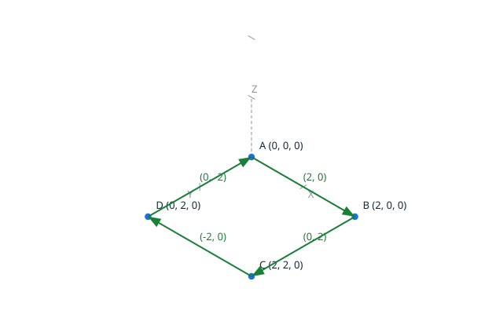
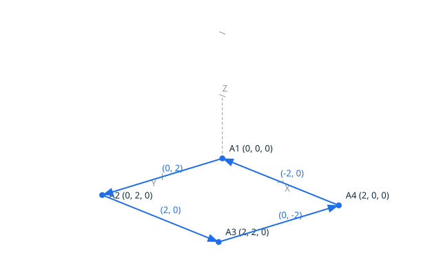
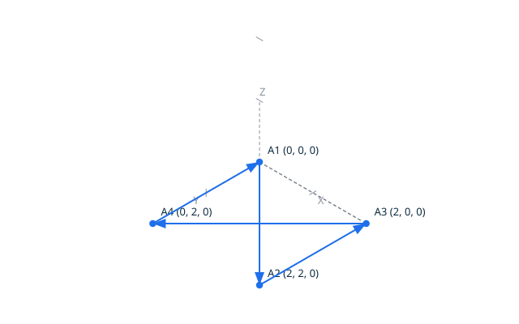
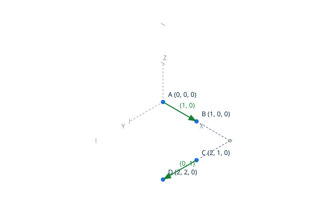
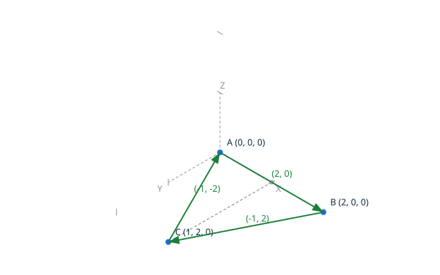
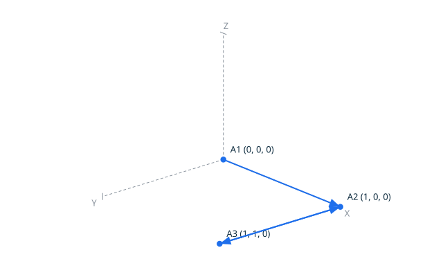
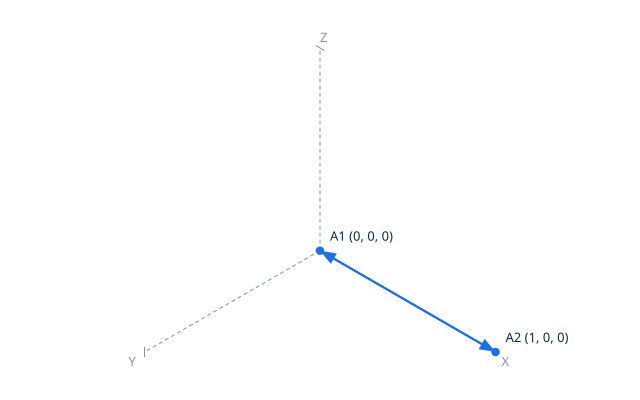
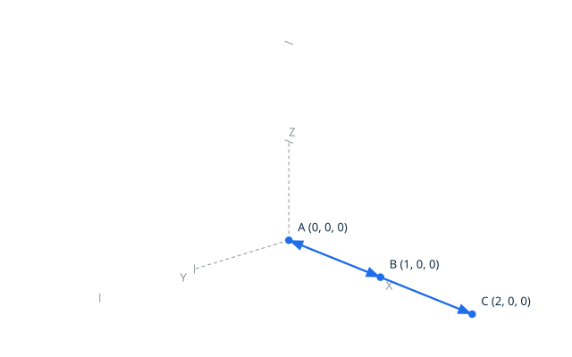
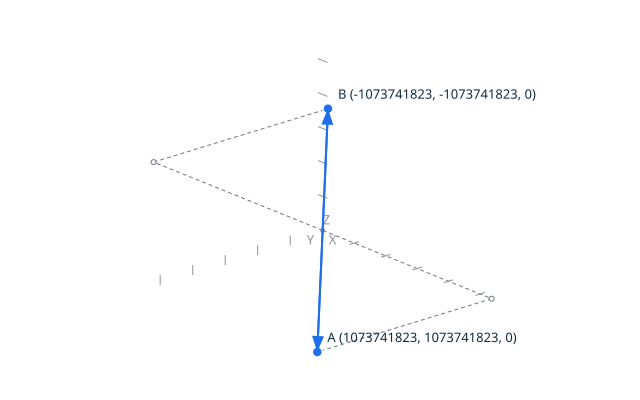
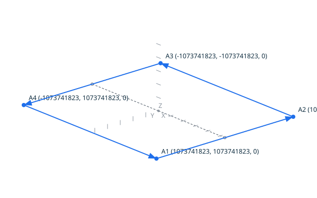

# Contours and Loops in 2D

This feature introduces oriented sequences of 2D segments to form **contours**
and **loops**, with exact verification of topological properties on the
discrete grid. The operations classify and validate geometric configurations
without approximation, tolerance, or floating-point arithmetic.

## Contents

- [Types and Definitions](#types-and-definitions)
  - [`Segment_Sequence_2D`](#segment_sequence_2d)
  - [Continuity](#continuity)
  - [Closure (Loop)](#closure-loop)
  - [Contour Orientation](#contour-orientation)
  - [Self-Intersection](#self-intersection)
  - [Degenerate Segment Rejection](#degenerate-segment-rejection)
- [Command-Line Interface](#command-line-interface)
- [Scenarios: Continuity](#scenarios-continuity)
  - [Scenario: a continuous sequence of two segments](#scenario-a-continuous-sequence-of-two-segments)
  - [Scenario: a discontinuous sequence](#scenario-a-discontinuous-sequence)
  - [Scenario: a single segment is trivially continuous](#scenario-a-single-segment-is-trivially-continuous)
  - [Scenario: an empty sequence is continuous](#scenario-an-empty-sequence-is-continuous)
- [Scenarios: Closure](#scenarios-closure)
  - [Scenario: a closed loop (square)](#scenario-a-closed-loop-square)
  - [Scenario: an open chain](#scenario-an-open-chain)
  - [Scenario: closure with a repeated point](#scenario-closure-with-a-repeated-point)
- [Scenarios: Contour Orientation](#scenarios-contour-orientation)
  - [Scenario: counter-clockwise square](#scenario-counter-clockwise-square)
  - [Scenario: clockwise square](#scenario-clockwise-square)
  - [Scenario: degenerate loop of zero area](#scenario-degenerate-loop-of-zero-area)
  - [Scenario: counter-clockwise triangle](#scenario-counter-clockwise-triangle)
- [Scenarios: Self-Intersection](#scenarios-self-intersection)
  - [Scenario: a simple loop does not self-intersect](#scenario-a-simple-loop-does-not-self-intersect)
  - [Scenario: a bowtie self-intersects](#scenario-a-bowtie-self-intersects)
  - [Scenario: three segments meeting at a point is not a self-intersection](#scenario-three-segments-meeting-at-a-point-is-not-a-self-intersection)
  - [Scenario: a single segment does not self-intersect](#scenario-a-single-segment-does-not-self-intersect)
- [Scenarios: Validity](#scenarios-validity)
  - [Scenario: a valid contour (non-degenerate, no three collinear)](#scenario-a-valid-contour-non-degenerate-no-three-collinear)
  - [Scenario: invalid due to degenerate segment](#scenario-invalid-due-to-degenerate-segment)
  - [Scenario: invalid due to three collinear consecutive points](#scenario-invalid-due-to-three-collinear-consecutive-points)
- [Scenarios: Grid Domain Limits](#scenarios-grid-domain-limits)
  - [Scenario: continuity at grid corners](#scenario-continuity-at-grid-corners)
  - [Scenario: orientation of extreme loop](#scenario-orientation-of-extreme-loop)
- [Proved Properties](#proved-properties)
  - [Closure](#closure)
  - [Contour Orientation](#contour-orientation-2)
  - [Numeric Safety](#numeric-safety)
  - [Self-Intersection](#self-intersection-2)
  - [Validity](#validity)
- [Design Notes](#design-notes)

## Types and Definitions

### `Segment_Sequence_2D`

An ordered list of 2D points representing a polygonal chain: `n` points
define the `n - 1` segments `(P1, P2), (P2, P3), ..., (Pn-1, Pn)`.
The sequence has a **length** (number of points, at most `Max_Points`) and is
either **empty**, **open**, or **closed** (see below).

A segment sequence is **non-degenerate** when no segment is degenerate
(i.e., no segment has coincident endpoints).

### Continuity

A sequence of segments is **continuous** when, for every consecutive pair
of segments `S_i` and `S_{i+1}`, the endpoint of `S_i` equals the start point
of `S_{i+1}`:

```text
S_i.End = S_{i+1}.Start
```

This property is decidable exactly by integer equality on the grid.

A `Segment_Sequence_2D` stores its points, not duplicated segment
endpoints, so a sequence built from a point chain is continuous by
construction. The property is therefore exercised through the
`contour_continuity` command, which takes the segments by their explicit
endpoints; the scenarios below show the chaining, and the gap when the
chain is discontinuous.

### Closure (Loop)

A sequence is **closed**, that is, forms a loop, when its first and last
points coincide:

```text
P_1 = P_n
```

A single point is trivially closed; an empty sequence is not. A loop has no
distinguished "start" or "end" — it is a closed boundary.

### Contour Orientation

The **orientation** of a loop is **counter-clockwise** if the interior is on
the left when traversing the boundary, and **clockwise** otherwise. For a
loop with points `P_1, P_2, ..., P_n, P_1`, the orientation is the sign of the
**signed area** computed by the shoelace formula:

```text
(1/2) * Sum_{i=1 to n} (P_i.X * P_{i+1}.Y - P_i.Y * P_{i+1}.X)
```

The sign alone (positive, zero, or negative) classifies the orientation
**exactly** without division: the factor 1/2 is omitted as it does not
affect the sign. The classification is:

- **counter_clockwise**: positive sum
- **clockwise**: negative sum
- **degenerate**: zero sum

For a simple loop (without self-intersections), the sum is never zero. The
degenerate case can only occur for a closed, valid sequence that is not
simple. Note: the signed area is computed in a domain large enough to avoid
overflow for the whole grid at the maximum sequence length (see Numeric
Model).

<!-- topodraw images/contour_1.svg
axes
ticks 1
anchors
point A 0 0 0
point B 2 0 0
point C 2 2 0
point D 0 2 0
vector A B (2, 0)
vector B C (0, 2)
vector C D (-2, 0)
vector D A (0, -2)
-->



<!-- topodraw images/contour_2.svg
axes
ticks 1
anchors
point A 0 0 0
point B 0 2 0
point C 2 2 0
point D 2 0 0
vector A B (0, 2)
vector B C (2, 0)
vector C D (0, -2)
vector D A (-2, 0)
-->



### Self-Intersection

A sequence **self-intersects** when two non-consecutive segments cross,
that is, when they share a grid position that is not a common endpoint of
both. Formally, for segments `S_i` and `S_j` with `|i - j| > 1`
(non-consecutive), the exact intersection of the two segments is:

- an **overlap**: the segments are collinear and share a sub-segment of
  positive length; or
- a **single common grid position** that is not simultaneously an endpoint
  of `S_i` and an endpoint of `S_j`.

Two non-consecutive segments that meet exactly at a shared endpoint form a
valid junction, not a self-intersection. Two segments that properly cross
at a position that is not on the grid share no grid position: in the
discrete model they do not cross, and the crossing is reported by the
`intersect` operation as `off_grid_crossing`.

Consecutive segments are never compared: they share an endpoint by
construction. This is checked using the exact `intersect` operation from
milestone 3.

<!-- topodraw images/contour_3.svg
axes
ticks 1
anchors
point A 0 0 0
point B 2 2 0
point C 2 0 0
point D 0 2 0
vector A B (2, 2)
vector B C (0, -2)
vector C D (-2, 2)
vector D A (0, -2)
-->



### Degenerate Segment Rejection

A segment sequence is **valid** for contour formation when:

1. No segment is degenerate (both endpoints differ)
2. No three consecutive points are collinear (no "flat" angle)

Property (2) ensures that the chain has a well-defined turning direction
at every point. Sequences of less than two points are vacuously valid.

## Command-Line Interface

The TopoProof application exposes the following operations for contour
validation and classification:

```sh
topoproof contour_continuity <n> <X1 Y1 X2 Y2 ... >
```
Classifies whether `n` segments, each given by its two endpoints (four
coordinates per segment), form a continuous sequence: the endpoint of each
segment must equal the start point of the next. Output is `continuity
continuous` or `continuity discontinuous`.

```sh
topoproof contour_closure <n> <X1 Y1 ... Xn Yn>
```
Classifies whether a sequence of `n` points forms a closed loop (i.e., the
first and last points coincide). Output is `closure closed` or `closure
open`.

```sh
topoproof contour_orientation <n> <X1 Y1 ... Xn Yn>
```
Returns the orientation of a closed, valid sequence of `n` points:
`orientation counter_clockwise`, `orientation clockwise`, or `orientation
degenerate`. An error is reported when the sequence has less than three
points, is not closed, or is not valid.

```sh
topoproof contour_self_intersects <n> <X1 Y1 ... Xn Yn>
```
Returns `true` if the sequence of `n` points self-intersects, `false`
otherwise.

```sh
topoproof contour_valid <n> <X1 Y1 ... Xn Yn>
```
Returns `true` if the sequence is valid (non-degenerate segments, no three
consecutive collinear points), `false` otherwise.

All operations use the same grid domain as the existing operations
(`Grid_Coordinate` range), and sequences are limited to `Max_Points`
points. Out-of-range values are rejected with an error.

## Scenarios: Continuity

### Scenario: a continuous sequence of two segments

The endpoint of the first segment equals the start point of the second.

<!-- topodraw images/contour_4.svg
axes
ticks 1
anchors
point A 0 0 0
point B 1 0 0
point C 1 1 0
vector A B (1, 0)
vector B C (0, 1)
-->


- When I successfully run `../bin/topoproof contour_continuity 2 0 0 1 0 1 0 1 1`
- Then the output is `continuity continuous`

### Scenario: a discontinuous sequence

The endpoint `(1, 0)` of the first segment differs from the start point
`(2, 1)` of the second: the chain has a gap.

<!-- topodraw images/contour_5.svg
axes
ticks 1
anchors
point A 0 0 0
point B 1 0 0
point C 2 1 0
point D 2 2 0
vector A B (1, 0)
vector C D (0, 1)
-->



- When I successfully run `../bin/topoproof contour_continuity 2 0 0 1 0 2 1 2 2`
- Then the output is `continuity discontinuous`

### Scenario: a single segment is trivially continuous
- When I successfully run `../bin/topoproof contour_continuity 1 0 0 1 1`
- Then the output is `continuity continuous`

### Scenario: an empty sequence is continuous
- When I successfully run `../bin/topoproof contour_continuity 0`
- Then the output is `continuity continuous`

## Scenarios: Closure

### Scenario: a closed loop (square)

The last point equals the first: the square of the orientation definition.


- When I successfully run `../bin/topoproof contour_closure 5 0 0 2 0 2 2 0 2 0 0`
- Then the output is `closure closed`

### Scenario: an open chain

The chain starts at `(0, 0)` and ends at `(1, 1)`: no segment returns to
the start point.

<!-- topodraw images/contour_6.svg
axes
ticks 1
anchors
point A 0 0 0
point B 1 0 0
point C 1 1 0
vector A B (1, 0)
vector B C (0, 1)
-->


- When I successfully run `../bin/topoproof contour_closure 3 0 0 1 0 1 1`
- Then the output is `closure open`

### Scenario: closure with a repeated point
- When I successfully run `../bin/topoproof contour_closure 2 5 5 5 5`
- Then the output is `closure closed`

## Scenarios: Contour Orientation

### Scenario: counter-clockwise square

The square of the orientation definition, traversed from `(0, 0)` towards
`(2, 0)`: the interior is on the left.


- When I successfully run `../bin/topoproof contour_orientation 5 0 0 2 0 2 2 0 2 0 0`
- Then the output is `orientation counter_clockwise`

### Scenario: clockwise square

The same square traversed from `(0, 0)` towards `(0, 2)`: the interior is
on the right.


- When I successfully run `../bin/topoproof contour_orientation 5 0 0 0 2 2 2 2 0 0 0`
- Then the output is `orientation clockwise`

### Scenario: degenerate loop of zero area

The bowtie of the self-intersection definition: the two lobes have the
same area and opposite orientations, so the shoelace sums to zero.


- When I successfully run `../bin/topoproof contour_orientation 5 0 0 2 2 2 0 0 2 0 0`
- Then the output is `orientation degenerate`

### Scenario: counter-clockwise triangle

<!-- topodraw images/contour_7.svg
axes
ticks 1
anchors
point A 0 0 0
point B 2 0 0
point C 1 2 0
vector A B (2, 0)
vector B C (-1, 2)
vector C A (-1, -2)
-->



- When I successfully run `../bin/topoproof contour_orientation 4 0 0 2 0 1 2 0 0`
- Then the output is `orientation counter_clockwise`

## Scenarios: Self-Intersection

### Scenario: a simple loop does not self-intersect

The square of the orientation definition: the only non-consecutive pair
that meets is the first and last segment, and they meet exactly at the
shared endpoint `(0, 0)`.


- When I successfully run `../bin/topoproof contour_self_intersects 5 0 0 2 0 2 2 0 2 0 0`
- Then the output is `false`

### Scenario: a bowtie self-intersects

The bowtie of the self-intersection definition: the first and third
segments cross at the grid position `(1, 1)`.


- When I successfully run `../bin/topoproof contour_self_intersects 5 0 0 2 2 2 0 0 2 0 0`
- Then the output is `true`

### Scenario: three segments meeting at a point is not a self-intersection

The chain comes back to `(1, 0)`, where the first segment ends and the
second and third segments meet: the common position is an endpoint of both
non-consecutive segments, so it is a valid junction.

<!-- topodraw images/contour_8.svg
axes
ticks 1
anchors
point A 0 0 0
point B 1 0 0
point C 1 1 0
vector A B (1, 0)
vector B C (0, 1)
vector C B (0, -1)
-->



- When I successfully run `../bin/topoproof contour_self_intersects 4 0 0 1 0 1 1 1 0`
- Then the output is `false`

### Scenario: a single segment does not self-intersect
- When I successfully run `../bin/topoproof contour_self_intersects 2 0 0 1 1`
- Then the output is `false`

## Scenarios: Validity

### Scenario: a valid contour (non-degenerate, no three collinear)

The square of the orientation definition.


- When I successfully run `../bin/topoproof contour_valid 5 0 0 2 0 2 2 0 2 0 0`
- Then the output is `true`

### Scenario: invalid due to degenerate segment

The first two points coincide, so the first segment has the same start and
end.

<!-- topodraw images/contour_9.svg
axes
ticks 1
anchors
point A 0 0 0
point B 1 0 0
vector A B (1, 0)
vector B A (-1, 0)
-->



- When I successfully run `../bin/topoproof contour_valid 4 0 0 0 0 1 0 0 0`
- Then the output is `false`

### Scenario: invalid due to three collinear consecutive points

The points `(0, 0)`, `(1, 0)`, `(2, 0)` are all on the X axis: the chain
has no turning direction at `(1, 0)`.

<!-- topodraw images/contour_10.svg
axes
ticks 1
anchors
point A 0 0 0
point B 1 0 0
point C 2 0 0
vector A B (1, 0)
vector B C (1, 0)
vector C A (-2, 0)
-->



- When I successfully run `../bin/topoproof contour_valid 4 0 0 1 0 2 0 0 0`
- Then the output is `false`

## Scenarios: Grid Domain Limits

### Scenario: continuity at grid corners

Two segments chaining at the two opposite corners of the grid, from
`(1073741823, 1073741823)` to `(-1073741823, -1073741823)` and back: the
extreme positions on both axes.

<!-- topodraw images/contour_11.svg
axes
anchors
point A 1073741823 1073741823 0
point B -1073741823 -1073741823 0
vector A B S1
vector B A S2
-->



- When I successfully run `../bin/topoproof contour_continuity 2 1073741823 1073741823 -1073741823 -1073741823 -1073741823 -1073741823 1073741823 1073741823`
- Then the output is `continuity continuous`

### Scenario: orientation of extreme loop

A square loop on the four corners of the grid, traversed from the
top-right corner downwards: the interior is on the right, so the loop is
clockwise, and the shoelace sum, about 2**63 per term, stays exact in the
`Area_Sum` domain.

<!-- topodraw images/contour_12.svg
axes
anchors
point A 1073741823 1073741823 0
point B 1073741823 -1073741823 0
point C -1073741823 -1073741823 0
point D -1073741823 1073741823 0
vector A B S1
vector B C S2
vector C D S3
vector D A S4
-->



- When I successfully run `../bin/topoproof contour_orientation 5 1073741823 1073741823 1073741823 -1073741823 -1073741823 -1073741823 -1073741823 1073741823 1073741823 1073741823`
- Then the output is `orientation clockwise`

## Proved Properties

All properties below are proved by SPARK over the whole grid domain, for
any sequence up to `Max_Points` points.

### Closure
- **`Is_Closed`**: the contract is the definition: a sequence is closed
  exactly when its first and last points coincide.

### Contour Orientation
- **`Orientation` postcondition**: the classification is exactly the sign
  of the signed area: positive is counter-clockwise, negative is
  clockwise, zero is degenerate.

### Numeric Safety
- **`Signed_Area` cannot overflow**: each shoelace term is an orientation
  determinant of the proved expression chain, computed exactly in the
  `Determinant` domain; the loop invariant bounds every partial sum by the
  number of accumulated terms times the determinant amplitude, and the
  total of at most `Max_Points` terms stays inside the `Area_Sum` domain
  defined for orientation calculations (about 2**94, on the 128-bit
  machine width, see Numeric Model).

### Self-Intersection
- **`Self_Intersects`**: reuses the exact `intersect` operation proved in
  milestone 3; only shared grid positions are considered, and a single
  common position that is an endpoint of both segments is a valid
  junction, not a self-intersection.

### Validity
- **`Is_Valid`**: the contract is the definition: a valid sequence has no
  degenerate segment and no three consecutive collinear points.

## Design Notes

1. **Segment Sequence Representation**: a `Segment_Sequence_2D` is stored
   as an array of `Point_2D` values, where consecutive points define
   segments. This avoids storing redundant endpoint data and makes
   continuity structural for sequences built from point chains.

2. **Orientation Computation**: the signed area is computed as a sum of
   cross determinants of consecutive position vectors. Each term is
   bounded by the `Determinant` domain, and a sequence has at most
   `Max_Points` points, so the total sum is bounded by
   `Max_Points * Determinant'Last`, about 2**79, which fits in the
   `Area_Sum` domain defined in `numeric-model.md`.

3. **Self-Intersection Check**: uses the existing exact `intersect`
   operation. For a sequence of `n` points, the check performs `O(n^2)`
   intersection tests, but each test is constant-time and exact.

4. **Sequence Length Bound**: `Max_Points` (2**15) keeps every index
   arithmetic on sequences far from the `Natural` bounds and keeps the
   shoelace sum within the `Area_Sum` domain. A contour passed on the
   command line stays far below this bound; raising it later only
   requires re-proving the index arithmetic, since the `Area_Sum` domain
   already covers any `Natural` length.

5. **Terminology Compliance**: this feature distinguishes:
   - `Segment_2D`: a geometric value (two endpoints)
   - `Edge`: a topological entity (to be introduced in milestone 5)
   - `Loop`: a closed sequence of segments forming a boundary
   - `Contour`: a loop with a well-defined orientation

6. **Future Extensions**: the `Segment_Sequence_2D` type will serve as
   the geometric support for topological `Edge` and `Loop` entities in
   milestone 5. Invariance lemmas (orientation under translation, under
   rotation of the starting point, and under reversal) are deferred until
   the loop abstraction stabilizes.
