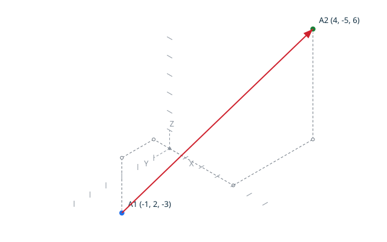

# Displacement

`displacement` computes the exact vector between two points:
`topocli displacement A=(AX, AY, AZ) B=(BX, BY, BZ)`.
The canonical result is `vector DX DY DZ`.

The diagram of the scenario is generated by the command itself, with
`--draw`: the drawn `A`, `B` and the displacement `D = B - A` are the
tested values.

## Contents

- [Scenario: compute command-line values](#scenario-compute-command-line-values)
- [Scenario: inject parameters from an input file](#scenario-inject-parameters-from-an-input-file)
- [Scenario: read and write files](#scenario-read-and-write-files)

## Scenario: compute command-line values

- When I successfully run `../bin/topocli displacement A=(-1, 2, -3) B=(4, -5, 6) --draw ../docs/features/images/displacement_1.svg`
- Then the output is `vector 5 -7 9`

## Scenario: inject parameters from an input file
- Given the new file `displacement.in` containing `displacement A=(10, 20, 30) B=(13, 18, 37)`
- When I successfully run `../bin/topocli --input displacement.in`
- Then the output is `vector 3 -2 7`

## Scenario: read and write files
- Given the new file `displacement-file.in` containing `displacement A=(0, 0, 0) B=(-4, 5, -6)`
- And there is no file `displacement-file.out`
- When I successfully run `../bin/topocli --input displacement-file.in --output displacement-file.out`
- Then the `displacement-file.out` file contains `vector -4 5 -6`
