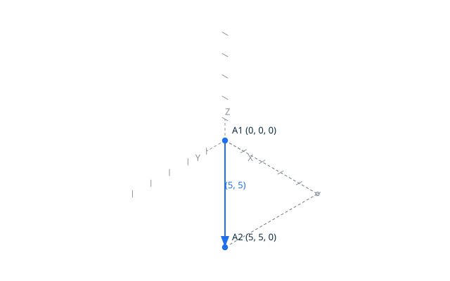
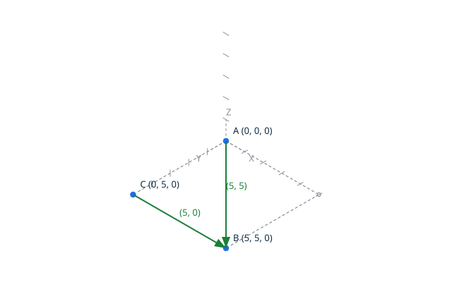

# Edges <!-- omit from toc -->

`Create_Edge` creates topological edges between vertices, the proved
`Create` of the kernel: each edge connects two distinct vertices by their
handles. The canonical result of creating the edge between the vertices at
`(0, 0)` and `(5, 5)` is `edge 1 vertex 1 vertex 2`, written by the explicit
`Put_Edge`.

An edge is a topological entity: it connects two distinct vertices by
handles, and carries no geometry (see `docs/terminology.md`). Degeneracy is
topological: an edge whose two ends are the same vertex is rejected. An edge
between two distinct vertices at the same point is a valid edge: identity is
not position (design decision DD-002), and the geometric degeneracy of its
support is judged at loop level. In a script, sharing is explicit: passing
the same handle variable to two `Create_Edge` calls connects both edges to
the same vertex.



## Contents <!-- omit from toc -->

- [Scenario: create an edge between two vertices](#scenario-create-an-edge-between-two-vertices)
- [Scenario: edges share vertices](#scenario-edges-share-vertices)
- [Scenario: an edge between two vertices at the same point is valid](#scenario-an-edge-between-two-vertices-at-the-same-point-is-valid)
- [Proved property](#proved-property)
- [Scenario: an edge back to the same vertex is degenerate](#scenario-an-edge-back-to-the-same-vertex-is-degenerate)

## Scenario: create an edge between two vertices

- Given the file `create_edge.topo`
  ```ada
  A    : constant Point_2D := (0, 0);
  B    : constant Point_2D := (5, 5);
  VA   : Vertex_Handle;
  VB   : Vertex_Handle;
  E    : Edge_Handle;

  Begin_Image (+"../docs/features/images/edges_1.svg");
  Draw_Axes;
  Draw_Named_Point_2D (A, +"A", Blue);
  Draw_Named_Point_2D (B, +"B", Blue);
  Draw_Edge (A, B, Blue);
  End_Image;

  Create_Vertex (A, VA);
  Put_Vertex (VA);
  Create_Vertex (B, VB);
  Put_Vertex (VB);
  Create_Edge (VA, VB, E);
  Put_Edge (E);
  ```
- When I successfully run `../bin/topocli run create_edge.topo`
- Then the output is
  ```text
  vertex 1 point 0 0
  vertex 2 point 5 5
  edge 1 vertex 1 vertex 2
  ```
- And the file `../docs/features/images/edges_1.svg` contains `#1f6feb`  
  (The `#1f6feb` value is the blue of `Color_Kind`: the check ensures
  the two vertices and the edge between them are drawn, the support
  of the topology the traces report.)

## Scenario: edges share vertices

The second edge receives the same handle `VB` as its endpoint: both edges
meet at one vertex, and both edge traces report `vertex 2`.



- Given the file `shared_vertex.topo`
  ```ada
  A    : constant Point_2D := (0, 0);
  B    : constant Point_2D := (5, 5);
  C    : constant Point_2D := (0, 5);
  VA   : Vertex_Handle;
  VB   : Vertex_Handle;
  VC   : Vertex_Handle;
  E1   : Edge_Handle;
  E2   : Edge_Handle;

  Begin_Image (+"../docs/features/images/edges_2.svg");
  Draw_Axes;
  Draw_Named_Point_2D (A, +"A", Blue);
  Draw_Named_Point_2D (B, +"B", Blue);
  Draw_Named_Point_2D (C, +"C", Blue);
  Draw_Edge (A, B, Blue);
  Draw_Edge (C, B, Blue);
  End_Image;

  Create_Vertex (A, VA);
  Put_Vertex (VA);
  Create_Vertex (B, VB);
  Put_Vertex (VB);
  Create_Edge (VA, VB, E1);
  Put_Edge (E1);

  Create_Vertex (C, VC);
  Put_Vertex (VC);
  Create_Edge (VC, VB, E2);
  Put_Edge (E2);
  ```

- When I successfully run `../bin/topocli run shared_vertex.topo`
- Then the output is
  ```text
  vertex 1 point 0 0
  vertex 2 point 5 5
  edge 1 vertex 1 vertex 2
  vertex 3 point 0 5
  edge 2 vertex 3 vertex 2
  ```
- And the file `../docs/features/images/edges_2.svg` contains `#1f6feb`  
  (The `#1f6feb` value is the blue of `Color_Kind`: the check ensures
  the three vertices and the two edges are drawn, meeting at `B`.)

## Scenario: an edge between two vertices at the same point is valid

Two creations at the same position return two distinct handles: the edge
between them is a valid topological edge, and the degeneracy of its
geometric support is judged later, at loop level.

- Given the file `same_point_edge.topo`
  ```ada
  P  : constant Point_2D := (1, 2);
  VA : Vertex_Handle;
  VB : Vertex_Handle;
  E  : Edge_Handle;

  Create_Vertex (P, VA);
  Put_Vertex (VA);
  Create_Vertex (P, VB);
  Put_Vertex (VB);
  Create_Edge (VA, VB, E);
  Put_Edge (E);
  ```
- When I successfully run `../bin/topocli run same_point_edge.topo`
- Then the output is
  ```text
  vertex 1 point 1 2
  vertex 2 point 1 2
  edge 1 vertex 1 vertex 2
  ```

## Proved property

Edge endpoints exist at creation: the SPARK precondition of `Edges.Create`
requires both vertex handles to be contained in the vertex store, and since
stored vertices are never removed, existing endpoints stay valid for the
whole lifetime of both stores. The postcondition states that the new handle
is contained, that its endpoints are exactly the given pair, and that every
previously stored edge is unchanged. Both contracts are proved by GNATprove
over the whole domain, as is the absence of run-time errors of every
operation of the unit.

## Scenario: an edge back to the same vertex is degenerate

The same handle passed as both endpoints designates the same vertex, so the
pair is degenerate: the edge is rejected.

- Given the file `degenerate_edge.topo`
  ```ada
  P : constant Point_2D := (1, 2);
  V : Vertex_Handle;
  E : Edge_Handle;

  Create_Vertex (P, V);
  Put_Vertex (V);

  Create_Edge (V, V, E);
  ```
- When I run `../bin/topocli run degenerate_edge.topo`
- Then the output is `vertex 1 point 1 2`
- And the error output is `error: degenerate edge`
- And the exit code is `1`
