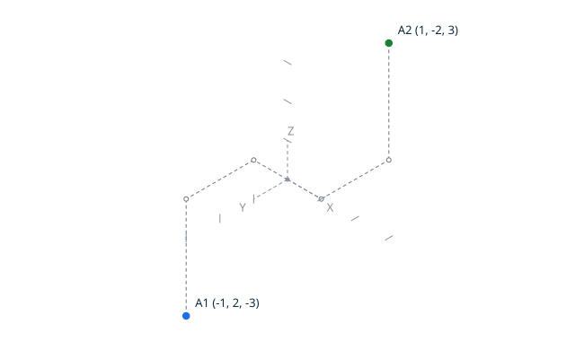

# Point equality <!-- omit from toc -->

`Equal` compares two points exactly, the proved point equality of the
kernel: two points are equal exactly when all three coordinates are
equal; there is no tolerance and no notion of almost-equal points. The
canonical result is `equal true` or `equal false`, written by the
explicit `Put_Equal`.

In the diagram of the first scenario, `A` and `B` share all three
coordinates, so the points coincide exactly. In the diagram of the
second, `A` and `B` differ only on `Z`, so they are two distinct grid
positions.


## Contents <!-- omit from toc -->

- [Scenario: identical points are equal](#scenario-identical-points-are-equal)
- [Scenario: different points are not equal](#scenario-different-points-are-not-equal)
- [Scenario: opposite points are not equal](#scenario-opposite-points-are-not-equal)

## Scenario: identical points are equal

- Given the file `equal_true.topo`
  ```ada
  A    : constant Point_3D := (1, 2, 3);
  B    : constant Point_3D := (1, 2, 3);
  K    : Equal_Kind;
  Name : VString := +"../docs/features/images/equality_1.svg";

  Begin_Image (Name);
  Draw_Axes;
  Draw_Point (A, Blue);
  Draw_Point (B, Green);

  Equal (A, B, K);
  End_Image;

  Put_Equal (K);
  ```
- When I successfully run `../bin/topocli run equal_true.topo`
- Then the output is `equal true`
- And the file `../docs/features/images/equality_1.svg` contains `#1a7f37`  
  (The `#1a7f37` value is the green of `Color_Kind`: the check ensures
  the point `B` is drawn; it stacks on `A`, since both positions
  coincide.)

## Scenario: different points are not equal

`A` and `B` differ only on `Z`: two positions one unit apart along the
vertical axis.


- Given the file `equal_false.topo`
  ```ada
  A    : constant Point_3D := (1, 2, 3);
  B    : constant Point_3D := (1, 2, 4);
  K    : Equal_Kind;
  Name : VString := +"../docs/features/images/equality_2.svg";

  Begin_Image (Name);
  Draw_Axes;
  Draw_Point (A, Blue);
  Draw_Point (B, Green);

  Equal (A, B, K);
  End_Image;

  Put_Equal (K);
  ```
- When I successfully run `../bin/topocli run equal_false.topo`
- Then the output is `equal false`
- And the file `../docs/features/images/equality_2.svg` contains `#1a7f37`  
  (The `#1a7f37` value is the green of `Color_Kind`: the check ensures
  the point `B` is drawn, at its own distinct position.)

## Scenario: opposite points are not equal

`A` and `B` differ on all three axes: two positions symmetric about the
origin.



- Given the file `equal_opposite.topo`
  ```ada
  A    : constant Point_3D := (-1, 2, -3);
  B    : constant Point_3D := (1, -2, 3);
  K    : Equal_Kind;
  Name : VString := +"../docs/features/images/equality_3.svg";

  Begin_Image (Name);
  Draw_Axes;
  Draw_Point (A, Blue);
  Draw_Point (B, Green);

  Equal (A, B, K);
  End_Image;

  Put_Equal (K);
  ```
- When I successfully run `../bin/topocli run equal_opposite.topo`
- Then the output is `equal false`
- And the file `../docs/features/images/equality_3.svg` contains `#1a7f37`  
  (The `#1a7f37` value is the green of `Color_Kind`: the check ensures
  the point `B` is drawn, symmetric to `A` about the origin.)
