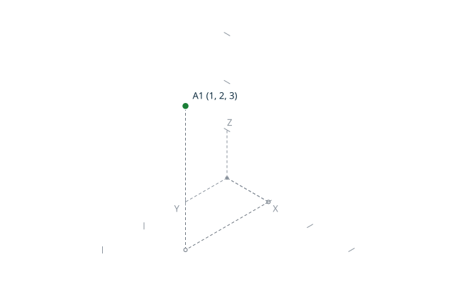
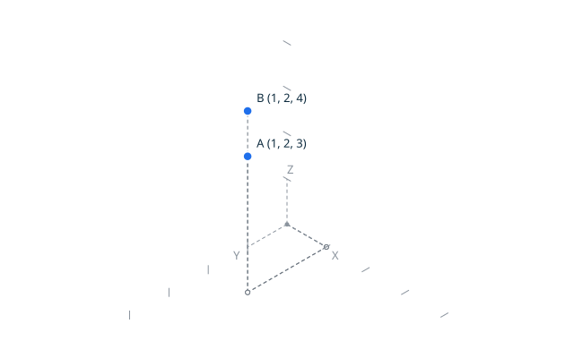

# Point equality

`equal` compares two points exactly: `topoproof equal AX AY AZ BX BY BZ`.
Two points are equal exactly when all three coordinates are equal; there is no
tolerance and no notion of almost-equal points.
The canonical result is `equal true` or `equal false`.

The diagrams show the geometry of the scenarios below. On the left, `A` and
`B` share all three coordinates, so the points coincide exactly. On the right,
`A` and `B` differ only on `Z`, so they are two distinct grid positions.
The images are generated by `make doc` from scene sources embedded as
invisible comments in this page.

<!-- topodraw images/equality_1.svg
point A 1 2 3
point B 1 2 3
-->

<!-- topodraw images/equality_2.svg
axes
ticks 1
anchors
point A 1 2 3
point B 1 2 4
-->

## Scenario: identical points are equal
- When I run `../bin/topoproof equal 1 2 3 1 2 3`
- Then the output is `equal true`
- And there is no error

## Scenario: different points are not equal
- When I run `../bin/topoproof equal 1 2 3 1 2 4`
- Then the output is `equal false`
- And there is no error

## Scenario: opposite points are not equal
- When I run `../bin/topoproof equal -1 2 -3 1 -2 3`
- Then the output is `equal false`
- And there is no error
