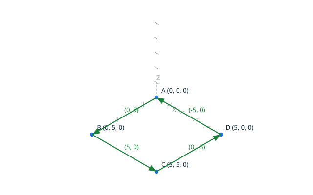

# Faces <!-- omit from toc -->

`face` builds a planar face from a chain of named points:
`topocli face A=(X, Y) B=(X, Y) ... A`.
The construction is the one of the loop command: one vertex per distinct
name, one edge per consecutive pair, closure on the first name. The
resulting loop is then classified again as a face boundary. The canonical
result of building the face `A=(0, 0) B=(5, 5) C=(0, 5) A` is
`face counter_clockwise`.

A face is a region of the plane bounded by one loop (see
`docs/terminology.md`). A valid face boundary is a valid loop whose
orientation is not degenerate: a closed two-edge backtrack is a valid
loop, but never a valid face boundary (DD-002, decision 3). The
orientation of a face is exactly the orientation of its boundary loop,
which a valid boundary guarantees to be counter-clockwise or clockwise.


## Contents <!-- omit from toc -->

- [Scenario: a counter-clockwise face](#scenario-a-counter-clockwise-face)
- [Scenario: a counter-clockwise face built by script](#scenario-a-counter-clockwise-face-built-by-script)
- [Scenario: a clockwise face](#scenario-a-clockwise-face)
- [Proved property](#proved-property)
- [Scenario: a degenerate boundary is rejected](#scenario-a-degenerate-boundary-is-rejected)

## Scenario: a counter-clockwise face

- When I successfully run `../bin/topocli face A=(0, 0) B=(5, 5) C=(0, 5) A --draw ../docs/features/images/faces_1.svg`
- Then the output is
   ```
   vertex 1 point 0 0
   vertex 2 point 5 5
   vertex 3 point 0 5
   edge 1 vertex 1 vertex 2
   edge 2 vertex 2 vertex 3
   edge 3 vertex 3 vertex 1
   face counter_clockwise
   ```

## Scenario: a counter-clockwise face built by script

The same face as the previous scenario, written as a TopoScript: the
construction is the one of the loop script, and the classification is
the same kernel one. The script draws its own diagram, the same
geometry as the one above, for a side-by-side comparison.

- Given the file `face.topo`
  ```ada
  A    : constant Point_2D := (0, 0);
  B    : constant Point_2D := (5, 5);
  C    : constant Point_2D := (0, 5);
  Kind : Face_Kind;
  Name : VString := +"../docs/features/images/faces_1_script.svg";

  Begin_Image (Name);
  Draw_Axes;
  Draw_Point_2D (A, Blue);
  Draw_Point_2D (B, Blue);
  Draw_Point_2D (C, Blue);
  Draw_Edge (A, B, Green);
  Draw_Edge (B, C, Green);
  Draw_Edge (C, A, Green);

  Add_Point (A);
  Add_Point (B);
  Add_Point (C);
  Add_Point (A);

  Make_Face (Kind);

  Put_Face (Kind);
  End_Image;
  ```
- When I successfully run `../bin/topocli run face.topo`
- Then the output is `face counter_clockwise`
- And the file `../docs/features/images/faces_1_script.svg` contains `(5, 5)`


## Scenario: a clockwise face



- When I successfully run `../bin/topocli face A=(0, 0) B=(0, 5) C=(5, 5) D=(5, 0) A --draw ../docs/features/images/faces_2.svg`
- Then the output is
   ```
   vertex 1 point 0 0
   vertex 2 point 0 5
   vertex 3 point 5 5
   vertex 4 point 5 0
   edge 1 vertex 1 vertex 2
   edge 2 vertex 2 vertex 3
   edge 3 vertex 3 vertex 4
   edge 4 vertex 4 vertex 1
   face clockwise
   ```

## Proved property

A valid face boundary is a valid loop whose orientation is not
degenerate: `Classify_Face` is proved exhaustive on these three cases, and
`Make_Face` builds a face only from a loop classifying as a valid boundary,
so invalid faces cannot be obtained from the public API. `Face_Orientation`
is proved to return exactly the orientation of the boundary loop, and never
the degenerate orientation for a valid face: face orientation is
consistent with loop orientation by construction. Every operation of the
unit is proved free of run-time errors.

## Scenario: a degenerate boundary is rejected

The chain closes, so the loop is valid, but the path goes to `B` and comes
back along the same segment: the boundary orientation is degenerate, and a
closed backtrack is never a valid face boundary.

- When I run `../bin/topocli face A=(0, 0) B=(5, 5) A`
- Then the output is
   ```
   vertex 1 point 0 0
   vertex 2 point 5 5
   edge 1 vertex 1 vertex 2
   edge 2 vertex 2 vertex 1
   error: degenerate face boundary
   ```
- And there is an error
