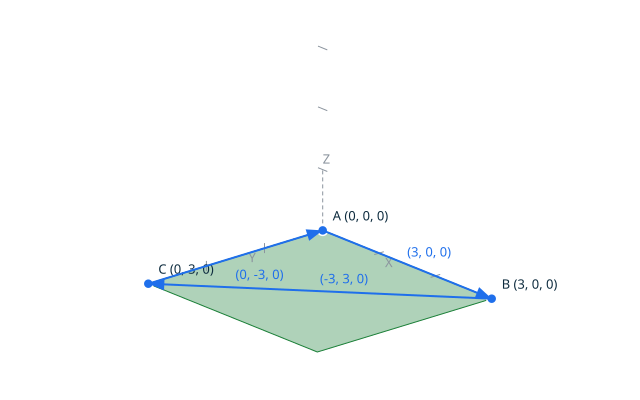
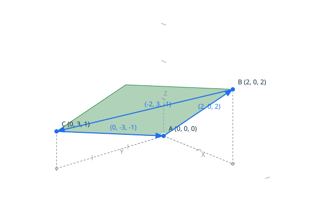
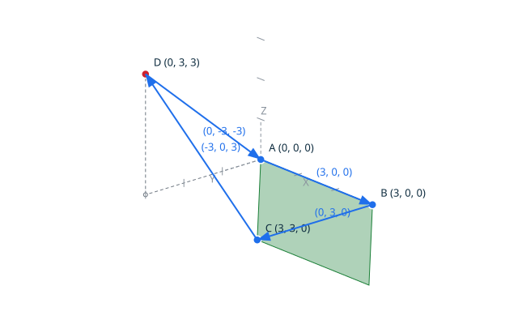
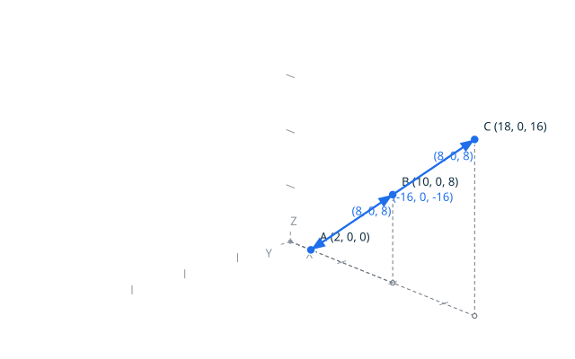
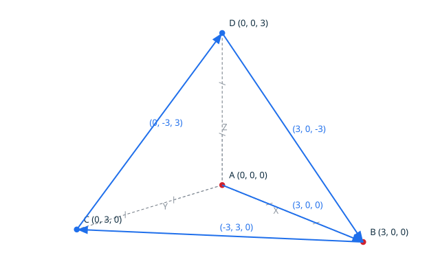

# Faces in three dimensions <!-- omit from toc -->

A face of the three-dimensional structure is a region of a plane bounded
by one loop (DD-005, decision 3). Its boundary is built like the 2D one:
vertices carry their own identity, edges connect distinct vertices, and
the face boundary is the chain of the created edges, in creation order.
The face is planar and exact: the construction derives the plane from the
support points — the first non-collinear triple of the boundary — and
requires every support point to lie exactly on it, no tolerance and no
approximation involved. The collinear and non-planar degeneracies are
reported, never built: no invalid face is obtained from the public API.

The plane is derived, never stored: the support points are the single
source, so no stored plane can diverge from them. The exact coplanarity
test is the four-point orientation determinant of Milestone 7, which
vanishes exactly on the plane.

## Contents <!-- omit from toc -->

- [Scenario: a triangular face on a coordinate plane](#scenario-a-triangular-face-on-a-coordinate-plane)
- [Scenario: an oblique face is planar too](#scenario-an-oblique-face-is-planar-too)
- [Scenario: a lifted vertex is rejected as non-planar](#scenario-a-lifted-vertex-is-rejected-as-non-planar)
- [Scenario: collinear support points carry no plane](#scenario-collinear-support-points-carry-no-plane)
- [Scenario: a closed backtrack is never a face boundary](#scenario-a-closed-backtrack-is-never-a-face-boundary)
- [Scenario: an open chain is rejected](#scenario-an-open-chain-is-rejected)

## Scenario: a triangular face on a coordinate plane

The triangle of the origin, (3, 0, 0) and (0, 3, 0) lies on the Z = 0
coordinate plane: three vertices, three edges, and the boundary closes on
its starting vertex. The support points are exactly coplanar and not
collinear, so the face is valid. The diagram draws the derived plane
patch and the three vertices.



- Given the file `triangular_face.topo`
  ```ada
  A : constant Point_3D := (0, 0, 0);
  B : constant Point_3D := (3, 0, 0);
  C : constant Point_3D := (0, 3, 0);
  HA, HB, HC : Vertex_Handle;
  E1, E2, E3 : Edge_Handle;
  K : Face_3D_Kind;

  Begin_Image (+"../docs/features/images/faces3d_1.svg");
  Draw_Axes;
  Draw_Plane (A, B, C, Green);
  Draw_Edge_3D (A, B, Blue);
  Draw_Edge_3D (B, C, Blue);
  Draw_Edge_3D (C, A, Blue);
  Draw_Named_Point (A, +"A", Blue);
  Draw_Named_Point (B, +"B", Blue);
  Draw_Named_Point (C, +"C", Blue);
  End_Image;

  Create_Vertex_3D (A, HA);
  Create_Vertex_3D (B, HB);
  Create_Vertex_3D (C, HC);
  Create_Edge_3D (HA, HB, E1);
  Create_Edge_3D (HB, HC, E2);
  Create_Edge_3D (HC, HA, E3);
  Make_Face_3D (K);
  Put_Face_3D (K);
  ```

- When I successfully run `../bin/topocli run triangular_face.topo`
- Then the output is
  ```text
  face3d planar
  ```
- And the file `../docs/features/images/faces3d_1.svg` contains `#1a7f37`
  (The `#1a7f37` value is the green of `Color_Kind`: the check ensures
  the derived plane patch, the actual subject of the scenario, is
  drawn.)

## Scenario: an oblique face is planar too

The triangle of the origin, (2, 0, 2) and (0, 3, 1) spans an oblique
plane. Planarity is a property of the support points, not of their
position relative to the coordinate planes: the derived plane carries
the three of them exactly.



- Given the file `oblique_face.topo`
  ```ada
  A : constant Point_3D := (0, 0, 0);
  B : constant Point_3D := (2, 0, 2);
  C : constant Point_3D := (0, 3, 1);
  HA, HB, HC : Vertex_Handle;
  E1, E2, E3 : Edge_Handle;
  K : Face_3D_Kind;

  Begin_Image (+"../docs/features/images/faces3d_2.svg");
  Draw_Axes;
  Draw_Plane (A, B, C, Green);
  Draw_Edge_3D (A, B, Blue);
  Draw_Edge_3D (B, C, Blue);
  Draw_Edge_3D (C, A, Blue);
  Draw_Named_Point (A, +"A", Blue);
  Draw_Named_Point (B, +"B", Blue);
  Draw_Named_Point (C, +"C", Blue);
  End_Image;

  Create_Vertex_3D (A, HA);
  Create_Vertex_3D (B, HB);
  Create_Vertex_3D (C, HC);
  Create_Edge_3D (HA, HB, E1);
  Create_Edge_3D (HB, HC, E2);
  Create_Edge_3D (HC, HA, E3);
  Make_Face_3D (K);
  Put_Face_3D (K);
  ```

- When I successfully run `../bin/topocli run oblique_face.topo`
- Then the output is
  ```text
  face3d planar
  ```
- And the file `../docs/features/images/faces3d_2.svg` contains `#1a7f37`
  (The `#1a7f37` value is the green of `Color_Kind`: the check ensures
  the derived plane patch, the actual subject of the scenario, is
  drawn.)

## Scenario: a lifted vertex is rejected as non-planar

The square of the Z = 0 plane with its last vertex lifted to Z = 3 is
not a face: one support point leaves the plane of the other three. The
exact classification reports the degeneracy, the chain builds no face,
and the run fails.



- Given the file `lifted_face.topo`
  ```ada
  A : constant Point_3D := (0, 0, 0);
  B : constant Point_3D := (3, 0, 0);
  C : constant Point_3D := (3, 3, 0);
  D : constant Point_3D := (0, 3, 3);
  HA, HB, HC, HD : Vertex_Handle;
  E1, E2, E3, E4 : Edge_Handle;
  K : Face_3D_Kind;

  Begin_Image (+"../docs/features/images/faces3d_3.svg");
  Draw_Axes;
  Draw_Plane (A, B, C, Green);
  Draw_Edge_3D (A, B, Blue);
  Draw_Edge_3D (B, C, Blue);
  Draw_Edge_3D (C, D, Blue);
  Draw_Edge_3D (D, A, Blue);
  Draw_Named_Point (A, +"A", Blue);
  Draw_Named_Point (B, +"B", Blue);
  Draw_Named_Point (C, +"C", Blue);
  Draw_Named_Point (D, +"D", Red);
  End_Image;

  Create_Vertex_3D (A, HA);
  Create_Vertex_3D (B, HB);
  Create_Vertex_3D (C, HC);
  Create_Vertex_3D (D, HD);
  Create_Edge_3D (HA, HB, E1);
  Create_Edge_3D (HB, HC, E2);
  Create_Edge_3D (HC, HD, E3);
  Create_Edge_3D (HD, HA, E4);
  Make_Face_3D (K);
  Put_Face_3D (K);
  ```

- When I run `../bin/topocli run lifted_face.topo`
- Then the error output is `error: non-planar face boundary`
- And the exit code is `1`
- And the file `../docs/features/images/faces3d_3.svg` contains `#cf222e`
  (The `#cf222e` value is the red of `Color_Kind`: the check ensures
  the lifted vertex, the point that breaks the planarity, is drawn.)

## Scenario: collinear support points carry no plane

The chain through (2, 0, 0), (10, 0, 8) and (18, 0, 16) is a closed loop
of non-degenerate edges, but its support points all lie on one line: no
plane exists, and no face is built. The line moves away from the x = y
bisector plane as it goes, and runs clear of the view direction, so the
diagram shows the three points apart.



- Given the file `collinear_face.topo`
  ```ada
  A : constant Point_3D := (2, 0, 0);
  B : constant Point_3D := (10, 0, 8);
  C : constant Point_3D := (18, 0, 16);
  HA, HB, HC : Vertex_Handle;
  E1, E2, E3 : Edge_Handle;
  K : Face_3D_Kind;

  Begin_Image (+"../docs/features/images/faces3d_4.svg");
  Draw_Axes;
  Draw_Edge_3D (A, B, Blue);
  Draw_Edge_3D (B, C, Blue);
  Draw_Edge_3D (C, A, Blue);
  Draw_Named_Point (A, +"A", Blue);
  Draw_Named_Point (B, +"B", Blue);
  Draw_Named_Point (C, +"C", Blue);
  End_Image;

  Create_Vertex_3D (A, HA);
  Create_Vertex_3D (B, HB);
  Create_Vertex_3D (C, HC);
  Create_Edge_3D (HA, HB, E1);
  Create_Edge_3D (HB, HC, E2);
  Create_Edge_3D (HC, HA, E3);
  Make_Face_3D (K);
  Put_Face_3D (K);
  ```

- When I run `../bin/topocli run collinear_face.topo`
- Then the error output is `error: collinear face boundary`
- And the exit code is `1`
- And the file `../docs/features/images/faces3d_4.svg` contains `#1f6feb`
  (The `#1f6feb` value is the blue of `Color_Kind`: the check ensures
  the collinear support points, the actual subject of the scenario,
  are drawn.)

## Scenario: a closed backtrack is never a face boundary

The two-edge backtrack through two distinct vertices is a valid loop
(DD-002, decision 3), but its two support points are always collinear:
like every collinear support, it carries no plane and builds no face.

- Given the file `backtrack_face.topo`
  ```ada
  A : constant Point_3D := (0, 0, 0);
  B : constant Point_3D := (2, 1, 3);
  HA, HB : Vertex_Handle;
  E1, E2 : Edge_Handle;
  K : Face_3D_Kind;

  Create_Vertex_3D (A, HA);
  Create_Vertex_3D (B, HB);
  Create_Edge_3D (HA, HB, E1);
  Create_Edge_3D (HB, HA, E2);
  Make_Face_3D (K);
  Put_Face_3D (K);
  ```
- When I run `../bin/topocli run backtrack_face.topo`
- Then the error output is `error: collinear face boundary`
- And the exit code is `1`

## Scenario: an open chain is rejected

The chain that visits a fourth vertex and does not return to its
starting vertex is not closed: the loop invariants are judged first,
the same way as the 2D structure, and the chain builds no face. The
diagnostic names the two unlinked vertices: the vertex the chain ends
at, here B, and the starting vertex the closure would return to, here
A. The diagram draws the open chain, and the two unlinked vertices in
red.



- Given the file `open_face.topo`
  ```ada
  A : constant Point_3D := (0, 0, 0);
  B : constant Point_3D := (3, 0, 0);
  C : constant Point_3D := (0, 3, 0);
  D : constant Point_3D := (0, 0, 3);
  HA, HB, HC, HD : Vertex_Handle;
  E1, E2, E3, E4 : Edge_Handle;
  K : Face_3D_Kind;

  Begin_Image (+"../docs/features/images/faces3d_5.svg");
  Draw_Axes;
  Draw_Edge_3D (A, B, Blue);
  Draw_Edge_3D (B, C, Blue);
  Draw_Edge_3D (C, D, Blue);
  Draw_Edge_3D (D, B, Blue);
  Draw_Named_Point (A, +"A", Red);
  Draw_Named_Point (B, +"B", Red);
  Draw_Named_Point (C, +"C", Blue);
  Draw_Named_Point (D, +"D", Blue);
  End_Image;

  Create_Vertex_3D (A, HA);
  Create_Vertex_3D (B, HB);
  Create_Vertex_3D (C, HC);
  Create_Vertex_3D (D, HD);
  Create_Edge_3D (HA, HB, E1);
  Create_Edge_3D (HB, HC, E2);
  Create_Edge_3D (HC, HD, E3);
  Create_Edge_3D (HD, HB, E4);
  Make_Face_3D (K);
  Put_Face_3D (K);
  ```

- When I run `../bin/topocli run open_face.topo`
- Then the error output is `error: open loop, vertex 2 is not linked back to vertex 1`
- And the exit code is `1`
- And the file `../docs/features/images/faces3d_5.svg` contains `#cf222e`
  (The `#cf222e` value is the red of `Color_Kind`: the check ensures
  the two unlinked vertices, the actual subject of the scenario, are
  drawn.)
