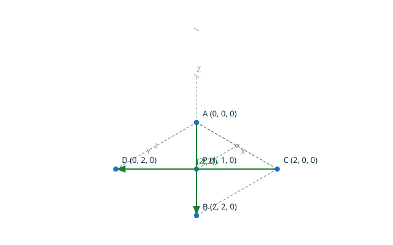
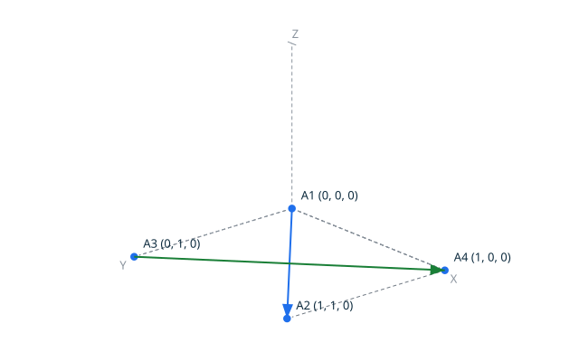
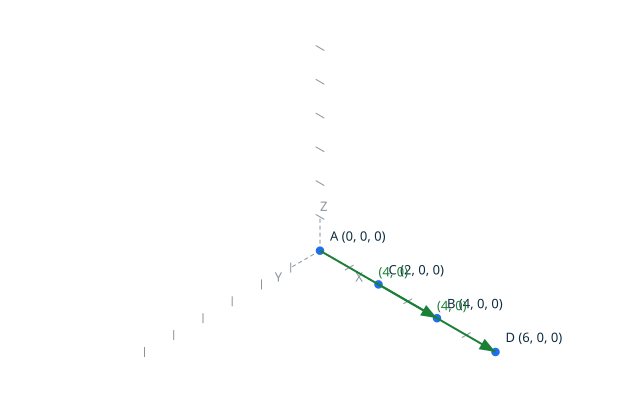
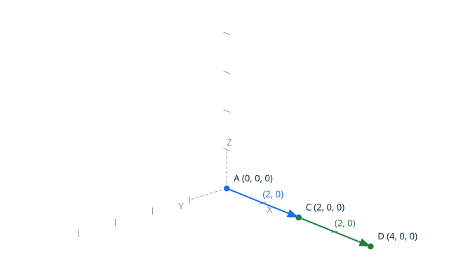
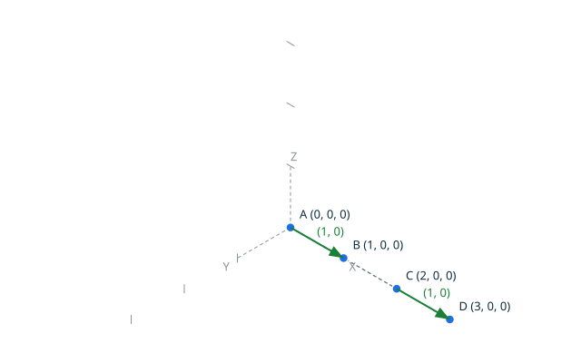
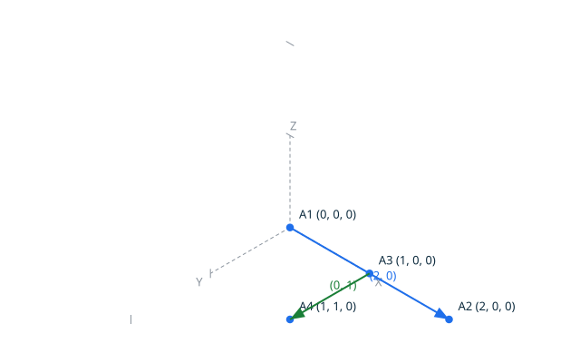
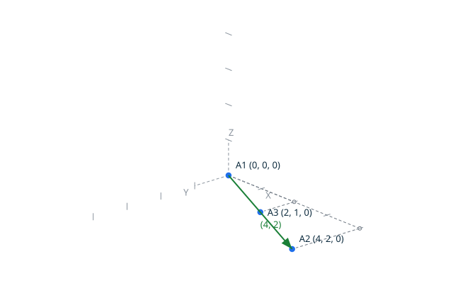
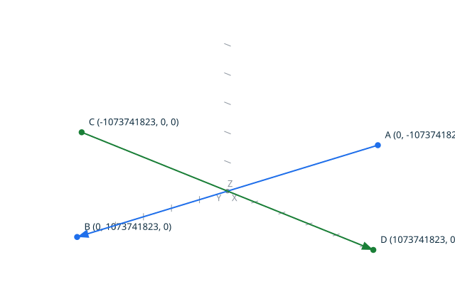

# Intersection <!-- omit from toc -->

`Intersection` classifies exactly the intersection of two 2D segments,
the proved intersection of the kernel, where the first segment runs from
`A` to `B` and the second from `C` to `D`. The canonical result is one
of, written by the explicit `Put_Intersection`:

- `intersection no_intersection`: the segments share no common grid position;
- `intersection point_intersection X Y`: they share exactly one grid
  position, returned with its coordinates;
- `intersection off_grid_crossing`: the segments properly cross, but at a
  point that is not a grid position — stated exactly, not approximated;
- `intersection overlap X1 Y1 X2 Y2`: the segments are collinear and share
  the returned sub-segment, canonically ordered along the common line.

The classification uses only exact integer arithmetic: orientation signs,
exact products and exact divisibility tests decide every case. There is no
tolerance, and no crossing is silently snapped to a grid position.

In the diagram on the left, the two segments properly cross at
`P = (1, 1)`, a grid position. In the diagram on the right, the two
diagonals of the unit square cross at `(0.5, 0.5)`, which is not a grid
position: the operation says so instead of approximating.





## Contents <!-- omit from toc -->

- [Scenario: a proper crossing on a grid position](#scenario-a-proper-crossing-on-a-grid-position)
- [Scenario: a proper crossing off the grid](#scenario-a-proper-crossing-off-the-grid)
- [Scenario: collinear segments overlap](#scenario-collinear-segments-overlap)
- [Scenario: collinear segments touch at one point](#scenario-collinear-segments-touch-at-one-point)
- [Scenario: collinear segments do not meet](#scenario-collinear-segments-do-not-meet)
- [Scenario: an endpoint on the other segment](#scenario-an-endpoint-on-the-other-segment)
- [Scenario: a degenerate point segment on another segment](#scenario-a-degenerate-point-segment-on-another-segment)
- [Scenario: two identical degenerate point segments](#scenario-two-identical-degenerate-point-segments)
- [Scenario: disjoint segments](#scenario-disjoint-segments)
- [Scenario: the grid corners do not overflow](#scenario-the-grid-corners-do-not-overflow)
- [Proved property](#proved-property)
- [Scenario: the order of the arguments does not matter](#scenario-the-order-of-the-arguments-does-not-matter)
- [Scenario: the overlap is returned identically in both orders](#scenario-the-overlap-is-returned-identically-in-both-orders)

## Scenario: a proper crossing on a grid position

- Given the file `crossing_grid.topo`
  ```ada
  A    : constant Point_2D := (0, 0);
  B    : constant Point_2D := (2, 2);
  C    : constant Point_2D := (2, 0);
  D    : constant Point_2D := (0, 2);
  R    : Intersection_Result;
  Name : VString := +"../docs/features/images/intersection_1.svg";

  Begin_Image (Name);
  Draw_Axes;
  Draw_Segment_2D (A, B, Blue);
  Draw_Segment_2D (C, D, Green);
  End_Image;

  Intersection (A, B, C, D, R);

  Put_Intersection (R);
  ```
- When I successfully run `../bin/topocli run crossing_grid.topo`
- Then the output is `intersection point_intersection 1 1`
- And the file `../docs/features/images/intersection_1.svg` contains `#1a7f37`  
  (The `#1a7f37` value is the green of `Color_Kind`: the check ensures
  the second segment, drawn in green, is in the image.)

## Scenario: a proper crossing off the grid

- Given the file `crossing_off_grid.topo`
  ```ada
  A    : constant Point_2D := (0, 0);
  B    : constant Point_2D := (1, 1);
  C    : constant Point_2D := (0, 1);
  D    : constant Point_2D := (1, 0);
  R    : Intersection_Result;
  Name : VString := +"../docs/features/images/intersection_2.svg";

  Begin_Image (Name);
  Draw_Axes;
  Draw_Segment_2D (A, B, Blue);
  Draw_Segment_2D (C, D, Green);
  End_Image;

  Intersection (A, B, C, D, R);

  Put_Intersection (R);
  ```
- When I successfully run `../bin/topocli run crossing_off_grid.topo`
- Then the output is `intersection off_grid_crossing`

## Scenario: collinear segments overlap

The two segments lie on the X axis and share the part from `(2, 0)` to
`(4, 0)`.



- Given the file `overlap.topo`
  ```ada
  A    : constant Point_2D := (0, 0);
  B    : constant Point_2D := (4, 0);
  C    : constant Point_2D := (2, 0);
  D    : constant Point_2D := (6, 0);
  R    : Intersection_Result;
  Name : VString := +"../docs/features/images/intersection_3.svg";

  Begin_Image (Name);
  Draw_Axes;
  Draw_Edge (A, B, Blue);
  Draw_Edge (C, D, Green);
  End_Image;

  Intersection (A, B, C, D, R);

  Put_Intersection (R);
  ```
- When I successfully run `../bin/topocli run overlap.topo`
- Then the output is `intersection overlap 2 0 4 0`

## Scenario: collinear segments touch at one point

The two segments meet exactly at the common position `(2, 0)`, an endpoint
of both.



- Given the file `touch.topo`
  ```ada
  A    : constant Point_2D := (0, 0);
  B    : constant Point_2D := (2, 0);
  C    : constant Point_2D := (2, 0);
  D    : constant Point_2D := (4, 0);
  R    : Intersection_Result;
  Name : VString := +"../docs/features/images/intersection_4.svg";

  Begin_Image (Name);
  Draw_Axes;
  Draw_Edge (A, B, Blue);
  Draw_Edge (C, D, Green);
  End_Image;

  Intersection (A, B, C, D, R);

  Put_Intersection (R);
  ```
- When I successfully run `../bin/topocli run touch.topo`
- Then the output is `intersection point_intersection 2 0`

## Scenario: collinear segments do not meet

The two segments lie on the same line with a gap between `(1, 0)` and
`(2, 0)`.



- Given the file `gap.topo`
  ```ada
  A    : constant Point_2D := (0, 0);
  B    : constant Point_2D := (1, 0);
  C    : constant Point_2D := (2, 0);
  D    : constant Point_2D := (3, 0);
  R    : Intersection_Result;
  Name : VString := +"../docs/features/images/intersection_5.svg";

  Begin_Image (Name);
  Draw_Axes;
  Draw_Edge (A, B, Blue);
  Draw_Edge (C, D, Green);
  End_Image;

  Intersection (A, B, C, D, R);

  Put_Intersection (R);
  ```
- When I successfully run `../bin/topocli run gap.topo`
- Then the output is `intersection no_intersection`

## Scenario: an endpoint on the other segment

The second segment starts at `(1, 0)`, a position inside the first
segment: a junction on the edge.



- Given the file `junction.topo`
  ```ada
  A    : constant Point_2D := (0, 0);
  B    : constant Point_2D := (2, 0);
  C    : constant Point_2D := (1, 0);
  D    : constant Point_2D := (1, 1);
  R    : Intersection_Result;
  Name : VString := +"../docs/features/images/intersection_6.svg";

  Begin_Image (Name);
  Draw_Axes;
  Draw_Edge (A, B, Blue);
  Draw_Edge (C, D, Green);
  End_Image;

  Intersection (A, B, C, D, R);

  Put_Intersection (R);
  ```
- When I successfully run `../bin/topocli run junction.topo`
- Then the output is `intersection point_intersection 1 0`

## Scenario: a degenerate point segment on another segment

The first segment is the single position `(2, 1)`, which lies exactly on
the second segment. A degenerate edge draws nothing: only the second
segment appears on the diagram.



- Given the file `point_on_segment.topo`
  ```ada
  A    : constant Point_2D := (2, 1);
  B    : constant Point_2D := (2, 1);
  C    : constant Point_2D := (0, 0);
  D    : constant Point_2D := (4, 2);
  R    : Intersection_Result;
  Name : VString := +"../docs/features/images/intersection_7.svg";

  Begin_Image (Name);
  Draw_Axes;
  Draw_Edge (C, D, Green);
  Draw_Point_2D (A, Blue);
  End_Image;

  Intersection (A, B, C, D, R);

  Put_Intersection (R);
  ```
- When I successfully run `../bin/topocli run point_on_segment.topo`
- Then the output is `intersection point_intersection 2 1`

## Scenario: two identical degenerate point segments

- Given the file `two_points.topo`
  ```ada
  A : constant Point_2D := (1, 1);
  B : constant Point_2D := (1, 1);
  R : Intersection_Result;

  Intersection (A, A, B, B, R);

  Put_Intersection (R);
  ```
- When I successfully run `../bin/topocli run two_points.topo`
- Then the output is `intersection point_intersection 1 1`

## Scenario: disjoint segments

- Given the file `disjoint.topo`
  ```ada
  A : constant Point_2D := (0, 0);
  B : constant Point_2D := (1, 0);
  C : constant Point_2D := (0, 2);
  D : constant Point_2D := (1, 2);
  R : Intersection_Result;

  Intersection (A, B, C, D, R);

  Put_Intersection (R);
  ```
- When I successfully run `../bin/topocli run disjoint.topo`
- Then the output is `intersection no_intersection`

## Scenario: the grid corners do not overflow

The two segments are the two diagonals of the whole grid, crossing exactly
at the origin.



- Given the file `corner_diagonals.topo`
  ```ada
  A    : constant Point_2D := (0, -1073741823);
  B    : constant Point_2D := (0, 1073741823);
  C    : constant Point_2D := (-1073741823, 0);
  D    : constant Point_2D := (1073741823, 0);
  R    : Intersection_Result;
  Name : VString := +"../docs/features/images/intersection_8.svg";

  Begin_Image (Name);
  Draw_Axes;
  Draw_Segment_2D (A, B, Blue);
  Draw_Segment_2D (C, D, Green);
  End_Image;

  Intersection (A, B, C, D, R);

  Put_Intersection (R);
  ```
- When I successfully run `../bin/topocli run corner_diagonals.topo`
- Then the output is `intersection point_intersection 0 0`

## Proved property

Exchanging the two segments does not change any result, and every reported
point or overlap boundary is a common grid position of both segments: both
properties are proved by SPARK over the whole grid domain, by the ghost
procedures `Lemma_Symmetry` and `Lemma_Membership`. All computations are
exact: orientation signs classify the configuration, and the crossing point
is accepted only when both exact coordinate quotients are integers in the
grid domain. No operation can overflow for any grid input: the degree-3
products of the crossing test are bounded by 1.6E28 and computed in a
128-bit intermediate domain.

## Scenario: the order of the arguments does not matter

The crossing of the first scenario, with the two segments exchanged: one
script classifies both orders, and both results are written.


- Given the file `symmetric_crossing.topo`
  ```ada
  A : constant Point_2D := (0, 0);
  B : constant Point_2D := (2, 2);
  C : constant Point_2D := (2, 0);
  D : constant Point_2D := (0, 2);
  R : Intersection_Result;

  Intersection (A, B, C, D, R);
  Put_Intersection (R);

  Intersection (C, D, A, B, R);
  Put_Intersection (R);
  ```
- When I successfully run `../bin/topocli run symmetric_crossing.topo`
- Then the output is
  ```text
  intersection point_intersection 1 1
  intersection point_intersection 1 1
  ```

## Scenario: the overlap is returned identically in both orders

The overlap of the collinear scenario, with the two segments exchanged.


- Given the file `symmetric_overlap.topo`
  ```ada
  A : constant Point_2D := (0, 0);
  B : constant Point_2D := (4, 0);
  C : constant Point_2D := (2, 0);
  D : constant Point_2D := (6, 0);
  R : Intersection_Result;

  Intersection (A, B, C, D, R);
  Put_Intersection (R);

  Intersection (C, D, A, B, R);
  Put_Intersection (R);
  ```
- When I successfully run `../bin/topocli run symmetric_overlap.topo`
- Then the output is
  ```text
  intersection overlap 2 0 4 0
  intersection overlap 2 0 4 0
  ```
