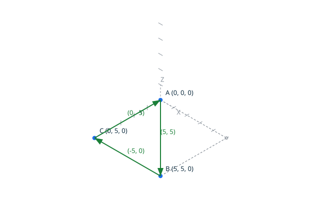

# Loops <!-- omit from toc -->

`Make_Loop` builds a loop from the chain accumulated by `Add_Point`:
the chain classifies exactly as the kernel `Classify_Loop`, and closes
the loop when its last position is the first one. In the script chain,
a repeated position closes on the same vertex. The canonical result of
building the loop `A=(0, 0) B=(5, 5) C=(0, 5) A` is
`loop closed counter_clockwise`, written by the explicit `Put_Loop`.

A loop is an oriented closed chain of connected edges (see
`docs/terminology.md`): it is a value, not a stored entity. The
classification is exact and has no tolerance: a chain is a valid loop when
it contains no orphan edge, every endpoint exists, the chain closes on its
starting vertex, consecutive edges are connected, and no edge is reduced to
a point. The geometric degeneracy of an edge support is judged here, at
loop level (DD-002, decision 6): an edge between two distinct vertices at
the same point is a valid edge, but no valid loop contains it. The chain
identifies vertices by position, so it cannot express two distinct
vertices at one point: that construction is built with the construction
operations, which carry the vertex identity by handles, and is classified
by `Make_Loop_From_Edges` over the created edges.



## Contents <!-- omit from toc -->

- [Scenario: a triangle loop](#scenario-a-triangle-loop)
- [Scenario: a clockwise square](#scenario-a-clockwise-square)
- [Scenario: a closed backtrack is a degenerate loop](#scenario-a-closed-backtrack-is-a-degenerate-loop)
- [Proved property](#proved-property)
- [Scenario: an open chain is rejected](#scenario-an-open-chain-is-rejected)
- [Scenario: a degenerate edge support is rejected](#scenario-a-degenerate-edge-support-is-rejected)

## Scenario: a triangle loop

The script draws the triangle, accumulates the chain, and classifies
it.

- Given the file `triangle.topo`
  ```ada
  A    : constant Point_2D := (0, 0);
  B    : constant Point_2D := (5, 5);
  C    : constant Point_2D := (0, 5);
  K    : Loop_Kind;

  Begin_Image (+"../docs/features/images/loops_1.svg");
  Draw_Axes;
  Draw_Point_2D (A, Blue);
  Draw_Point_2D (B, Blue);
  Draw_Point_2D (C, Blue);
  Draw_Edge (A, B, Blue);
  Draw_Edge (B, C, Blue);
  Draw_Edge (C, A, Blue);
  End_Image;

  Add_Point (A);
  Add_Point (B);
  Add_Point (C);
  Add_Point (A);

  Make_Loop (K);

  Put_Loop (K);
  ```
- When I successfully run `../bin/topocli run triangle.topo`
- Then the output is `loop closed counter_clockwise`
- And the file `../docs/features/images/loops_1.svg` contains `#1f6feb`  
  (The `#1f6feb` value is the blue of `Color_Kind`: the check ensures
  the three vertices and edges of the loop are drawn, closed on `A`.)

## Scenario: a clockwise square

The same square traversed from `(0, 0)` towards `(0, 5)`: the interior
is on the right.


- Given the file `clockwise_square.topo`
  ```ada
  A    : constant Point_2D := (0, 0);
  B    : constant Point_2D := (0, 5);
  C    : constant Point_2D := (5, 5);
  D    : constant Point_2D := (5, 0);
  K    : Loop_Kind;

  Begin_Image (+"../docs/features/images/loops_2.svg");
  Draw_Axes;
  Draw_Point_2D (A, Blue);
  Draw_Point_2D (B, Blue);
  Draw_Point_2D (C, Blue);
  Draw_Point_2D (D, Blue);
  Draw_Edge (A, B, Blue);
  Draw_Edge (B, C, Blue);
  Draw_Edge (C, D, Blue);
  Draw_Edge (D, A, Blue);
  End_Image;

  Add_Point (A);
  Add_Point (B);
  Add_Point (C);
  Add_Point (D);
  Add_Point (A);

  Make_Loop (K);

  Put_Loop (K);
  ```
- When I successfully run `../bin/topocli run clockwise_square.topo`
- Then the output is `loop closed clockwise`
- And the file `../docs/features/images/loops_2.svg` contains `#1f6feb`  
  (The `#1f6feb` value is the blue of `Color_Kind`: the check ensures
  the four vertices and edges of the loop are drawn, traversed
  clockwise.)

## Scenario: a closed backtrack is a degenerate loop

The chain `A B A` goes to `B` and comes back along the same segment: the
loop is closed and valid, but its orientation is degenerate, and it is
never a valid face boundary (DD-002, decision 3).

- Given the file `backtrack.topo`
  ```ada
  A : constant Point_2D := (0, 0);
  B : constant Point_2D := (5, 5);
  K : Loop_Kind;

  Add_Point (A);
  Add_Point (B);
  Add_Point (A);

  Make_Loop (K);

  Put_Loop (K);
  ```
- When I successfully run `../bin/topocli run backtrack.topo`
- Then the output is `loop closed degenerate`

## Proved property

The classification is proved exhaustive: `Classify_Loop` returns
`Valid_Loop` exactly when every loop invariant holds, and `Make_Loop` only
builds a loop from a chain classifying as `Valid_Loop`, so invalid loops
cannot be obtained from the public API. `Point_Sequence` is proved to return
the closed, valid point sequence of the chain: a valid loop has at least
two edges, because one stored edge cannot close on itself. The orientation
of a loop is exactly the milestone 4 orientation of that sequence, proved
by reusing its contract. Every operation of the unit is proved free of
run-time errors.

## Scenario: an open chain is rejected

The chain never returns to its first position: the classification owns
no canonical line, only the rejection diagnostic.

- Given the file `open_chain.topo`
  ```ada
  A : constant Point_2D := (0, 0);
  B : constant Point_2D := (5, 5);
  C : constant Point_2D := (0, 5);
  K : Loop_Kind;

  Add_Point (A);
  Add_Point (B);
  Add_Point (C);

  Make_Loop (K);

  Put_Loop (K);
  ```
- When I run `../bin/topocli run open_chain.topo`
- Then the error output is `error: open loop`
- And there is an error

## Scenario: a degenerate edge support is rejected

Both edges are valid topological edges between distinct vertices at the
same point, but their support is reduced to a point: no valid loop contains
them. The degeneracy is judged here, at loop level, not at edge level
(DD-002, decision 6). The chain cannot express this construction, so the
script builds it with the construction operations and classifies the
created edges: the traces are the construction ones, and the rejection is
the loop-level diagnostic.

- Given the file `degenerate_support.topo`
  ```ada
  P  : constant Point_2D := (1, 2);
  VA : Vertex_Handle;
  VB : Vertex_Handle;
  E1 : Edge_Handle;
  E2 : Edge_Handle;
  K  : Loop_Kind;

  Create_Vertex (P, VA);
  Put_Vertex (VA);
  Create_Vertex (P, VB);
  Put_Vertex (VB);
  Create_Edge (VA, VB, E1);
  Put_Edge (E1);
  Create_Edge (VB, VA, E2);
  Put_Edge (E2);

  Make_Loop_From_Edges (K);

  Put_Loop (K);
  ```
- When I run `../bin/topocli run degenerate_support.topo`
- Then the output is
  ```text
  vertex 1 point 1 2
  vertex 2 point 1 2
  edge 1 vertex 1 vertex 2
  edge 2 vertex 2 vertex 1
  ```
- And the error output is `error: degenerate edge support`
- And there is an error
