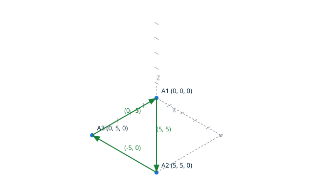

# Loops <!-- omit from toc -->

`loop` builds a loop from a chain of named points:  
`topocli loop A=(X, Y) B=(X, Y) ... A`.  
Within the command, a name designates one vertex: a repeated name is the
same vertex, never a new one. The command creates one edge per consecutive
pair of names, then classifies the chain exactly, and closes the loop when
the last name is the first one. The canonical result of building the loop
`A=(0, 0) B=(5, 5) C=(0, 5) A` is `loop closed counter_clockwise`.

A loop is an oriented closed chain of connected edges (see
`docs/terminology.md`): it is a value, not a stored entity. The
classification is exact and has no tolerance: a chain is a valid loop when
it contains no orphan edge, every endpoint exists, the chain closes on its
starting vertex, consecutive edges are connected, and no edge is reduced to
a point. The geometric degeneracy of an edge support is judged here, at
loop level (DD-002, decision 6): an edge between two distinct vertices at
the same point is a valid edge, but no valid loop contains it.


## Contents <!-- omit from toc -->

- [Scenario: a triangle loop](#scenario-a-triangle-loop)
- [Scenario: a triangle loop built by script](#scenario-a-triangle-loop-built-by-script)
- [Scenario: a clockwise square](#scenario-a-clockwise-square)
- [Scenario: a closed backtrack is a degenerate loop](#scenario-a-closed-backtrack-is-a-degenerate-loop)
- [Proved property](#proved-property)
- [Scenario: an open chain is rejected](#scenario-an-open-chain-is-rejected)
- [Scenario: a degenerate edge support is rejected](#scenario-a-degenerate-edge-support-is-rejected)

## Scenario: a triangle loop

- When I successfully run `../bin/topocli loop A=(0, 0) B=(5, 5) C=(0, 5) A --draw ../docs/features/images/loops_1.svg`
- Then the output is
   ```
   vertex 1 point 0 0
   vertex 2 point 5 5
   vertex 3 point 0 5
   edge 1 vertex 1 vertex 2
   edge 2 vertex 2 vertex 3
   edge 3 vertex 3 vertex 1
   loop closed counter_clockwise
   ```

## Scenario: a triangle loop built by script

The same triangle as the previous scenario, written as a TopoScript:
the chain accumulates the points, and the classification is the same
kernel one. In the script chain, a repeated position closes on the
same vertex. The script draws its own diagram, the same geometry as
the one above, for a side-by-side comparison.

- Given the file `triangle.topo`
  ```ada
  A    : constant Point_2D := (0, 0);
  B    : constant Point_2D := (5, 5);
  C    : constant Point_2D := (0, 5);
  Kind : Loop_Kind;
  Name : VString := +"../docs/features/images/loops_1_script.svg";

  Begin_Image (Name);
  Draw_Axes;
  Draw_Point_2D (A, Blue);
  Draw_Point_2D (B, Blue);
  Draw_Point_2D (C, Blue);
  Draw_Edge (A, B, Green);
  Draw_Edge (B, C, Green);
  Draw_Edge (C, A, Green);

  Add_Point (A);
  Add_Point (B);
  Add_Point (C);
  Add_Point (A);

  Make_Loop (Kind);

  Put_Loop (Kind);
  End_Image;
  ```
- When I successfully run `../bin/topocli run triangle.topo`
- Then the output is `loop closed counter_clockwise`
- And the file `../docs/features/images/loops_1_script.svg` contains `(5, 5)`



## Scenario: a clockwise square


- When I successfully run `../bin/topocli loop A=(0, 0) B=(0, 5) C=(5, 5) D=(5, 0) A --draw ../docs/features/images/loops_2.svg`
- Then the output is
   ```
   vertex 1 point 0 0
   vertex 2 point 0 5
   vertex 3 point 5 5
   vertex 4 point 5 0
   edge 1 vertex 1 vertex 2
   edge 2 vertex 2 vertex 3
   edge 3 vertex 3 vertex 4
   edge 4 vertex 4 vertex 1
   loop closed clockwise
   ```

## Scenario: a closed backtrack is a degenerate loop

The chain `A B A` goes to `B` and comes back along the same segment: the
loop is closed and valid, but its orientation is degenerate, and it is
never a valid face boundary (DD-002, decision 3).

- When I successfully run `../bin/topocli loop A=(0, 0) B=(5, 5) A`
- Then the output is
   ```
   vertex 1 point 0 0
   vertex 2 point 5 5
   edge 1 vertex 1 vertex 2
   edge 2 vertex 2 vertex 1
   loop closed degenerate
   ```

## Proved property

The classification is proved exhaustive: `Classify_Loop` returns
`Valid_Loop` exactly when every loop invariant holds, and `Make_Loop` only
builds a loop from a chain classifying as `Valid_Loop`, so invalid loops
cannot be obtained from the public API. `Point_Sequence` is proved to return
the closed, valid point sequence of the chain: a valid loop has at least
two edges, because one stored edge cannot close on itself. The orientation
of a loop is exactly the milestone 4 orientation of that sequence, proved
by reusing its contract. Every operation of the unit is proved free of
run-time errors.

## Scenario: an open chain is rejected

The chain never returns to its first vertex.

- When I run `../bin/topocli loop A=(0, 0) B=(5, 5) C=(0, 5)`
- Then the output is
   ```
   vertex 1 point 0 0
   vertex 2 point 5 5
   vertex 3 point 0 5
   edge 1 vertex 1 vertex 2
   edge 2 vertex 2 vertex 3
   error: open loop
   ```
- And there is an error

## Scenario: a degenerate edge support is rejected

Both edges are valid topological edges between distinct vertices at the
same point, but their support is reduced to a point: no valid loop contains
them. The degeneracy is judged here, at loop level, not at edge level
(DD-002, decision 6).

- When I run `../bin/topocli loop A=(1, 2) B=(1, 2) A`
- Then the output is
   ```
   vertex 1 point 1 2
   vertex 2 point 1 2
   edge 1 vertex 1 vertex 2
   edge 2 vertex 2 vertex 1
   error: degenerate edge support
   ```
- And there is an error
