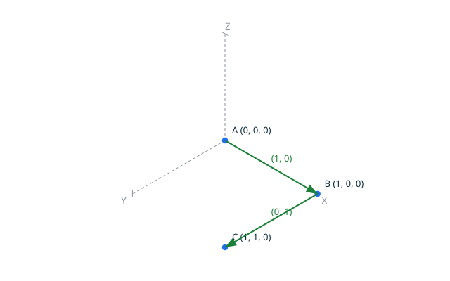
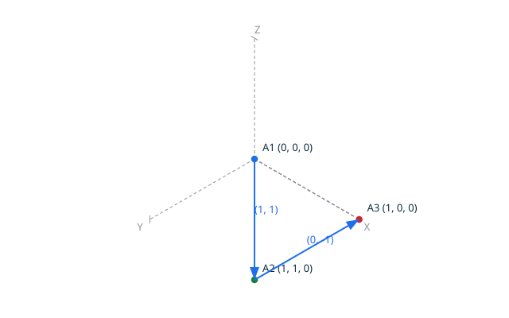
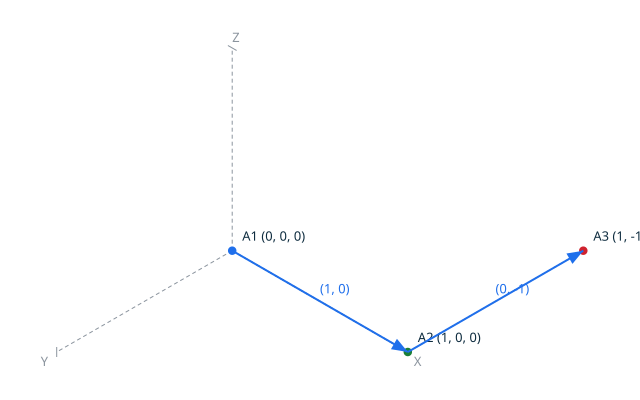
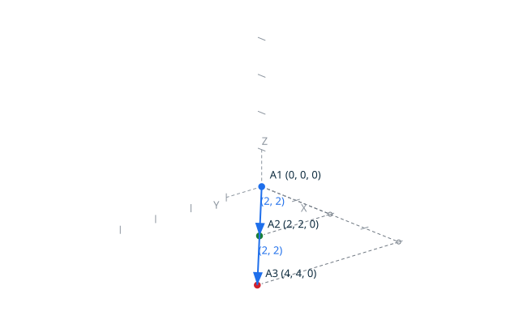
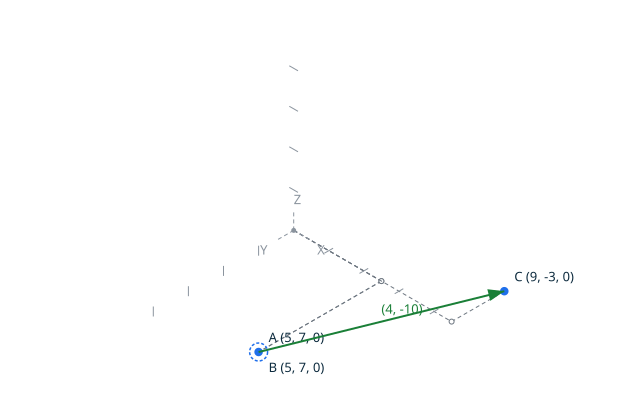
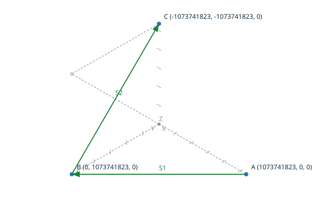
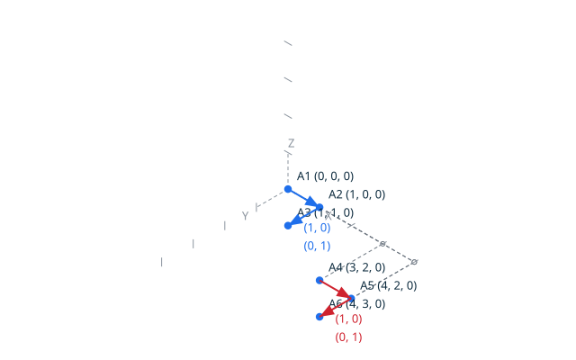

# Orientation

`orientation` classifies exactly the path formed by three 2D points:
`topoproof orientation AX AY BX BY CX CY`.
The result is `orientation counter_clockwise`, `orientation clockwise` or
`orientation collinear`, according to the exact sign of the determinant:

```text
(BX - AX) * (CY - AY) - (BY - AY) * (CX - AX)
```

There is no tolerance, no angle computation and no floating-point value: the
three products and their difference are computed exactly in integer types
sized for the expression, and the sign of the result decides. The
classification is exhaustive: the determinant is positive, zero or negative,
and each case corresponds to exactly one result.

The diagrams show the geometry of the scenarios below. On the left, the path
`A -> B -> C` turns counter-clockwise. On the right, the same points visited
in the exchanged order `A -> B -> C` turn clockwise: exchanging two points
mirrors the orientation.

<!-- topodraw images/orientation_1.svg
axes
ticks 1
anchors
point A 0 0 0
point B 1 0 0
point C 1 1 0
vector A B (1, 0)
vector B C (0, 1)
-->



<!-- topodraw images/orientation_2.svg
axes
ticks 1
anchors
point A 0 0 0
point B 1 1 0
point C 1 0 0
vector A B (1, 1)
vector B C (0, -1)
-->



## Contents

- [Scenario: a counter-clockwise path](#scenario-a-counter-clockwise-path)
- [Scenario: a clockwise path](#scenario-a-clockwise-path)
- [Scenario: three aligned points are collinear](#scenario-three-aligned-points-are-collinear)
- [Scenario: two coincident points make a degenerate collinear path](#scenario-two-coincident-points-make-a-degenerate-collinear-path)
- [Scenario: the extreme corners of the grid do not overflow](#scenario-the-extreme-corners-of-the-grid-do-not-overflow)
- [Proved property](#proved-property)
- [Scenario: a cyclic permutation keeps the orientation](#scenario-a-cyclic-permutation-keeps-the-orientation)
- [Scenario: exchanging two points mirrors the orientation](#scenario-exchanging-two-points-mirrors-the-orientation)
- [Scenario: the orientation is invariant under translation](#scenario-the-orientation-is-invariant-under-translation)

## Scenario: a counter-clockwise path


- When I successfully run `../bin/topoproof orientation 0 0 1 0 1 1`
- Then the output is `orientation counter_clockwise`

## Scenario: a clockwise path

The path turns right at `(1, 0)`.

<!-- topodraw images/orientation_3.svg
axes
ticks 1
anchors
point A 0 0 0
point B 1 0 0
point C 1 -1 0
vector A B (1, 0)
vector B C (0, -1)
-->



- When I successfully run `../bin/topoproof orientation 0 0 1 0 1 -1`
- Then the output is `orientation clockwise`

## Scenario: three aligned points are collinear

The path stays on the diagonal line: no turn at all.

<!-- topodraw images/orientation_4.svg
axes
ticks 2
anchors
point A 0 0 0
point B 2 2 0
point C 4 4 0
vector A B (2, 2)
vector B C (2, 2)
-->



- When I successfully run `../bin/topoproof orientation 0 0 2 2 4 4`
- Then the output is `orientation collinear`

## Scenario: two coincident points make a degenerate collinear path

`A` and `B` are the same position `(5, 7)`: the path degenerates before
reaching `C`.

<!-- topodraw images/orientation_5.svg
axes
ticks 5
anchors
point A 5 7 0
point B 5 7 0
point C 9 -3 0
vector B C (4, -10)
-->



- When I successfully run `../bin/topoproof orientation 5 7 5 7 9 -3`
- Then the output is `orientation collinear`

## Scenario: the extreme corners of the grid do not overflow

The path visits three corners of the grid; the determinant of the extreme
coordinates is computed exactly in the `Determinant` domain.

<!-- topodraw images/orientation_6.svg
axes
anchors
point A 1073741823 0 0
point B 0 1073741823 0
point C -1073741823 -1073741823 0
vector A B S1
vector B C S2
-->



- When I successfully run `../bin/topoproof orientation 1073741823 0 0 1073741823 -1073741823 -1073741823`
- Then the output is `orientation counter_clockwise`

## Proved property

Cyclically permuting the three points does not change the orientation, and
exchanging two points mirrors it. Both are proved by SPARK over the whole
grid domain, by the ghost procedures
`Lemma_Cyclic_Permutation` and `Lemma_Reversed_Permutation`. Two coincident
points force a degenerate, collinear path
(`Lemma_Degenerate_Collinear`), and the orientation is invariant under any
representable translation of the three points
(`Lemma_Translation_Invariance`). No overflow can occur on any grid input:
the determinant of extreme coordinates is bounded by 8E18, within the proved
`Determinant` domain.

## Scenario: a cyclic permutation keeps the orientation

The same triangle as the first scenario, visited from a different starting
point.


- When I successfully run `../bin/topoproof orientation 0 0 1 0 1 1`
- Then the output is `orientation counter_clockwise`
- When I successfully run `../bin/topoproof orientation 1 0 1 1 0 0`
- Then the output is `orientation counter_clockwise`

## Scenario: exchanging two points mirrors the orientation

The exchanged path of the first scenario.


- When I successfully run `../bin/topoproof orientation 0 0 1 1 1 0`
- Then the output is `orientation clockwise`

## Scenario: the orientation is invariant under translation

The same path as the first scenario, translated by `(10, 20)`: the turn
direction is unchanged.

<!-- topodraw images/orientation_7.svg
axes
ticks 5
anchors
point A 0 0 0
point B 1 0 0
point C 1 1 0
point E 10 20 0
point F 11 20 0
point G 11 21 0
vector A B (1, 0)
vector B C (0, 1)
vector E F (1, 0)
vector F G (0, 1)
-->



- When I successfully run `../bin/topoproof orientation 0 0 1 0 1 1`
- Then the output is `orientation counter_clockwise`
- When I successfully run `../bin/topoproof orientation 10 20 11 20 11 21`
- Then the output is `orientation counter_clockwise`
