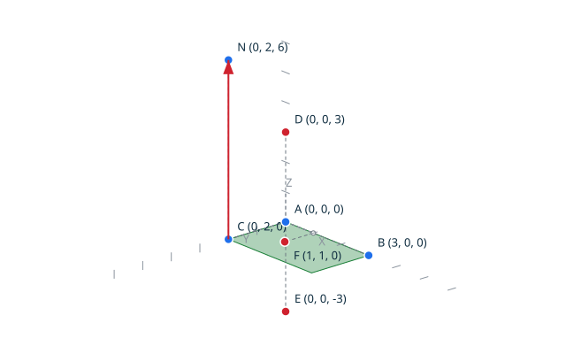
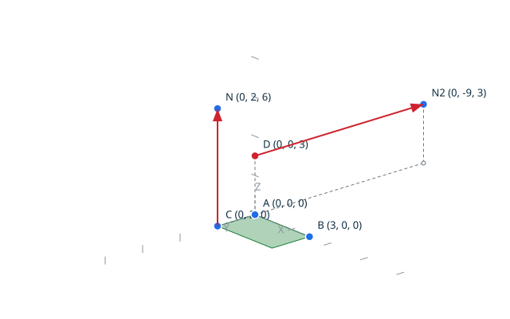
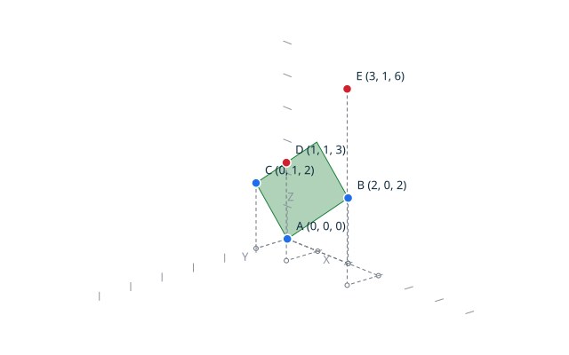
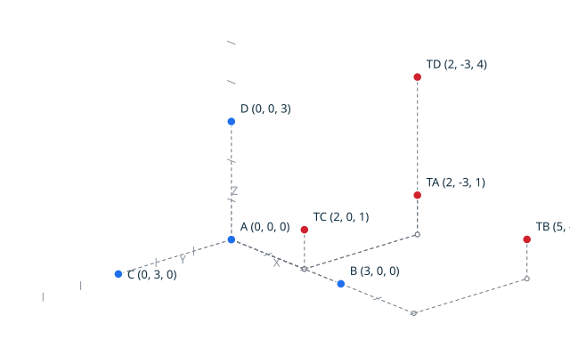

# Orientation in three dimensions <!-- omit from toc -->

Four ordered grid points classify by the sign of their exact orientation
determinant: the mixed product of the three displacements from the first
point, that is (B - A) x (C - A) . (D - A), six times the signed volume of
the tetrahedron they span. The ordered quadruple is right-handed when the
determinant is positive, left-handed when it is negative, and the four
points are coplanar when it is zero. Everything is exact, no tolerance is
involved: the determinant is computed in its exact 128-bit domain, and no
grid input can overflow it.

The classification is proved over the whole grid domain: it is exhaustive,
it coincides with the exact plane equation of the first three points, an
exchange of two points mirrors it, an even permutation preserves it, two
coincident points make it coplanar, and it is invariant under any
representable translation.

## Contents <!-- omit from toc -->

- [Scenario: a tetrahedron along the axes classifies right-handed](#scenario-a-tetrahedron-along-the-axes-classifies-right-handed)
- [Scenario: exchanging two points mirrors the orientation](#scenario-exchanging-two-points-mirrors-the-orientation)
- [Scenario: coplanar points classify as coplanar](#scenario-coplanar-points-classify-as-coplanar)
- [Scenario: the classification is translation invariant](#scenario-the-classification-is-translation-invariant)
- [Scenario: the grid corners do not overflow](#scenario-the-grid-corners-do-not-overflow)

## Scenario: a tetrahedron along the axes classifies right-handed

The tetrahedron spanned by the origin and three grid steps along the axes
is right-handed: the determinant of the ordered quadruple is the product
of the three step lengths, positive. The mirrored tetrahedron, its last
point taken against the Z axis, is left-handed, and a point of the base
plane makes the quadruple coplanar. The Y and Z steps have different
lengths, so no base edge projects on the Z axis of the diagram. The
diagram draws the base patch, the three classified points, and the base
normal rising from the C corner, along Z.

- Given the file `tetrahedron.topo`
  ```ada
  A : constant Point_3D := (0, 0, 0);
  B : constant Point_3D := (3, 0, 0);
  C : constant Point_3D := (0, 2, 0);
  D : constant Point_3D := (0, 0, 3);
  E : constant Point_3D := (0, 0, -3);
  F : constant Point_3D := (1, 1, 0);
  U1 : constant Vector_3D := (3, 0, 0);
  U2 : constant Vector_3D := (0, 2, 0);
  NV : Vector_3D;
  K, L, M : Orientation_3D_Kind;

  Cross_Product (U1, U2, NV);

  Begin_Image (+"../docs/features/images/orientation3d_1.svg");
  Draw_Axes;
  Draw_Plane (A, B, C, Green);
  Draw_Named_Vector (C, NV, +"N", Red);
  Draw_Named_Point (A, +"A", Blue);
  Draw_Named_Point (B, +"B", Blue);
  Draw_Named_Point (C, +"C", Blue);
  Draw_Named_Point (D, +"D", Red);
  Draw_Named_Point (E, +"E", Red);
  Draw_Named_Point (F, +"F", Red);
  End_Image;

  Orientation_3D (A, B, C, D, K);
  Orientation_3D (A, B, C, E, L);
  Orientation_3D (A, B, C, F, M);

  Put_Orientation_3D (K);
  Put_Orientation_3D (L);
  Put_Orientation_3D (M);
  ```
- When I successfully run `../bin/topocli run tetrahedron.topo`
- Then the output is
  ```text
  orientation3d right_handed
  orientation3d left_handed
  orientation3d coplanar
  ```
- And the file `../docs/features/images/orientation3d_1.svg` contains `#1a7f37`
  (The `#1a7f37` value is the green of `Color_Kind`: the check ensures
  the base patch, the actual subject of the scenario, is drawn.)



## Scenario: exchanging two points mirrors the orientation

Exchanging the last two points of the quadruple mirrors the orientation:
the tetrahedron is traversed the other way around. Exchanging the first
two points mirrors it too, so exchanging two pairs, an even permutation,
preserves it.

- Given the file `exchanged_tetrahedron.topo`
  ```ada
  A : constant Point_3D := (0, 0, 0);
  B : constant Point_3D := (3, 0, 0);
  C : constant Point_3D := (0, 2, 0);
  D : constant Point_3D := (0, 0, 3);
  U1 : constant Vector_3D := (3, 0, 0);
  U2 : constant Vector_3D := (0, 2, 0);
  U3 : constant Vector_3D := (0, 0, 3);
  N1, N2 : Vector_3D;
  K, L, M : Orientation_3D_Kind;

  Cross_Product (U1, U2, N1);
  Cross_Product (U1, U3, N2);

  Begin_Image (+"../docs/features/images/orientation3d_2.svg");
  Draw_Axes;
  Draw_Plane (A, B, C, Green);
  Draw_Named_Vector (C, N1, +"N", Red);
  Draw_Named_Vector (D, N2, +"N2", Red);
  Draw_Named_Point (A, +"A", Blue);
  Draw_Named_Point (B, +"B", Blue);
  Draw_Named_Point (C, +"C", Blue);
  Draw_Named_Point (D, +"D", Red);
  End_Image;

  Orientation_3D (A, B, C, D, K);
  Orientation_3D (A, B, D, C, L);
  Orientation_3D (B, A, D, C, M);

  Put_Orientation_3D (K);
  Put_Orientation_3D (L);
  Put_Orientation_3D (M);
  ```
- When I successfully run `../bin/topocli run exchanged_tetrahedron.topo`
- Then the output is
  ```text
  orientation3d right_handed
  orientation3d left_handed
  orientation3d right_handed
  ```
- And the file `../docs/features/images/orientation3d_2.svg` contains `#cf222e`
  (The `#cf222e` value is the red of `Color_Kind`: the check ensures the
  base normals, whose pair shows the mirror, are drawn.)



## Scenario: coplanar points classify as coplanar

The oblique plane through the origin, (2, 0, 2) and (0, 1, 2) carries
every point whose Z coordinate equals its X coordinate plus twice its Y
coordinate: the determinant vanishes on them, whatever the other
coordinates. A point displaced off the plane classifies by the side it
lands on.

- Given the file `coplanar_tetrahedron.topo`
  ```ada
  A : constant Point_3D := (0, 0, 0);
  B : constant Point_3D := (2, 0, 2);
  C : constant Point_3D := (0, 1, 2);
  D : constant Point_3D := (1, 1, 3);
  E : constant Point_3D := (3, 1, 6);
  K, L : Orientation_3D_Kind;

  Begin_Image (+"../docs/features/images/orientation3d_3.svg");
  Draw_Axes;
  Draw_Plane (A, B, C, Green);
  Draw_Named_Point (A, +"A", Blue);
  Draw_Named_Point (B, +"B", Blue);
  Draw_Named_Point (C, +"C", Blue);
  Draw_Named_Point (D, +"D", Red);
  Draw_Named_Point (E, +"E", Red);
  End_Image;

  Orientation_3D (A, B, C, D, K);
  Orientation_3D (A, B, C, E, L);

  Put_Orientation_3D (K);
  Put_Orientation_3D (L);
  ```
- When I successfully run `../bin/topocli run coplanar_tetrahedron.topo`
- Then the output is
  ```text
  orientation3d coplanar
  orientation3d right_handed
  ```
- And the file `../docs/features/images/orientation3d_3.svg` contains `#1a7f37`
  (The `#1a7f37` value is the green of `Color_Kind`: the check ensures
  the plane patch carrying D, the actual subject of the scenario, is
  drawn.)



## Scenario: the classification is translation invariant

Translating the four points by any representable vector leaves the
classification unchanged: the displacements, hence the determinant, do
not depend on where the tetrahedron sits on the grid.

- Given the file `translated_tetrahedron.topo`
  ```ada
  A : constant Point_3D := (0, 0, 0);
  B : constant Point_3D := (3, 0, 0);
  C : constant Point_3D := (0, 3, 0);
  D : constant Point_3D := (0, 0, 3);
  V : constant Vector_3D := (2, -3, 1);
  TA, TB, TC, TD : Point_3D;
  K, L : Orientation_3D_Kind;

  Translate (A, V, TA);
  Translate (B, V, TB);
  Translate (C, V, TC);
  Translate (D, V, TD);

  Begin_Image (+"../docs/features/images/orientation3d_4.svg");
  Draw_Axes;
  Draw_Named_Point (A, +"A", Blue);
  Draw_Named_Point (B, +"B", Blue);
  Draw_Named_Point (C, +"C", Blue);
  Draw_Named_Point (D, +"D", Blue);
  Draw_Named_Point (TA, +"TA", Red);
  Draw_Named_Point (TB, +"TB", Red);
  Draw_Named_Point (TC, +"TC", Red);
  Draw_Named_Point (TD, +"TD", Red);
  End_Image;

  Orientation_3D (A, B, C, D, K);
  Orientation_3D (TA, TB, TC, TD, L);

  Put_Orientation_3D (K);
  Put_Orientation_3D (L);
  ```
- When I successfully run `../bin/topocli run translated_tetrahedron.topo`
- Then the output is
  ```text
  orientation3d right_handed
  orientation3d right_handed
  ```
- And the file `../docs/features/images/orientation3d_4.svg` contains `#cf222e`
  (The `#cf222e` value is the red of `Color_Kind`: the check ensures the
  translated tetrahedron, the actual subject of the scenario, is drawn.)



## Scenario: the grid corners do not overflow

The four points at the extreme corners of the grid classify exactly: the
determinant reaches about 5.9E28 there, exact in its 128-bit domain, with
no overflow and no degradation. Exchanging the last two corner points
mirrors the classification, from the positive (2L)³ to the negative
-(2L)³.

- Given the file `corner_tetrahedron.topo`
  ```ada
  A : constant Point_3D := (-1073741823, -1073741823, -1073741823);
  B : constant Point_3D := (1073741823, -1073741823, -1073741823);
  C : constant Point_3D := (-1073741823, 1073741823, -1073741823);
  D : constant Point_3D := (-1073741823, -1073741823, 1073741823);
  K, L : Orientation_3D_Kind;

  Orientation_3D (A, B, C, D, K);
  Orientation_3D (A, B, D, C, L);

  Put_Orientation_3D (K);
  Put_Orientation_3D (L);
  ```
- When I successfully run `../bin/topocli run corner_tetrahedron.topo`
- Then the output is
  ```text
  orientation3d right_handed
  orientation3d left_handed
  ```
