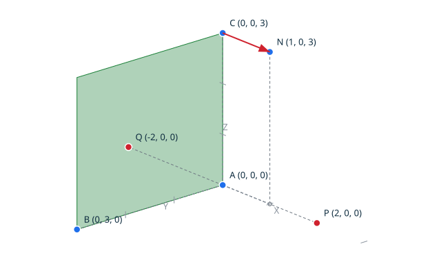
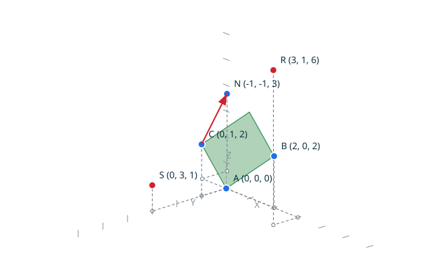

# Planes <!-- omit from toc -->

A plane is defined by three non-collinear grid points. Its exact normal is
the cross product of the two displacements from the first defining point,
and a point classifies relative to the plane by the sign of the exact plane
equation: the mixed dot of the normal with the displacement from the first
defining point to the classified point. Everything is exact, no tolerance is
involved, and the collinear degeneracy is reported, never built: the
construction rejects it instead of building a plane.

The classification is proved over the whole grid domain: the plane equation
stays in its exact 128-bit domain for any grid input, the classification is
invariant under any representable translation, and a degenerate definition
classifies every point as on the plane.

## Contents <!-- omit from toc -->

- [Scenario: the coordinate plane classifies its points](#scenario-the-coordinate-plane-classifies-its-points)
- [Scenario: coplanar points classify as on the plane](#scenario-coplanar-points-classify-as-on-the-plane)
- [Scenario: a collinear definition is rejected](#scenario-a-collinear-definition-is-rejected)
- [Scenario: the classification is translation invariant](#scenario-the-classification-is-translation-invariant)
- [Scenario: the grid boundary classifies exactly](#scenario-the-grid-boundary-classifies-exactly)

## Scenario: the coordinate plane classifies its points

The plane through the origin, the unit Y point and the unit Z point is the
YZ coordinate plane; its normal points along X, computed by the script as
the exact cross product of the two unit steps. The point two steps along
X classifies in front, the point two steps against X behind, and a point
of the plane itself on the plane. The diagram draws the plane patch
between the Y and Z axes, the classified points, and the normal rising
from the C corner, along X.

- Given the file `coordinate_plane.topo`
  ```ada
  A : constant Point_3D := (0, 0, 0);
  B : constant Point_3D := (0, 3, 0);
  C : constant Point_3D := (0, 0, 3);
  P : constant Point_3D := (2, 0, 0);
  Q : constant Point_3D := (-2, 0, 0);
  R : constant Point_3D := (0, 2, 1);
  U1 : constant Vector_3D := (0, 1, 0);
  U2 : constant Vector_3D := (0, 0, 1);
  NV : Vector_3D;
  K : Plane_Kind;
  S, T, U : Plane_Side_Kind;

  Cross_Product (U1, U2, NV);

  Begin_Image (+"../docs/features/images/planes_1.svg");
  Draw_Axes;
  Draw_Plane (A, B, C, Green);
  Draw_Named_Vector (C, NV, +"N", Red);
  Draw_Named_Point (A, +"A", Blue);
  Draw_Named_Point (B, +"B", Blue);
  Draw_Named_Point (C, +"C", Blue);
  Draw_Named_Point (P, +"P", Red);
  Draw_Named_Point (Q, +"Q", Red);
  End_Image;

  Make_Plane (A, B, C, K);
  Plane_Side (P, A, B, C, S);
  Plane_Side (Q, A, B, C, T);
  Plane_Side (R, A, B, C, U);

  Put_Plane_Kind (K);
  Put_Plane_Side (S);
  Put_Plane_Side (T);
  Put_Plane_Side (U);
  ```
- When I successfully run `../bin/topocli run coordinate_plane.topo`
- Then the output is
  ```text
  plane valid
  side in_front
  side behind
  side on_plane
  ```
- And the file `../docs/features/images/planes_1.svg` contains `#1a7f37`
  (The `#1a7f37` value is the green of `Color_Kind`: the check ensures
  the plane patch, the actual subject of the scenario, is drawn.)



## Scenario: coplanar points classify as on the plane

The oblique plane through the origin, (2, 0, 2) and (0, 1, 2) carries every
point whose Z coordinate equals its X coordinate plus twice its Y
coordinate: the plane equation vanishes on them, whatever the other
coordinates. A point displaced off the plane classifies by the side it
lands on. The diagram draws the patch, wide open toward the viewer, and
the normal direction: the exact cross product of the plane's two unit
grid steps, computed by the script, tilted away from the vertical and
rising from the C corner.

- Given the file `coplanar_points.topo`
  ```ada
  A : constant Point_3D := (0, 0, 0);
  B : constant Point_3D := (2, 0, 2);
  C : constant Point_3D := (0, 1, 2);
  P : constant Point_3D := (1, 1, 3);
  Q : constant Point_3D := (3, -1, 1);
  R : constant Point_3D := (3, 1, 6);
  S : constant Point_3D := (0, 3, 1);
  U1 : constant Vector_3D := (1, 0, 1);
  U2 : constant Vector_3D := (0, 1, 2);
  NV : Vector_3D;
  K : Plane_Kind;
  SP, SQ, SR, SS : Plane_Side_Kind;

  Cross_Product (U1, U2, NV);

  Begin_Image (+"../docs/features/images/planes_2.svg");
  Draw_Axes;
  Draw_Plane (A, B, C, Green);
  Draw_Named_Vector (C, NV, +"N", Red);
  Draw_Named_Point (A, +"A", Blue);
  Draw_Named_Point (B, +"B", Blue);
  Draw_Named_Point (C, +"C", Blue);
  Draw_Named_Point (R, +"R", Red);
  Draw_Named_Point (S, +"S", Red);
  End_Image;

  Make_Plane (A, B, C, K);
  Plane_Side (P, A, B, C, SP);
  Plane_Side (Q, A, B, C, SQ);
  Plane_Side (R, A, B, C, SR);
  Plane_Side (S, A, B, C, SS);

  Put_Plane_Kind (K);
  Put_Plane_Side (SP);
  Put_Plane_Side (SQ);
  Put_Plane_Side (SR);
  Put_Plane_Side (SS);
  ```
- When I successfully run `../bin/topocli run coplanar_points.topo`
- Then the output is
  ```text
  plane valid
  side on_plane
  side on_plane
  side in_front
  side behind
  ```
- And the file `../docs/features/images/planes_2.svg` contains `#cf222e`
  (The `#cf222e` value is the red of `Color_Kind`: the check ensures the
  normal of the plane, the result of the script's own cross product, is
  drawn.)



## Scenario: a collinear definition is rejected

A plane is defined only by non-collinear points. Three collinear points
have a null normal, no plane is built, and the construction reports the
degeneracy. The classification of a collinear definition is exact too: the
null normal makes the plane equation vanish, so every point classifies as
on the plane.

- Given the file `collinear_plane.topo`
  ```ada
  A : constant Point_3D := (0, 0, 0);
  B : constant Point_3D := (1, 1, 1);
  C : constant Point_3D := (2, 2, 2);
  P : constant Point_3D := (5, -3, 2);
  K : Plane_Kind;
  S : Plane_Side_Kind;

  Make_Plane (A, B, C, K);
  Plane_Side (P, A, B, C, S);

  Put_Plane_Kind (K);
  Put_Plane_Side (S);
  ```
- When I successfully run `../bin/topocli run collinear_plane.topo`
- Then the output is
  ```text
  plane collinear
  side on_plane
  ```

## Scenario: the classification is translation invariant

Translating the defining points and the classified point by the same
representable displacement leaves every side unchanged: the normal and the
displacements of the plane equation are translation invariant, proved over
the whole grid domain by the kernel lemma.

- Given the file `translated_plane.topo`
  ```ada
  A  : constant Point_3D := (0, 0, 0);
  B  : constant Point_3D := (2, 0, 0);
  C  : constant Point_3D := (0, 2, 2);
  P  : constant Point_3D := (1, 1, 2);
  D  : constant Vector_3D := (7, -13, 17);
  A2, B2, C2, P2 : Point_3D;
  S, S2 : Plane_Side_Kind;

  Translate (A, D, A2);
  Translate (B, D, B2);
  Translate (C, D, C2);
  Translate (P, D, P2);

  Plane_Side (P, A, B, C, S);
  Plane_Side (P2, A2, B2, C2, S2);

  Put_Plane_Side (S);
  Put_Plane_Side (S2);
  ```
- When I successfully run `../bin/topocli run translated_plane.topo`
- Then the output is
  ```text
  side in_front
  side in_front
  ```

## Scenario: the grid boundary classifies exactly

The defining points and the classified points at the largest grid
positions classify exactly: the plane equation reaches about 1.2E18
there, exact in its 128-bit domain, with no overflow and no degradation.

- Given the file `boundary_plane.topo`
  ```ada
  A : constant Point_3D := (0, 0, 0);
  B : constant Point_3D := (1073741823, 0, 0);
  C : constant Point_3D := (0, 1073741823, 0);
  P : constant Point_3D := (0, 0, 1073741823);
  Q : constant Point_3D := (0, 0, -1073741823);
  S, T : Plane_Side_Kind;

  Plane_Side (P, A, B, C, S);
  Plane_Side (Q, A, B, C, T);

  Put_Plane_Side (S);
  Put_Plane_Side (T);
  ```
- When I successfully run `../bin/topocli run boundary_plane.topo`
- Then the output is
  ```text
  side in_front
  side behind
  ```
