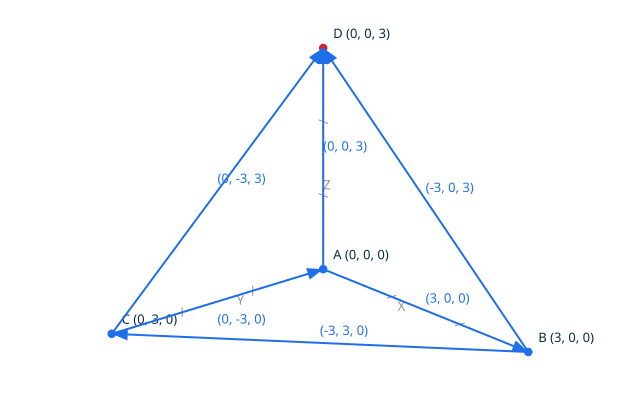
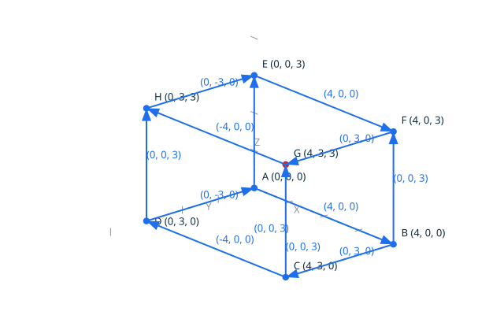

# Shells in three dimensions <!-- omit from toc -->

A shell is an assembly of face boundaries over the shared edge and vertex
stores (DD-005, decision 1): the faces in build order, each one carrying
its own oriented edges, so a shared geometric segment appears as two
directed edges, one per incident face. The shell is closed when every
face boundary is a valid loop and the pairing is exact: every directed
support is carried by one use, matched by one opposite use - the same two
vertices traversed the other way around - and no same-support use. The
first violated property is reported, with the face that carries it: an
invalid boundary, a support used more than twice (a non-manifold
assembly), two uses of one support in the same direction (the signature
of an inverted face), or a support carried by one use only (a free edge,
the signature of a missing face). Everything is exact, no tolerance is
involved.

The faces are built with the face operation, one after another: every
call consumes the edges created since the previous one, a planar boundary
joins the assembly, a rejected one is discarded. The shell classification
judges the assembly of the built faces as it stands.

## Contents <!-- omit from toc -->

- [Scenario: a tetrahedron closes its shell](#scenario-a-tetrahedron-closes-its-shell)
- [Scenario: the box closes its shell](#scenario-the-box-closes-its-shell)
- [Scenario: a missing face leaves a free edge](#scenario-a-missing-face-leaves-a-free-edge)
- [Scenario: an inverted face pairs in the same direction](#scenario-an-inverted-face-pairs-in-the-same-direction)
- [Scenario: three faces on one edge are rejected](#scenario-three-faces-on-one-edge-are-rejected)

## Scenario: a tetrahedron closes its shell

The tetrahedron of the origin and the three unit axis points: four
triangular faces, six segments, each segment carried twice, once per
direction. Every face is planar, every support is matched by its
opposite, and the shell is closed. The diagram draws the skeleton of the
six segments and the four vertices, the apex in red.



- Given the file `tetrahedron_shell.topo`
  ```ada
  A : constant Point_3D := (0, 0, 0);
  B : constant Point_3D := (3, 0, 0);
  C : constant Point_3D := (0, 3, 0);
  D : constant Point_3D := (0, 0, 3);
  HA, HB, HC, HD : Vertex_Handle;
  E1, E2, E3, E4, E5, E6, E7, E8, E9, E10, E11, E12 : Edge_Handle;
  K1, K2, K3, K4 : Face_3D_Kind;
  KS : Shell_3D_Kind;

  Begin_Image (+"../docs/features/images/shells_1.svg");
  Draw_Axes;
  -- Draw_Plane (A, B, C, Green);
  Draw_Edge_3D (A, B, Blue);
  Draw_Edge_3D (B, C, Blue);
  Draw_Edge_3D (C, A, Blue);
  Draw_Edge_3D (A, D, Blue);
  Draw_Edge_3D (B, D, Blue);
  Draw_Edge_3D (C, D, Blue);
  Draw_Named_Point (A, +"A", Blue);
  Draw_Named_Point (B, +"B", Blue);
  Draw_Named_Point (C, +"C", Blue);
  Draw_Named_Point (D, +"D", Red);
  End_Image;

  Create_Vertex_3D (A, HA);
  Create_Vertex_3D (B, HB);
  Create_Vertex_3D (C, HC);
  Create_Vertex_3D (D, HD);
  Create_Edge_3D (HA, HB, E1);
  Create_Edge_3D (HB, HC, E2);
  Create_Edge_3D (HC, HA, E3);
  Make_Face_3D (K1);
  Create_Edge_3D (HA, HC, E4);
  Create_Edge_3D (HC, HD, E5);
  Create_Edge_3D (HD, HA, E6);
  Make_Face_3D (K2);
  Create_Edge_3D (HA, HD, E7);
  Create_Edge_3D (HD, HB, E8);
  Create_Edge_3D (HB, HA, E9);
  Make_Face_3D (K3);
  Create_Edge_3D (HB, HD, E10);
  Create_Edge_3D (HD, HC, E11);
  Create_Edge_3D (HC, HB, E12);
  Make_Face_3D (K4);
  Make_Shell_3D (KS);
  Put_Shell_3D (KS);
  ```
- When I successfully run `../bin/topocli run tetrahedron_shell.topo`
- Then the output is
  ```text
  shell3d closed
  ```
- And the file `../docs/features/images/shells_1.svg` contains `#cf222e`
  (The `#cf222e` value is the red of `Color_Kind`: the check ensures
  the apex D, the vertex that lifts the skeleton into a shell, is
  drawn.)

## Scenario: the box closes its shell

The box of the (4, 3, 3) corner: eight vertices, twelve segments, six
rectangular faces, each segment carried twice, once per direction. The
six faces are built in one consistent orientation - the traversal
directions are the ones that pair every segment exactly once per
direction - and the shell is closed.



- Given the file `box_shell.topo`
  ```ada
  A : constant Point_3D := (0, 0, 0);
  B : constant Point_3D := (4, 0, 0);
  C : constant Point_3D := (4, 3, 0);
  D : constant Point_3D := (0, 3, 0);
  E : constant Point_3D := (0, 0, 3);
  F : constant Point_3D := (4, 0, 3);
  G : constant Point_3D := (4, 3, 3);
  H : constant Point_3D := (0, 3, 3);
  HA, HB, HC, HD, HE, HF, HG, HH : Vertex_Handle;
  E1, E2, E3, E4 : Edge_Handle;
  K : Face_3D_Kind;
  KS : Shell_3D_Kind;

  Begin_Image (+"../docs/features/images/shells_2.svg");
  Draw_Axes;
  Draw_Edge_3D (A, B, Blue);
  Draw_Edge_3D (B, C, Blue);
  Draw_Edge_3D (C, D, Blue);
  Draw_Edge_3D (D, A, Blue);
  Draw_Edge_3D (E, F, Blue);
  Draw_Edge_3D (F, G, Blue);
  Draw_Edge_3D (G, H, Blue);
  Draw_Edge_3D (H, E, Blue);
  Draw_Edge_3D (A, E, Blue);
  Draw_Edge_3D (B, F, Blue);
  Draw_Edge_3D (C, G, Blue);
  Draw_Edge_3D (D, H, Blue);
  Draw_Named_Point (A, +"A", Blue);
  Draw_Named_Point (B, +"B", Blue);
  Draw_Named_Point (C, +"C", Blue);
  Draw_Named_Point (D, +"D", Blue);
  Draw_Named_Point (E, +"E", Blue);
  Draw_Named_Point (F, +"F", Blue);
  Draw_Named_Point (G, +"G", Red);
  Draw_Named_Point (H, +"H", Blue);
  End_Image;

  Create_Vertex_3D (A, HA);
  Create_Vertex_3D (B, HB);
  Create_Vertex_3D (C, HC);
  Create_Vertex_3D (D, HD);
  Create_Vertex_3D (E, HE);
  Create_Vertex_3D (F, HF);
  Create_Vertex_3D (G, HG);
  Create_Vertex_3D (H, HH);
  --  The bottom face, then the top face, then the four sides, every
  --  segment carried once per direction across the whole assembly.
  Create_Edge_3D (HA, HB, E1);
  Create_Edge_3D (HB, HC, E2);
  Create_Edge_3D (HC, HD, E3);
  Create_Edge_3D (HD, HA, E4);
  Make_Face_3D (K);
  Create_Edge_3D (HF, HE, E1);
  Create_Edge_3D (HE, HH, E2);
  Create_Edge_3D (HH, HG, E3);
  Create_Edge_3D (HG, HF, E4);
  Make_Face_3D (K);
  Create_Edge_3D (HB, HA, E1);
  Create_Edge_3D (HA, HE, E2);
  Create_Edge_3D (HE, HF, E3);
  Create_Edge_3D (HF, HB, E4);
  Make_Face_3D (K);
  Create_Edge_3D (HC, HB, E1);
  Create_Edge_3D (HB, HF, E2);
  Create_Edge_3D (HF, HG, E3);
  Create_Edge_3D (HG, HC, E4);
  Make_Face_3D (K);
  Create_Edge_3D (HD, HC, E1);
  Create_Edge_3D (HC, HG, E2);
  Create_Edge_3D (HG, HH, E3);
  Create_Edge_3D (HH, HD, E4);
  Make_Face_3D (K);
  Create_Edge_3D (HA, HD, E1);
  Create_Edge_3D (HD, HH, E2);
  Create_Edge_3D (HH, HE, E3);
  Create_Edge_3D (HE, HA, E4);
  Make_Face_3D (K);
  Make_Shell_3D (KS);
  Put_Shell_3D (KS);
  ```
- When I successfully run `../bin/topocli run box_shell.topo`
- Then the output is
  ```text
  shell3d closed
  ```
- And the file `../docs/features/images/shells_2.svg` contains `#cf222e`
  (The `#cf222e` value is the red of `Color_Kind`: the check ensures
  the far top corner of the box, the vertex the skeleton rises to, is
  drawn.)

## Scenario: a missing face leaves a free edge

The tetrahedron without its last face: three faces built, the three
segments of the missing face carried once, never against their
direction. The pairing fails on the first of them, carried by the first
face, and no shell is built.

- Given the file `missing_face_shell.topo`
  ```ada
  A : constant Point_3D := (0, 0, 0);
  B : constant Point_3D := (3, 0, 0);
  C : constant Point_3D := (0, 3, 0);
  D : constant Point_3D := (0, 0, 3);
  HA, HB, HC, HD : Vertex_Handle;
  E1, E2, E3, E4, E5, E6, E7, E8, E9 : Edge_Handle;
  K1, K2, K3 : Face_3D_Kind;
  KS : Shell_3D_Kind;

  Create_Vertex_3D (A, HA);
  Create_Vertex_3D (B, HB);
  Create_Vertex_3D (C, HC);
  Create_Vertex_3D (D, HD);
  Create_Edge_3D (HA, HB, E1);
  Create_Edge_3D (HB, HC, E2);
  Create_Edge_3D (HC, HA, E3);
  Make_Face_3D (K1);
  Create_Edge_3D (HA, HC, E4);
  Create_Edge_3D (HC, HD, E5);
  Create_Edge_3D (HD, HA, E6);
  Make_Face_3D (K2);
  Create_Edge_3D (HA, HD, E7);
  Create_Edge_3D (HD, HB, E8);
  Create_Edge_3D (HB, HA, E9);
  Make_Face_3D (K3);
  Make_Shell_3D (KS);
  Put_Shell_3D (KS);
  ```
- When I run `../bin/topocli run missing_face_shell.topo`
- Then the error output is `error: an edge has no opposite use (face 1)`
- And the exit code is `1`

## Scenario: an inverted face pairs in the same direction

The tetrahedron with its last face traversed the other way around: the
face is built - three points, one plane - but its segments run in the
same direction as the ones of the faces they should pair with. The
pairing fails on the first shared support, and no shell is built.

- Given the file `inverted_face_shell.topo`
  ```ada
  A : constant Point_3D := (0, 0, 0);
  B : constant Point_3D := (3, 0, 0);
  C : constant Point_3D := (0, 3, 0);
  D : constant Point_3D := (0, 0, 3);
  HA, HB, HC, HD : Vertex_Handle;
  E1, E2, E3, E4, E5, E6, E7, E8, E9, E10, E11, E12 : Edge_Handle;
  K1, K2, K3, K4 : Face_3D_Kind;
  KS : Shell_3D_Kind;

  Create_Vertex_3D (A, HA);
  Create_Vertex_3D (B, HB);
  Create_Vertex_3D (C, HC);
  Create_Vertex_3D (D, HD);
  Create_Edge_3D (HA, HB, E1);
  Create_Edge_3D (HB, HC, E2);
  Create_Edge_3D (HC, HA, E3);
  Make_Face_3D (K1);
  Create_Edge_3D (HA, HC, E4);
  Create_Edge_3D (HC, HD, E5);
  Create_Edge_3D (HD, HA, E6);
  Make_Face_3D (K2);
  Create_Edge_3D (HA, HD, E7);
  Create_Edge_3D (HD, HB, E8);
  Create_Edge_3D (HB, HA, E9);
  Make_Face_3D (K3);
  Create_Edge_3D (HB, HC, E10);
  Create_Edge_3D (HC, HD, E11);
  Create_Edge_3D (HD, HB, E12);
  Make_Face_3D (K4);
  Make_Shell_3D (KS);
  Put_Shell_3D (KS);
  ```
- When I run `../bin/topocli run inverted_face_shell.topo`
- Then the error output is `error: an edge is used twice in the same direction (face 1)`
- And the exit code is `1`

## Scenario: three faces on one edge are rejected

Three faces sharing the same segment, two of them traversing it in the
same direction: the support is carried three times, the assembly is not
manifold, and no shell is built.

- Given the file `overused_edge_shell.topo`
  ```ada
  A : constant Point_3D := (0, 0, 0);
  B : constant Point_3D := (3, 0, 0);
  C : constant Point_3D := (0, 3, 0);
  D : constant Point_3D := (0, 0, 3);
  HA, HB, HC, HD : Vertex_Handle;
  E1, E2, E3, E4, E5, E6, E7, E8, E9 : Edge_Handle;
  K1, K2, K3 : Face_3D_Kind;
  KS : Shell_3D_Kind;

  Create_Vertex_3D (A, HA);
  Create_Vertex_3D (B, HB);
  Create_Vertex_3D (C, HC);
  Create_Vertex_3D (D, HD);
  Create_Edge_3D (HA, HB, E1);
  Create_Edge_3D (HB, HC, E2);
  Create_Edge_3D (HC, HA, E3);
  Make_Face_3D (K1);
  Create_Edge_3D (HA, HB, E4);
  Create_Edge_3D (HB, HD, E5);
  Create_Edge_3D (HD, HA, E6);
  Make_Face_3D (K2);
  Create_Edge_3D (HA, HD, E7);
  Create_Edge_3D (HD, HB, E8);
  Create_Edge_3D (HB, HA, E9);
  Make_Face_3D (K3);
  Make_Shell_3D (KS);
  Put_Shell_3D (KS);
  ```
- When I run `../bin/topocli run overused_edge_shell.topo`
- Then the error output is `error: an edge is used more than twice (face 1)`
- And the exit code is `1`
