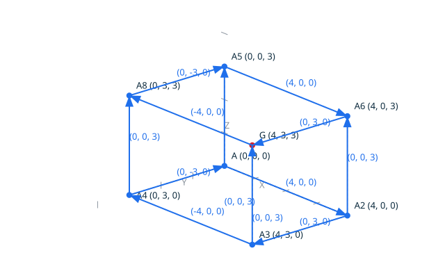
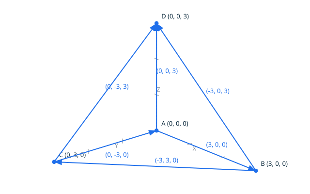
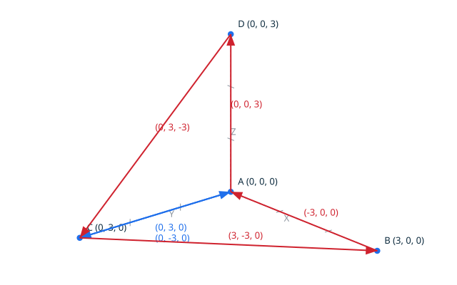

# Solids in three dimensions <!-- omit from toc -->

A solid is the first closed solid of the minimal B-Rep model (DD-005,
decision 5): one closed, paired shell of planar face boundaries, and the
exact signed volume that shell encloses. The volume is exact too: the fan
decomposition of every face, one four-point orientation determinant per
fan triangle, summed over the whole assembly in the 128-bit Volume
domain - six times the enclosed volume, computed with no tolerance and
no approximation, for any closed assembly of the grid.

The sign of the sum decides the two orientation worlds: the faces wind
counter-clockwise seen from outside - the outward orientation, the sum
is positive - or clockwise - the inward one, the sum is negative. Both
make a solid. A closed shell whose volume sum vanishes encloses
nothing: it is never a solid, the flat degeneracy is reported, never
built, the same way a closed backtrack is a valid loop but never a face
boundary (DD-002, decision 3). And a shell that does not close is not a
solid either: the pairing defects are reported the shell way, the
supports left without their opposite in red in the diagrams.

## Contents <!-- omit from toc -->

- [Scenario: the tetrahedron is a solid](#scenario-the-tetrahedron-is-a-solid)
- [Scenario: the box is a solid](#scenario-the-box-is-a-solid)
- [Scenario: an inward tetrahedron is a solid too](#scenario-an-inward-tetrahedron-is-a-solid-too)
- [Scenario: a flat shell is not a solid](#scenario-a-flat-shell-is-not-a-solid)
- [Scenario: a non-closed shell is not a solid](#scenario-a-non-closed-shell-is-not-a-solid)
## Scenario: the tetrahedron is a solid

The tetrahedron of the origin and the three unit axis points, its four
faces oriented outward: every face is planar, every segment is carried
once per direction, the volume sum is positive, and the solid is built.
The diagram draws the skeleton of the six segments and the four
vertices, the apex in red.


- Given the file `tetrahedron_solid.topo`
  ```ada
  A : constant Point_3D := (0, 0, 0);
  B : constant Point_3D := (3, 0, 0);
  C : constant Point_3D := (0, 3, 0);
  D : constant Point_3D := (0, 0, 3);
  HA, HB, HC, HD : Vertex_Handle;
  E1, E2, E3, E4, E5, E6, E7, E8, E9, E10, E11, E12 : Edge_Handle;
  K1, K2, K3, K4 : Face_3D_Kind;
  KS : Solid_3D_Kind;

  Begin_Image (+"../docs/features/images/solids_1.svg");
  Draw_Axes;
  Draw_Edge_3D (A, B, Blue);
  Draw_Edge_3D (B, C, Blue);
  Draw_Edge_3D (C, A, Blue);
  Draw_Edge_3D (A, D, Blue);
  Draw_Edge_3D (B, D, Blue);
  Draw_Edge_3D (C, D, Blue);
  Draw_Named_Point (A, +"A", Blue);
  Draw_Named_Point (B, +"B", Blue);
  Draw_Named_Point (C, +"C", Blue);
  Draw_Named_Point (D, +"D", Red);
  End_Image;

  Create_Vertex_3D (A, HA);
  Create_Vertex_3D (B, HB);
  Create_Vertex_3D (C, HC);
  Create_Vertex_3D (D, HD);
  Create_Edge_3D (HA, HC, E1);
  Create_Edge_3D (HC, HB, E2);
  Create_Edge_3D (HB, HA, E3);
  Make_Face_3D (K1);
  Create_Edge_3D (HA, HD, E4);
  Create_Edge_3D (HD, HC, E5);
  Create_Edge_3D (HC, HA, E6);
  Make_Face_3D (K2);
  Create_Edge_3D (HA, HB, E7);
  Create_Edge_3D (HB, HD, E8);
  Create_Edge_3D (HD, HA, E9);
  Make_Face_3D (K3);
  Create_Edge_3D (HB, HC, E10);
  Create_Edge_3D (HC, HD, E11);
  Create_Edge_3D (HD, HB, E12);
  Make_Face_3D (K4);
  Make_Solid_3D (KS);
  Put_Solid_3D (KS);
  ```
- When I successfully run `../bin/topocli run tetrahedron_solid.topo`
- Then the output is
  ```text
  solid3d outward
  ```
- And the file `../docs/features/images/solids_1.svg` contains `#cf222e`
  (The `#cf222e` value is the red of `Color_Kind`: the check ensures
  the apex D, the vertex that lifts the skeleton into a solid, is
  drawn.)

## Scenario: the box is a solid

The box of the (4, 3, 3) corner, its six faces oriented outward: eight
vertices, twelve segments, each carried once per direction, and the
solid is built.



- Given the file `box_solid.topo`
  ```ada
  A : constant Point_3D := (0, 0, 0);
  B : constant Point_3D := (4, 0, 0);
  C : constant Point_3D := (4, 3, 0);
  D : constant Point_3D := (0, 3, 0);
  E : constant Point_3D := (0, 0, 3);
  F : constant Point_3D := (4, 0, 3);
  G : constant Point_3D := (4, 3, 3);
  H : constant Point_3D := (0, 3, 3);
  HA, HB, HC, HD, HE, HF, HG, HH : Vertex_Handle;
  E1, E2, E3, E4 : Edge_Handle;
  K : Face_3D_Kind;
  KS : Solid_3D_Kind;

  Begin_Image (+"../docs/features/images/solids_2.svg");
  Draw_Axes;
  Draw_Edge_3D (A, B, Blue);
  Draw_Edge_3D (B, C, Blue);
  Draw_Edge_3D (C, D, Blue);
  Draw_Edge_3D (D, A, Blue);
  Draw_Edge_3D (E, F, Blue);
  Draw_Edge_3D (F, G, Blue);
  Draw_Edge_3D (G, H, Blue);
  Draw_Edge_3D (H, E, Blue);
  Draw_Edge_3D (A, E, Blue);
  Draw_Edge_3D (B, F, Blue);
  Draw_Edge_3D (C, G, Blue);
  Draw_Edge_3D (D, H, Blue);
  Draw_Named_Point (A, +"A", Blue);
  Draw_Named_Point (G, +"G", Red);
  End_Image;

  Create_Vertex_3D (A, HA);
  Create_Vertex_3D (B, HB);
  Create_Vertex_3D (C, HC);
  Create_Vertex_3D (D, HD);
  Create_Vertex_3D (E, HE);
  Create_Vertex_3D (F, HF);
  Create_Vertex_3D (G, HG);
  Create_Vertex_3D (H, HH);
  --  The bottom face, then the top face, then the four sides, every
  --  segment carried once per direction, the faces winding
  --  counter-clockwise seen from outside.
  Create_Edge_3D (HD, HC, E1);
  Create_Edge_3D (HC, HB, E2);
  Create_Edge_3D (HB, HA, E3);
  Create_Edge_3D (HA, HD, E4);
  Make_Face_3D (K);
  Create_Edge_3D (HE, HF, E1);
  Create_Edge_3D (HF, HG, E2);
  Create_Edge_3D (HG, HH, E3);
  Create_Edge_3D (HH, HE, E4);
  Make_Face_3D (K);
  Create_Edge_3D (HB, HF, E1);
  Create_Edge_3D (HF, HE, E2);
  Create_Edge_3D (HE, HA, E3);
  Create_Edge_3D (HA, HB, E4);
  Make_Face_3D (K);
  Create_Edge_3D (HB, HC, E1);
  Create_Edge_3D (HC, HG, E2);
  Create_Edge_3D (HG, HF, E3);
  Create_Edge_3D (HF, HB, E4);
  Make_Face_3D (K);
  Create_Edge_3D (HC, HD, E1);
  Create_Edge_3D (HD, HH, E2);
  Create_Edge_3D (HH, HG, E3);
  Create_Edge_3D (HG, HC, E4);
  Make_Face_3D (K);
  Create_Edge_3D (HD, HA, E1);
  Create_Edge_3D (HA, HE, E2);
  Create_Edge_3D (HE, HH, E3);
  Create_Edge_3D (HH, HD, E4);
  Make_Face_3D (K);
  Make_Solid_3D (KS);
  Put_Solid_3D (KS);
  ```
- When I successfully run `../bin/topocli run box_solid.topo`
- Then the output is
  ```text
  solid3d outward
  ```
- And the file `../docs/features/images/solids_2.svg` contains `#cf222e`
  (The `#cf222e` value is the red of `Color_Kind`: the check ensures
  the far top corner of the box, the vertex the skeleton rises to, is
  drawn.)

## Scenario: an inward tetrahedron is a solid too

The same tetrahedron, its four faces traversed the other way around:
the pairing still closes - every segment is carried once per direction,
the other way - the volume sum is negative, and the solid is built
inward. The two orientation worlds are both solids; which one is the
outward normalization of the model is the open question of DD-005. The
diagram draws the same skeleton, the apex in blue this time: the
structure is the mirror one.



- Given the file `inward_tetrahedron_solid.topo`
  ```ada
  A : constant Point_3D := (0, 0, 0);
  B : constant Point_3D := (3, 0, 0);
  C : constant Point_3D := (0, 3, 0);
  D : constant Point_3D := (0, 0, 3);
  HA, HB, HC, HD : Vertex_Handle;
  E1, E2, E3, E4, E5, E6, E7, E8, E9, E10, E11, E12 : Edge_Handle;
  K1, K2, K3, K4 : Face_3D_Kind;
  KS : Solid_3D_Kind;

  Begin_Image (+"../docs/features/images/solids_3.svg");
  Draw_Axes;
  Draw_Edge_3D (A, B, Blue);
  Draw_Edge_3D (B, C, Blue);
  Draw_Edge_3D (C, A, Blue);
  Draw_Edge_3D (A, D, Blue);
  Draw_Edge_3D (B, D, Blue);
  Draw_Edge_3D (C, D, Blue);
  Draw_Named_Point (A, +"A", Blue);
  Draw_Named_Point (B, +"B", Blue);
  Draw_Named_Point (C, +"C", Blue);
  Draw_Named_Point (D, +"D", Blue);
  End_Image;

  Create_Vertex_3D (A, HA);
  Create_Vertex_3D (B, HB);
  Create_Vertex_3D (C, HC);
  Create_Vertex_3D (D, HD);
  Create_Edge_3D (HA, HB, E1);
  Create_Edge_3D (HB, HC, E2);
  Create_Edge_3D (HC, HA, E3);
  Make_Face_3D (K1);
  Create_Edge_3D (HA, HC, E4);
  Create_Edge_3D (HC, HD, E5);
  Create_Edge_3D (HD, HA, E6);
  Make_Face_3D (K2);
  Create_Edge_3D (HA, HD, E7);
  Create_Edge_3D (HD, HB, E8);
  Create_Edge_3D (HB, HA, E9);
  Make_Face_3D (K3);
  Create_Edge_3D (HB, HD, E10);
  Create_Edge_3D (HD, HC, E11);
  Create_Edge_3D (HC, HB, E12);
  Make_Face_3D (K4);
  Make_Solid_3D (KS);
  Put_Solid_3D (KS);
  ```
- When I successfully run `../bin/topocli run inward_tetrahedron_solid.topo`
- Then the output is
  ```text
  solid3d inward
  ```
- And the file `../docs/features/images/solids_3.svg` contains `#1f6feb`
  (The `#1f6feb` value is the blue of `Color_Kind`: the check ensures
  the skeleton of the mirrored solid, the actual subject of the
  scenario, is drawn.)

## Scenario: a flat shell is not a solid

Two mirrored triangles on the Z = 0 plane: every segment is carried
once per direction, the pairing closes, and the volume sum vanishes -
the assembly encloses nothing, and no solid is built.

- Given the file `flat_shell_solid.topo`
  ```ada
  A : constant Point_3D := (0, 0, 0);
  B : constant Point_3D := (3, 0, 0);
  C : constant Point_3D := (0, 3, 0);
  HA, HB, HC : Vertex_Handle;
  E1, E2, E3, E4, E5, E6 : Edge_Handle;
  K1, K2 : Face_3D_Kind;
  KS : Solid_3D_Kind;

  Create_Vertex_3D (A, HA);
  Create_Vertex_3D (B, HB);
  Create_Vertex_3D (C, HC);
  Create_Edge_3D (HA, HB, E1);
  Create_Edge_3D (HB, HC, E2);
  Create_Edge_3D (HC, HA, E3);
  Make_Face_3D (K1);
  Create_Edge_3D (HA, HC, E4);
  Create_Edge_3D (HC, HB, E5);
  Create_Edge_3D (HB, HA, E6);
  Make_Face_3D (K2);
  Make_Solid_3D (KS);
  Put_Solid_3D (KS);
  ```
- When I run `../bin/topocli run flat_shell_solid.topo`
- Then the error output is `error: flat shell`
- And the exit code is `1`

## Scenario: a non-closed shell is not a solid

The tetrahedron without its last face: two faces built, and four of
their supports - C to B, B to A, A to D, D to C - left without their
opposite. The pairing fails the shell way on the first of them, and no
solid is built. The diagram draws the six carried supports: the two
paired ones in blue, the four free ones in red.



- Given the file `open_shell_solid.topo`
  ```ada
  A : constant Point_3D := (0, 0, 0);
  B : constant Point_3D := (3, 0, 0);
  C : constant Point_3D := (0, 3, 0);
  D : constant Point_3D := (0, 0, 3);
  HA, HB, HC, HD : Vertex_Handle;
  E1, E2, E3, E4, E5, E6 : Edge_Handle;
  K1, K2 : Face_3D_Kind;
  KS : Solid_3D_Kind;

  Begin_Image (+"../docs/features/images/solids_4.svg");
  Draw_Axes;
  Draw_Edge_3D (A, C, Blue);
  Draw_Edge_3D (C, A, Blue);
  Draw_Edge_3D (C, B, Red);
  Draw_Edge_3D (B, A, Red);
  Draw_Edge_3D (A, D, Red);
  Draw_Edge_3D (D, C, Red);
  Draw_Named_Point (A, +"A", Blue);
  Draw_Named_Point (B, +"B", Blue);
  Draw_Named_Point (C, +"C", Blue);
  Draw_Named_Point (D, +"D", Blue);
  End_Image;

  Create_Vertex_3D (A, HA);
  Create_Vertex_3D (B, HB);
  Create_Vertex_3D (C, HC);
  Create_Vertex_3D (D, HD);
  Create_Edge_3D (HA, HC, E1);
  Create_Edge_3D (HC, HB, E2);
  Create_Edge_3D (HB, HA, E3);
  Make_Face_3D (K1);
  Create_Edge_3D (HA, HD, E4);
  Create_Edge_3D (HD, HC, E5);
  Create_Edge_3D (HC, HA, E6);
  Make_Face_3D (K2);
  Make_Solid_3D (KS);
  Put_Solid_3D (KS);
  ```
- When I run `../bin/topocli run open_shell_solid.topo`
- Then the error output is `error: an edge has no opposite use (face 1)`
- And the exit code is `1`
- And the file `../docs/features/images/solids_4.svg` contains `#cf222e`
  (The `#cf222e` value is the red of `Color_Kind`: the check ensures
  the four free supports, the actual subject of the scenario, are
  drawn.)
