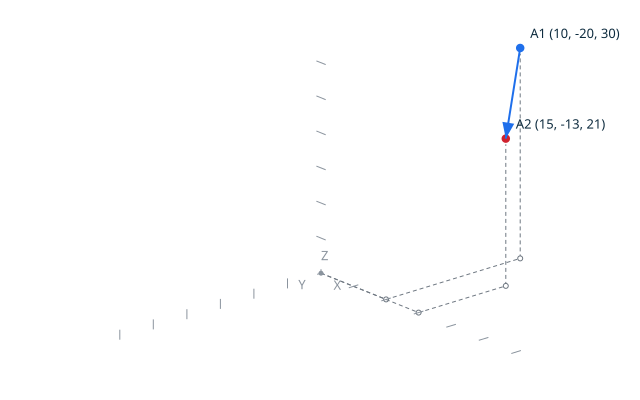

# TopoScript <!-- omit from toc -->

> **Status: implemented (Milestone 6).** `topocli run FILE.topo` executes
> a TopoScript through the embedded HAC interpreter. The scenario blocks
> of this page are run by `make test`, like every feature page under
> `docs/features/`. The arbitration record lives in `DD-003`.

TopoScript is a lightweight Ada-based scripting facility, implemented with
HAC, for two complementary uses: readable executable inputs for bbt
scenarios, and the future language for user macros, modules, and
extensions. TopoScript complements the graphical user interface; it does
not turn TopoProof into an Ada equivalent of OpenSCAD. The HAC interpreter
and its Ada subset are presented in
[Ada and a mini-Ada interpreter, FOSDEM 2025](https://github.com/zertovitch/hac/blob/master/doc/ada_mini_ada_fosdem_2025.pdf).

## Contents <!-- omit from toc -->

- [Source form](#source-form)
- [Observable result and verdict](#observable-result-and-verdict)
- [Output contract](#output-contract)
- [Scripting API](#scripting-api)
- [Standalone scripts](#standalone-scripts)
- [Scenarios](#scenarios)
- [Scenario: translate a point and a vector](#scenario-translate-a-point-and-a-vector)
- [Scenario: reject an unrepresentable translation](#scenario-reject-an-unrepresentable-translation)
- [Scenario: reject a declaration after the first statement](#scenario-reject-a-declaration-after-the-first-statement)
- [Scenario: draw the diagnostic image of the translation](#scenario-draw-the-diagnostic-image-of-the-translation)
- [Scenario: --output receives the canonical result of a script](#scenario---output-receives-the-canonical-result-of-a-script)
- [Scenario: an inline fragment runs without a file](#scenario-an-inline-fragment-runs-without-a-file)
- [Scenario: an inline rejection points at the inline line](#scenario-an-inline-rejection-points-at-the-inline-line)
- [Scenario: an inline run writes to the output file](#scenario-an-inline-run-writes-to-the-output-file)
- [Scenario: an empty fragment executes silently](#scenario-an-empty-fragment-executes-silently)
- [Scenario: a fragment of declarations only executes silently](#scenario-a-fragment-of-declarations-only-executes-silently)
- [Scenario: a compilation diagnostic points at the declaration line](#scenario-a-compilation-diagnostic-points-at-the-declaration-line)
- [Scenario: a declaration split across several lines is rejected cleanly](#scenario-a-declaration-split-across-several-lines-is-rejected-cleanly)
- [Scenario: a declaration form outside the subset is rejected before compilation](#scenario-a-declaration-form-outside-the-subset-is-rejected-before-compilation)
- [Scenario: two consecutive image sessions produce two images](#scenario-two-consecutive-image-sessions-produce-two-images)
- [Scenario: End_Image without Begin_Image records the rejection](#scenario-end_image-without-begin_image-records-the-rejection)
- [Scenario: a chain continues after a rejected operation, the first failure is retained](#scenario-a-chain-continues-after-a-rejected-operation-the-first-failure-is-retained)
- [Diagnostic drawing](#diagnostic-drawing)
- [User macros and extensions](#user-macros-and-extensions)
- [CLI direction](#cli-direction)

## Source form

A TopoScript contains object declarations followed by executable
statements, without compilation-unit boilerplate:

```ada
P      : constant Point_3D := (10, -20, 30);
D      : constant Vector_3D := (5, 7, -9);
Result : Point_3D;

Translate (P, D, Result);

Put (Result);
```

The user does not write:

```ada
with ...;
use ...;

procedure ... is
begin
   ...
end ...;
```

`topocli` generates that wrapper before passing the complete source to
HAC. The scripting API (`Point_3D`, `Vector_3D`, the operations) is
injected before the user declarations: HAC imports native procedures
only, so each operation returns its result through an `out` parameter,
and `Put` writes the canonical representation of its value natively,
the same one as every other script operation.

TopoScript preserves ordinary Ada notation, including:

- `:=` for assignment;
- `=>` for named associations, in aggregates; the calls to the
  scripting operations are positional, like every native operation;
- `;` as the statement terminator;
- `--` for comments;
- explicit types and constants;
- the control structures supported by the selected HAC subset.

Declarations must precede executable statements: a declaration appearing
after the first executable statement is rejected before any compilation,
and so are the declaration forms the initial subset does not cover.

## Observable result and verdict

The script computes the actual result and writes its canonical textual
representation:

```ada
Put (Result);
```

The scenario retains the expected value. This separation is mandatory:

- TopoScript defines the input and performs the operation;
- `Put` exposes the actual observable result;
- the bbt scenario defines the expected result;
- bbt compares actual and expected values and determines the verdict.

TopoScript introduces no parallel assertion framework such as `Check.Equal`
for these scenarios.

## Output contract

Script execution preserves a stable separation between outputs:

- standard output contains the canonical value inspected by bbt; with
  `--output FILE`, the file receives every canonical line of the run
  instead: it is created at the first line and closed at the end of the
  run, with the same accumulation semantics as the command form
  (DD-004, decision 8);
- standard error contains diagnostics and execution errors;
- the process status reports successful or failed execution.

Diagnostic messages must not pollute the canonical value written to
standard output. Compilation diagnostics refer to the fragment: the
path, the line and the column are the ones of the `.topo` source, not
of the generated wrapper.

## Scripting API

The wrapper injects the following declarations ahead of every
fragment. They are the initial stable scripting API of the milestone;
the compatibility-versioning question stays open in `DD-003`.

Types:

| type | values |
|------|--------|
| `Point_3D`, `Vector_3D`, `Point_2D` | grid values, built from integer aggregates |
| `Color_Kind` | `Blue`, `Green`, `Red` |
| `Equal_Kind` | `Equal_True`, `Equal_False` |
| `Orientation_Kind` | `Orientation_Collinear`, `Orientation_Counter_Clockwise`, `Orientation_Clockwise` (prefixed: HAC does not overload enumeration literals) |
| `Intersection_Kind` | `No_Intersection`, `Point_Intersection`, `Off_Grid_Crossing`, `Overlap` |
| `Intersection_Result` | the intersection kind, with the reported positions |
| `Loop_Kind` | `Counter_Clockwise`, `Clockwise`, `Degenerate`, or the kernel rejection kinds |
| `Face_Kind` | `Face_Counter_Clockwise`, `Face_Clockwise`, `Face_Degenerate_Boundary`, `Face_Invalid_Boundary` |
| `Continuity_Kind` | `Continuous`, `Discontinuous` |
| `Closure_Kind` | `Closed`, `Open` |
| `Contour_Orientation_Kind` | `Contour_Counter_Clockwise`, `Contour_Clockwise`, `Contour_Degenerate` (prefixed: HAC does not overload enumeration literals) |
| `Bool_Kind` | `Bool_True`, `Bool_False` |
| `Vertex_Handle`, `Edge_Handle` | the observable handles of the created vertices and edges, valid for the whole run |

Operations:

| operation | effect |
|-----------|--------|
| `Translate (P, V, Result)` | runs the proved `Translate` on the point `P` and the vector `V` |
| `Displacement (A, B, Result)` | computes the exact vector from `A` to `B` |
| `Equal (A, B, Result)` | compares two points exactly, through `Equal_True` / `Equal_False` |
| `Orientation (A, B, C, Result)` | classifies the 2D path `A -> B -> C` exactly |
| `Intersection (A, B, C, D, Result)` | classifies the exact intersection of the segments `A -> B` and `C -> D`, with the reported positions |
| `Put (P)` | writes `point X Y Z` on standard output |
| `Put_Vector (D)` | writes `vector DX DY DZ` on standard output |
| `Put_Equal (K)` | writes `equal true` or `equal false` on standard output |
| `Put_Orientation (K)` | writes `orientation ...` on standard output |
| `Put_Intersection (R)` | writes the intersection line of `R` on standard output |
| `Add_Point (P)` | appends a 2D point to the chain |
| `Make_Loop (K)` | classifies the accumulated chain as a loop, the kernel classification |
| `Make_Face (K)` | classifies the same chain as a face boundary |
| `Make_Loop_From_Edges (K)` | classifies the edges created by `Create_Edge`, in creation order, as a loop: the handles carry the vertex identity, so the support degeneracy is judged at loop level |
| `Contour_Continuity (K)` | classifies the chain read as segment pairs: `Continuous` when the endpoint of each segment equals the start point of the next |
| `Contour_Closure (K)` | classifies whether the chain is closed, the kernel `Is_Closed` |
| `Contour_Orientation (K)` | classifies the closed, valid chain by the sign of its signed area, with the client pre-check diagnostics |
| `Contour_Self_Intersects (B)` | classifies whether the chain self-intersects, the kernel classification |
| `Contour_Valid (B)` | classifies the geometric validity of the chain, the kernel `Is_Valid` |
| `Contour_No_Flat_Turns (B)` | classifies the absence of flat turns, the kernel `Has_No_Flat_Turns` |
| `Create_Vertex (P, H)` | creates one vertex referring to the point `P` in the store of the run, and returns its handle |
| `Create_Edge (A, B, E)` | creates one oriented edge between the vertex handles `A` and `B`, and returns its handle |
| `Put_Vertex (H)` | writes `vertex H point X Y`, the trace of the created vertex |
| `Put_Edge (E)` | writes `edge E vertex A vertex B`, the trace of the created edge |
| `Put_Loop (K)` | writes `loop closed ...`, or records the rejection diagnostic |
| `Put_Face (K)` | writes `face ...`, or records the rejection diagnostic |
| `Put_Continuity (K)` | writes `continuity continuous` or `continuity discontinuous` on standard output |
| `Put_Closure (K)` | writes `closure closed` or `closure open` on standard output |
| `Put_Contour_Orientation (K)` | writes `orientation counter_clockwise`, `orientation clockwise` or `orientation degenerate` on standard output |
| `Put_Bool (B)` | writes `true` or `false` on standard output |
| `Begin_Image (Name)` | opens one image under the `VString` name |
| `Draw_Axes` | axes with automatic ticks and dashed coordinate paths |
| `Draw_Point (P, Color)` | colors a 3D point of the image |
| `Draw_Vector (Origin, Value, Color)` | draws the labeled arrow of the vector |
| `Draw_Point_2D (P, Color)` | colors a 2D point of the image |
| `Draw_Edge (P, Q, Color)` | draws the labeled segment arrow from `P` to `Q` |
| `Draw_Segment_2D (P, Q, Color)` | draws the plain 2D segment from `P` to `Q`, without label |
| `End_Image` | renders the image through the topodraw renderer |

The rejected operations record the same diagnostics as the client
operations, on standard error, and the process status carries the
verdict.

## Standalone scripts

The scenarios of this page are one use of TopoScript; any `.topo`
fragment runs the same way outside the test suite:

```text
topocli run FILE.topo
```

The output contract holds identically: the canonical values go to
standard output, the diagnostics to standard error with the fragment
path, line and column, and the process status carries the verdict.

A short script also runs inline, without a file:

```text
topocli run_code "P : constant Point_3D := (10, -20, 30); Put (P);"
```

The fragment is the rest of the command line, every argument joined
back with spaces, so it is usually passed as one double-quoted
argument, and a shell or a runner that hands it over split on its
spaces changes nothing: the join restores it, and the same command
line runs on every platform. The `--output FILE` pair is extracted on
the way. The fragment is split into lines at every semicolon:
the wrapper line rules apply unchanged, the declarations precede the
statements, and the diagnostics point at the inline lines under the
`<inline>` name. A fragment comment may not carry a semicolon, since
the split does not look inside comments.

## Scenarios

The scenario embeds the TopoScript in a `Given` step: the temporary
`.topo` file is an execution artefact produced by bbt, not a separately
maintained test source. The fragment terminators are covered by
construction: the wrapper accepts a fragment with or without a final
line feed, and the Windows runners materialise every block with CRLF
line endings, so both terminator forms stay exercised by the whole
suite.

## Scenario: an empty fragment executes silently

- Given the file `empty.topo`
  ```text
  ```
- When I successfully run `../bin/topocli run empty.topo`
- Then the output is
  ```text
  ```

## Scenario: a fragment of declarations only executes silently

- Given the file `declarations_only.topo`
  ```ada
  P : constant Point_3D := (10, -20, 30);
  D : constant Vector_3D := (5, 7, -9);
  ```
- When I successfully run `../bin/topocli run declarations_only.topo`
- Then the output is
  ```text
  ```

## Scenario: a compilation diagnostic points at the declaration line

The diagnostics of the generated wrapper are mapped back to the
fragment: the error on the first declaration line is reported on
fragment line 1, not on a wrapper line.

- Given the file `bad_declaration.topo`
  ```ada
  P : constant Point_3D := Q;
  R : constant Point_3D := (4, 5, 6);

  Put (R);
  ```
- When I run `../bin/topocli run bad_declaration.topo`
- Then the error output contains `bad_declaration.topo:1:`
- And there is an error

## Scenario: a declaration split across several lines is rejected cleanly

The line-based classifier of the wrapper rejects the bare identifier
with the fragment location, instead of letting the fragment reach the
compilation with a confusing message.

- Given the file `split_declaration.topo`
  ```ada
  P
     : constant Point_3D := (1, 2, 3);
  ```
- When I run `../bin/topocli run split_declaration.topo`
- Then the error output is
  ```text
  error: split_declaration.topo:1: a bare identifier is neither a complete object declaration nor a statement: the initial subset rejects a declaration split across several lines
  ```
- And there is an error

## Scenario: a declaration form outside the subset is rejected before compilation

- Given the file `out_of_subset.topo`
  ```ada
  type Color is (Red);
  ```
- When I run `../bin/topocli run out_of_subset.topo`
- Then the error output is
  ```text
  error: out_of_subset.topo:1: the initial TopoScript subset accepts object declarations and statements only
  ```
- And there is an error

## Scenario: two consecutive image sessions produce two images

- Given the file `two_images.topo`
  ```ada
  A  : constant Point_3D := (1, 2, 3);
  B  : constant Point_3D := (4, 5, 6);

  Begin_Image (+"../docs/features/images/toposcript_2.svg");
  Draw_Axes;
  Draw_Point (A, Blue);
  End_Image;

  Begin_Image (+"../docs/features/images/toposcript_3.svg");
  Draw_Axes;
  Draw_Point (B, Green);
  End_Image;
  ```
- When I successfully run `../bin/topocli run two_images.topo`
- Then the file `../docs/features/images/toposcript_2.svg` contains `#1f6feb`  
  (The `#1f6feb` value is the blue of `Color_Kind`: the check ensures
  the point `A` of the first image is drawn.)
- And the file `../docs/features/images/toposcript_3.svg` contains `#1a7f37`  
  (The `#1a7f37` value is the green of `Color_Kind`: the check ensures
  the point `B` of the second image is drawn.)

## Scenario: End_Image without Begin_Image records the rejection

- Given the file `no_image.topo`
  ```ada
  End_Image;
  ```
- When I run `../bin/topocli run no_image.topo`
- Then the error output is `error: no open image`
- And there is an error

## Scenario: a chain continues after a rejected operation, the first failure is retained

The one-point chain is rejected as an open loop, and the diagnostic is
retained; the script runs on, and the later successful operation writes
its canonical result: the first rejection is never masked.

- Given the file `first_failure.topo`
  ```ada
  A : constant Point_2D := (0, 0);
  K : Loop_Kind;
  P : constant Point_3D := (10, -20, 30);
  D : constant Vector_3D := (5, 7, -9);
  R : Point_3D;

  Add_Point (A);
  Make_Loop (K);
  Translate (P, D, R);
  Put (R);
  ```
- When I run `../bin/topocli run first_failure.topo`
- Then the output is `point 15 -13 21`
- And the error output is `error: open loop`
- And there is an error

## Scenario: translate a point and a vector

- Given the file `translate.topo`
  ```ada
  P      : constant Point_3D := (10, -20, 30);
  D      : constant Vector_3D := (5, 7, -9);
  Result : Point_3D;

  Translate (P, D, Result);

  Put (Result);
  ```
- When I successfully run `../bin/topocli run translate.topo`
- Then the output is `point 15 -13 21`

## Scenario: reject an unrepresentable translation

The point starts on the corner of the grid; the translation would move
it one unit beyond the largest representable position.

- Given the file `translate_beyond.topo`
  ```ada
  P      : constant Point_3D := (1073741823, 0, 0);
  D      : constant Vector_3D := (1, 0, 0);
  Result : Point_3D;

  Translate (P, D, Result);

  Put (Result);
  ```
- When I run `../bin/topocli run translate_beyond.topo`
- Then the error output is `error: translation is not representable`
- And there is an error

## Scenario: reject a declaration after the first statement

The wrapper rejects the fragment before any compilation: declarations
must precede the executable statements.

- Given the file `late_declaration.topo`
  ```ada
  P : constant Point_3D := (10, -20, 30);

  Put (P);

  Q : Point_3D;
  ```
- When I run `../bin/topocli run late_declaration.topo`
- Then the error output is
  ```text
  error: late_declaration.topo:5: declaration after the first executable statement
  ```
- And there is an error

## Scenario: draw the diagnostic image of the translation

The script draws one image containing the axes, the input geometry
(`P`, blue), the expected result (`Expected`, green) and the actual
result (`Result`, red on the same position): a failure is immediately
visible. The image is a generated file: the canonical standard output
carries the result only.

- Given the file `translate_draw.topo`
  ```ada
  P        : constant Point_3D := (10, -20, 30);
  D        : constant Vector_3D := (5, 7, -9);
  Expected : constant Point_3D := (15, -13, 21);
  Result   : Point_3D;

  Begin_Image (+"../docs/features/images/toposcript_1.svg");
  Draw_Axes;
  Draw_Point (P, Blue);
  Draw_Vector (P, D, Blue);
  Draw_Point (Expected, Green);

  Translate (P, D, Result);

  Draw_Point (Result, Red);
  End_Image;

  Put (Result);
  ```
- When I successfully run `../bin/topocli run translate_draw.topo`
- Then the output is `point 15 -13 21`
- And the file `../docs/features/images/toposcript_1.svg` contains `#cf222e`  
  (The `#cf222e` value is the red of `Color_Kind`: the check ensures the
  actual result point, the target of the scenario, is drawn red.)



## Scenario: --output receives the canonical result of a script

With `--output FILE`, every canonical line of the run goes to the file,
and the standard output stays empty.

- Given the file `translate_output.topo`
  ```ada
  P      : constant Point_3D := (10, -20, 30);
  D      : constant Vector_3D := (5, 7, -9);
  Result : Point_3D;

  Translate (P, D, Result);

  Put (Result);
  ```
- When I successfully run `../bin/topocli run translate_output.topo --output result.out`
- Then the output is
  ```text
  ```
- And the file `result.out` is `point 15 -13 21`

## Scenario: an inline fragment runs without a file

The fragment is one quoted argument, split into lines at every
semicolon: the whole script fits a single command line, the same one
on every runner.

- When I successfully run `../bin/topocli run_code "P : constant Point_3D := (10, -20, 30); D : constant Vector_3D := (5, 7, -9); Result : Point_3D; Translate (P, D, Result); Put (Result);"`
- Then the output is `point 15 -13 21`

## Scenario: an inline rejection points at the inline line

Each semicolon ends an inline line: the late declaration sits on the
third one, and the diagnostic carries the `<inline>` name and its
line.

- When I run `../bin/topocli run_code "P : constant Point_3D := (10, -20, 30); Put (P); Q : Point_3D;"`
- Then the error output is `error: <inline>:3: declaration after the first executable statement`
- And there is an error

## Scenario: an inline run writes to the output file

The inline entry owns the same option as the file entry.

- When I successfully run `../bin/topocli run_code "A : constant Point_2D := (0, 0); B : constant Point_2D := (2, 0); K : Continuity_Kind; Add_Point (A); Add_Point (B); Add_Point (B); Add_Point (A); Contour_Continuity (K); Put_Continuity (K);" --output inline.out`
- Then the output is
  ```text
  ```
- And the file `inline.out` is `continuity continuous`

## Diagnostic drawing

A script generates one diagnostic image through the drawing API,
rendered by the topodraw renderer:

```ada
P        : constant Point_3D := (10, -20, 30);
D        : constant Vector_3D := (5, 7, -9);
Expected : constant Point_3D := (15, -13, 21);
Result   : Point_3D;

Begin_Image (+"translation.svg");
Draw_Axes;
Draw_Point (P, Blue);
Draw_Vector (P, D, Blue);
Draw_Point (Expected, Green);

Translate (P, D, Result);

Draw_Point (Result, Red);
End_Image;

Put (Result);
```

In this example, `Expected` is used only to explain the scenario visually. It
does not determine the test verdict; the expected textual result remains in
the bbt `Then` step. The image name is a `VString`: the `+` operator of HAT
turns the literal into the `VString` of the call, and the calls to the
operations are positional. The 2D chain scenarios draw through
`Draw_Point_2D` and `Draw_Edge`, the labeled segment arrows of the client
diagrams.

## User macros and extensions

The same TopoScript language should later be usable in standalone `.topo`
files for user automation:

```ada
P : Shape;

P := Box (100, 50, 20);
P := Fillet (P, Radius => 5);
Model.Add (P);
```

The example above is illustrative: `Shape`, `Box`, `Fillet`, and `Model` do
not exist yet. The first implementation avoids designing GUI metadata or a
complete plugin lifecycle; those concerns can be added after script execution
and the scripting API are stable.

## CLI direction

The script entries are:

```text
topocli run FILE.topo [--output FILE]
topocli run_code "FRAGMENT" [--output FILE]
```

Useful diagnostic options may later include:

```text
topocli run FILE.topo --show-generated-source
topocli check FILE.topo
```

These options are suggestions, not requirements for the next increments.
