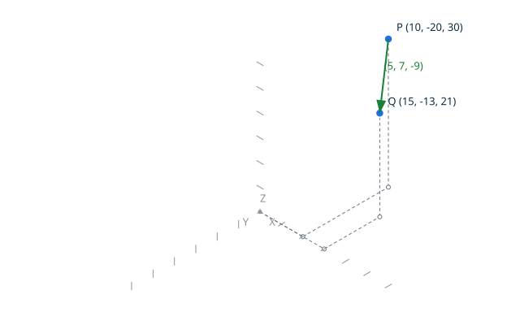
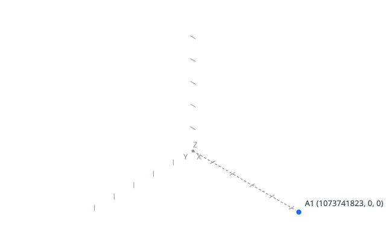

# Translation <!-- omit from toc -->

`Translate` applies an exact displacement to a point, the proved
`Translate` of the kernel. The canonical result is `point X Y Z`,
written by the explicit `Put`.



## Contents <!-- omit from toc -->

- [Scenario: translate a point by a vector](#scenario-translate-a-point-by-a-vector)
- [Scenario: reject an unrepresentable result](#scenario-reject-an-unrepresentable-result)
- [Scenario: write the result to a file](#scenario-write-the-result-to-a-file)
- [Proved property](#proved-property)
- [Scenario: translation and displacement compose to the identity](#scenario-translation-and-displacement-compose-to-the-identity)

## Scenario: translate a point by a vector

The script draws the input point and the displacement vector, then
writes the canonical result. The result point, the actual result of
the operation, is drawn in red.

- Given the file `translate.topo`
  ```ada
  P      : constant Point_3D := (10, -20, 30);
  D      : constant Vector_3D := (5, 7, -9);
  Result : Point_3D;

  Begin_Image (+"../docs/features/images/translation_1.svg");
  Draw_Axes;
  Draw_Point (P, Blue);
  Draw_Vector (P, D, Blue);

  Translate (P, D, Result);

  Draw_Point (Result, Red);
  End_Image;

  Put (Result);
  ```
- When I successfully run `../bin/topocli run translate.topo`
- Then the output is `point 15 -13 21`
- And the file `../docs/features/images/translation_1.svg` contains `#cf222e`  
  (The `#cf222e` value is the red of `Color_Kind`: the check ensures
  the result point, the actual result of the scenario, is drawn red.)

## Scenario: reject an unrepresentable result

The point starts on the corner of the grid; the translation would move it
one unit beyond the largest representable position. The script draws the
corner point only: the vector would leave the grid, and the translated
point does not exist, so the image shows the point at the tip of the
representable grid and nothing else.



- Given the file `translate_beyond.topo`
  ```ada
  P      : constant Point_3D := (1073741823, 0, 0);
  D      : constant Vector_3D := (1, 0, 0);
  Result : Point_3D;

  Begin_Image (+"../docs/features/images/translation_2.svg");
  Draw_Axes;
  Draw_Point (P, Blue);
  End_Image;

  Translate (P, D, Result);
  ```
- When I run `../bin/topocli run translate_beyond.topo`
- Then the error output is `error: translation is not representable`
- And the exit code is `1`
- And the file `../docs/features/images/translation_2.svg` contains `#1f6feb`  
  (The `#1f6feb` value is the blue of `Color_Kind`: the check ensures
  the corner point `P` is drawn, at the tip of the representable grid.)

## Scenario: write the result to a file

With `--output FILE`, the canonical result of the run goes to the file,
and the standard output stays empty.

- Given the file `translate_output.topo`
  ```ada
  P      : constant Point_3D := (1, 2, 3);
  D      : constant Vector_3D := (4, 5, 6);
  Result : Point_3D;

  Translate (P, D, Result);

  Put (Result);
  ```
- When I successfully run `../bin/topocli run translate_output.topo --output translation.out`
- Then the output is
  ```text
  ```
- And the file `translation.out` is `point 5 7 9`

## Proved property

`Translate (A, Displacement (A, B)) = B` is proved by SPARK over the whole
grid domain by the ghost procedure `Translations.Lemma_Translate_Displacement`.
The composed translation is always representable, for any two points of the
model.

## Scenario: translation and displacement compose to the identity

The geometry of the first scenario: one script computes the displacement
from `A` to `B`, then applies it to `A`, and the composed translation
rebuilds `B`.


- Given the file `compose.topo`
  ```ada
  A : constant Point_3D := (10, -20, 30);
  B : constant Point_3D := (15, -13, 21);
  D : Vector_3D;
  Q : Point_3D;

  Displacement (A, B, D);
  Put_Vector (D);

  Translate (A, D, Q);
  Put (Q);
  ```
- When I successfully run `../bin/topocli run compose.topo`
- Then the output is
  ```text
  vector 5 7 -9
  point 15 -13 21
  ```
