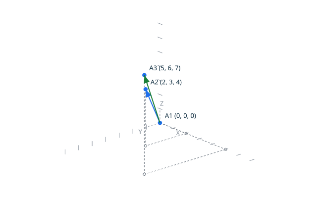
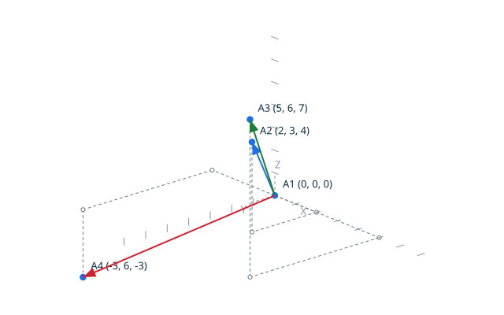

# Vectors <!-- omit from toc -->

The vector operations compute the exact products of two grid vectors, the
proved `Dot_Product` and `Cross_Product` of the kernel. A component of a
dot or cross result is exact, and never rounded: the results may leave the
grid amplitude, and the operations return them as they are.



## Contents <!-- omit from toc -->

- [Scenario: the dot product of two vectors](#scenario-the-dot-product-of-two-vectors)
- [Scenario: the cross product of two vectors](#scenario-the-cross-product-of-two-vectors)
- [Scenario: the exact results leave the grid amplitude](#scenario-the-exact-results-leave-the-grid-amplitude)

## Scenario: the dot product of two vectors

The dot product of the two vectors is the exact sum of the three exact
component products. The script draws the two operands, then writes the
canonical result.

- Given the file `dot_product.topo`
  ```ada
  O : constant Point_3D := (0, 0, 0);
  A : constant Vector_3D := (2, 3, 4);
  B : constant Vector_3D := (5, 6, 7);
  D : Integer;

  Begin_Image (+"../docs/features/images/vectors_1.svg");
  Draw_Axes;
  Draw_Vector (O, A, Blue);
  Draw_Vector (O, B, Green);
  End_Image;

  Dot_Product (A, B, D);

  Put_Dot (D);
  ```
- When I successfully run `../bin/topocli run dot_product.topo`
- Then the output is `dot 56`


## Scenario: the cross product of two vectors

The cross product of the two vectors is the exact vector of the three
component product differences. It is orthogonal to both operands, and its
orientation follows the right-hand rule. The script draws the two operands
and the cross vector, the actual result of the operation, drawn in red.

- Given the file `cross_product.topo`
  ```ada
  O : constant Point_3D := (0, 0, 0);
  A : constant Vector_3D := (2, 3, 4);
  B : constant Vector_3D := (5, 6, 7);
  V : Vector_3D;

  Cross_Product (A, B, V);

  Begin_Image (+"../docs/features/images/cross_product_1.svg");
  Draw_Axes;
  Draw_Vector (O, A, Blue);
  Draw_Vector (O, B, Green);
  Draw_Vector (O, V, Red);
  End_Image;

  Put_Cross_Vector (V);
  ```
- When I successfully run `../bin/topocli run cross_product.topo`
- Then the output is `cross -3 6 -3`
- And the file `../docs/features/images/cross_product_1.svg` contains `#cf222e`
  (The `#cf222e` value is the red of `Color_Kind`: the check ensures the
  cross vector, the actual result of the scenario, is drawn red.)



## Scenario: the exact results leave the grid amplitude

The dot and cross results are exact, beyond the grid amplitude of the
coordinates and components: a scenario computes a cross product of
2500000000, far beyond the largest grid coordinate, without any overflow
and without any approximation. The result is far too large to be drawn to
scale next to its operands, so this scenario has no image: the exact
output line is the evidence.

- Given the file `cross_amplitude.topo`
  ```ada
  A : constant Vector_3D := (50000, 0, 0);
  B : constant Vector_3D := (0, 50000, 0);
  V : Vector_3D;

  Cross_Product (A, B, V);

  Put_Cross_Vector (V);
  ```
- When I successfully run `../bin/topocli run cross_amplitude.topo`
- Then the output is `cross 0 0 2500000000`
