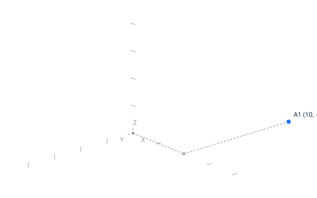

# Vertices <!-- omit from toc -->

`Create_Vertex` creates topological vertices from 2D points, the proved
`Create` of the kernel. Each creation returns an observable handle, and the
canonical trace of creating a vertex at `(10, -20)` is
`vertex 1 point 10 -20`, written by the explicit `Put_Vertex`.

A vertex is a topological entity: it has its own identity, distinct from its
geometric point (see `docs/terminology.md`). Two vertices at the same point
remain distinct: identity is not position (design decision DD-002). In a
script, identity is the handle: two `Create_Vertex` calls return two
distinct handles, even at the same point, and the same handle designates the
same vertex for the whole run.



## Contents <!-- omit from toc -->

- [Scenario: create a vertex from a point](#scenario-create-a-vertex-from-a-point)
- [Scenario: two vertices at the same point are distinct](#scenario-two-vertices-at-the-same-point-are-distinct)
- [Scenario: vertices are numbered in creation order](#scenario-vertices-are-numbered-in-creation-order)
- [Move](#move)
  - [Scenario: move a vertex to an exact translated point](#scenario-move-a-vertex-to-an-exact-translated-point)
  - [Scenario: a move beyond the grid has no point](#scenario-a-move-beyond-the-grid-has-no-point)
- [Proved property](#proved-property)

## Scenario: create a vertex from a point

- Given the file `create_vertex.topo`
  ```ada
  P    : constant Point_2D := (10, -20);
  V    : Vertex_Handle;

  Begin_Image (+"../docs/features/images/vertices_1.svg");
  Draw_Axes;
  Draw_Named_Point_2D (P, +"P", Blue);
  End_Image;

  Create_Vertex (P, V);

  Put_Vertex (V);
  ```
- When I successfully run `../bin/topocli run create_vertex.topo`
- Then the output is `vertex 1 point 10 -20`
- And the file `../docs/features/images/vertices_1.svg` contains `#1f6feb`  
  (The `#1f6feb` value is the blue of `Color_Kind`: the check ensures
  the point of the vertex is drawn, at the position the trace
  reports.)

## Scenario: two vertices at the same point are distinct

Creating two vertices at the same point allocates two handles: no merging
ever happens in `Create_Vertex`.

- Given the file `same_point_vertices.topo`
  ```ada
  P : constant Point_2D := (1, 2);
  V : Vertex_Handle;
  W : Vertex_Handle;

  Create_Vertex (P, V);
  Put_Vertex (V);

  Create_Vertex (P, W);
  Put_Vertex (W);
  ```
- When I successfully run `../bin/topocli run same_point_vertices.topo`
- Then the output is
  ```text
  vertex 1 point 1 2
  vertex 2 point 1 2
  ```

## Scenario: vertices are numbered in creation order

- Given the file `creation_order.topo`
  ```ada
  A : constant Point_2D := (0, 0);
  B : constant Point_2D := (5, 5);
  C : constant Point_2D := (-5, 3);
  V : Vertex_Handle;

  Create_Vertex (A, V);
  Put_Vertex (V);

  Create_Vertex (B, V);
  Put_Vertex (V);

  Create_Vertex (C, V);
  Put_Vertex (V);
  ```
- When I successfully run `../bin/topocli run creation_order.topo`
- Then the output is
  ```text
  vertex 1 point 0 0
  vertex 2 point 5 5
  vertex 3 point -5 3
  ```

## Move

`Move_Vertex (V, DX, DY, Q)` replaces the point of an existing vertex by
its exact translation by the displacement `(DX, DY)`, and writes the
moved point into `Q`: the delivered result makes the move observable, the
caller never recomputes a position. The identity of the vertex stays: the
handle designates the same vertex, so the edges, loops and faces referring
to it keep designating it at the new position — no handle is created,
none is merged, none is invalidated (DD-002, identity is not position).

The moved point must stay on the grid. A move beyond the grid has no
point: like the unrepresentable translation, it is a rejected run with the
observable contract of the kernel rejections — the diagnostic on standard
error, the exit code 1, and nothing delivered.

The diagram of the move scenario draws the starting point in blue and the
moved point in red, the moved point being the kernel-reported `out` value.

### Scenario: move a vertex to an exact translated point

- Given the file `move_vertex.topo`
  ```ada
  P : constant Point_2D := (10, -20);
  V : Vertex_Handle;
  Q : Point_2D;

  Begin_Image (+"../docs/features/images/vertices_move_1.svg");
  Draw_Axes;
  Draw_Named_Point_2D (P, +"Before", Blue);
  End_Image;

  Create_Vertex (P, V);
  Move_Vertex (V, 5, 7, Q);
  Put_Vertex (V);

  Begin_Image (+"../docs/features/images/vertices_move_1.svg");
  Draw_Axes;
  Draw_Named_Point_2D (P, +"Before", Blue);
  Draw_Named_Point_2D (Q, +"Moved", Red);
  End_Image;
  ```
- When I successfully run `../bin/topocli run move_vertex.topo`
- Then the output is `vertex 1 point 15 -13`
- And the file `../docs/features/images/vertices_move_1.svg` contains `#cf222e`  \
  (The `#cf222e` value is the red of `Color_Kind`: the check ensures the
  moved point, the actual result of the scenario, is drawn red at the
  position the trace reports.)
- And the file `../docs/features/images/vertices_move_1.svg` contains `#1f6feb`  \
  (The `#1f6feb` value is the blue of `Color_Kind`: the check ensures the
  starting point is drawn.)

### Scenario: a move beyond the grid has no point

The point starts on the corner of the grid; the move would take it one
unit beyond the largest representable position. The image draws the
starting point only: the moved point does not exist.

- Given the file `move_beyond.topo`
  ```ada
  P : constant Point_2D := (1073741823, 0);
  V : Vertex_Handle;
  Q : Point_2D;

  Create_Vertex (P, V);
  Move_Vertex (V, 1, 0, Q);
  ```
- When I run `../bin/topocli run move_beyond.topo`
- Then the error output is `error: the vertex move is not representable`
- And the exit code is `1`

## Proved property

Reference validity is preserved by construction: `Create` allocates the next
handle of a store that never removes vertices, so every previously stored
vertex keeps its handle and its point. The SPARK postcondition of
`Vertices.Create` states that the new handle is contained in the store, that
its point is the given one, and that every existing vertex is unchanged; it is
proved by GNATprove over the whole domain, as is the absence of run-time
errors of every operation of the unit.
