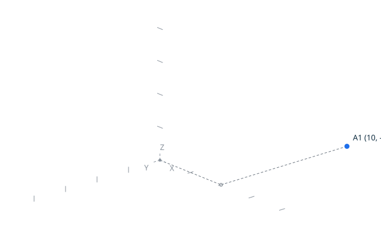

# Vertices <!-- omit from toc -->

`Create_Vertex` creates topological vertices from 2D points, the proved
`Create` of the kernel. Each creation returns an observable handle, and the
canonical trace of creating a vertex at `(10, -20)` is
`vertex 1 point 10 -20`, written by the explicit `Put_Vertex`.

A vertex is a topological entity: it has its own identity, distinct from its
geometric point (see `docs/terminology.md`). Two vertices at the same point
remain distinct: identity is not position (design decision DD-002). In a
script, identity is the handle: two `Create_Vertex` calls return two
distinct handles, even at the same point, and the same handle designates the
same vertex for the whole run.



## Contents <!-- omit from toc -->

- [Scenario: create a vertex from a point](#scenario-create-a-vertex-from-a-point)
- [Scenario: two vertices at the same point are distinct](#scenario-two-vertices-at-the-same-point-are-distinct)
- [Scenario: vertices are numbered in creation order](#scenario-vertices-are-numbered-in-creation-order)
- [Proved property](#proved-property)

## Scenario: create a vertex from a point

- Given the file `create_vertex.topo`
  ```ada
  P    : constant Point_2D := (10, -20);
  V    : Vertex_Handle;
  Name : VString := +"../docs/features/images/vertices_1.svg";

  Begin_Image (Name);
  Draw_Axes;
  Draw_Point_2D (P, Blue);
  End_Image;

  Create_Vertex (P, V);

  Put_Vertex (V);
  ```
- When I successfully run `../bin/topocli run create_vertex.topo`
- Then the output is `vertex 1 point 10 -20`
- And the file `../docs/features/images/vertices_1.svg` contains `#1f6feb`  
  (The `#1f6feb` value is the blue of `Color_Kind`: the check ensures
  the point of the vertex is drawn, at the position the trace
  reports.)

## Scenario: two vertices at the same point are distinct

Creating two vertices at the same point allocates two handles: no merging
ever happens in `Create_Vertex`.

- Given the file `same_point_vertices.topo`
  ```ada
  P : constant Point_2D := (1, 2);
  V : Vertex_Handle;
  W : Vertex_Handle;

  Create_Vertex (P, V);
  Put_Vertex (V);

  Create_Vertex (P, W);
  Put_Vertex (W);
  ```
- When I successfully run `../bin/topocli run same_point_vertices.topo`
- Then the output is
  ```text
  vertex 1 point 1 2
  vertex 2 point 1 2
  ```

## Scenario: vertices are numbered in creation order

- Given the file `creation_order.topo`
  ```ada
  A : constant Point_2D := (0, 0);
  B : constant Point_2D := (5, 5);
  C : constant Point_2D := (-5, 3);
  V : Vertex_Handle;

  Create_Vertex (A, V);
  Put_Vertex (V);

  Create_Vertex (B, V);
  Put_Vertex (V);

  Create_Vertex (C, V);
  Put_Vertex (V);
  ```
- When I successfully run `../bin/topocli run creation_order.topo`
- Then the output is
  ```text
  vertex 1 point 0 0
  vertex 2 point 5 5
  vertex 3 point -5 3
  ```

## Proved property

Reference validity is preserved by construction: `Create` allocates the next
handle of a store that never removes vertices, so every previously stored
vertex keeps its handle and its point. The SPARK postcondition of
`Vertices.Create` states that the new handle is contained in the store, that
its point is the given one, and that every existing vertex is unchanged; it is
proved by GNATprove over the whole domain, as is the absence of run-time
errors of every operation of the unit.
