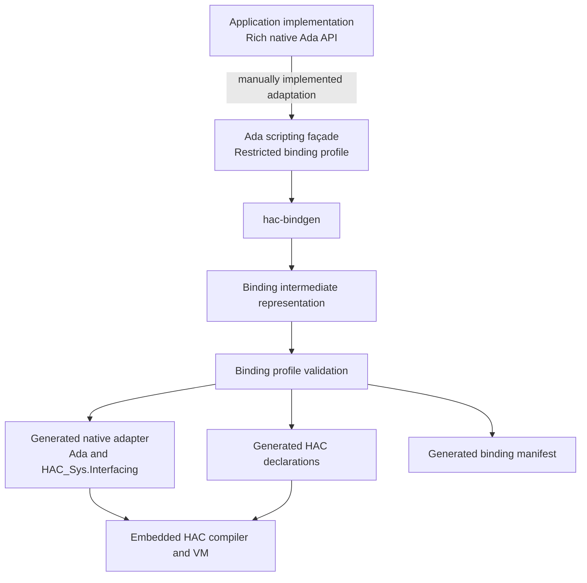
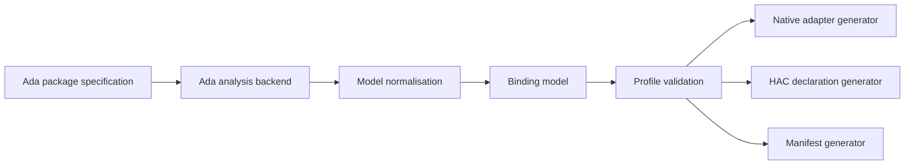
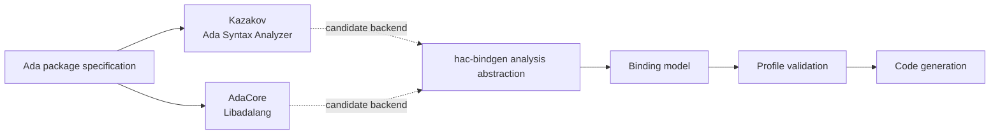
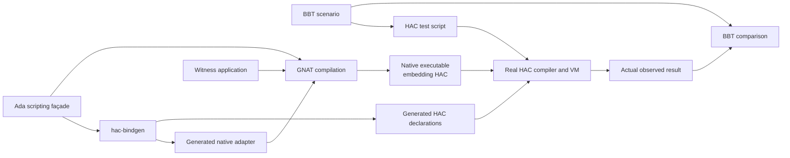

# HAC Bindgen Manifesto

## Status

Experimental proposal.

This document defines the intent, scope, architecture, binding profile and
validation strategy of `hac-bindgen`, an experimental binding generator for
HAC.

The experiment is independent of any particular application.

Its purpose is to determine whether a deliberately restricted Ada API can be
exposed to programs compiled and executed by HAC without requiring application
developers to write the HAC interfacing glue manually.

If its technical value is demonstrated and its implementation remains small,
predictable and maintainable, the tool is intended to be proposed as a
contribution to the HAC ecosystem.

---

## 1. Motivation

HAC can be embedded into an Ada application and supports data exchange between
a HAC program and its native host through dynamically registered callbacks.

This makes HAC a potential embedded scripting language for Ada applications.

However, exposing native Ada operations to HAC requires application-specific
interfacing code.

That glue is expected to be largely mechanical:

- retrieve arguments from the HAC virtual machine;
- validate their number and representation;
- convert them to native Ada values;
- invoke a native subprogram;
- convert its result to a HAC value;
- register the callback under a name visible to HAC;
- provide declarations usable by HAC programs;
- translate boundary and native errors into a form understood by HAC.

Writing and maintaining this code manually becomes repetitive and error-prone
as a scripting API grows.

`hac-bindgen` explores whether this work can be generated from an ordinary Ada
package specification.

---

## 2. Manifesto

### 2.1 The Ada specification is the source of truth

The input of `hac-bindgen` is an ordinary Ada package specification.

The generator does not require a separate IDL, JSON file, YAML file or binding
description.

A developer defines a scripting façade as a normal Ada package:

```ada
package Geometry_Scripting is

   type Point_Handle is new Natural;
   type Edge_Handle  is new Natural;

   function New_Point
     (X, Y, Z : Long_Float) return Point_Handle;

   function New_Edge
     (From, To : Point_Handle) return Edge_Handle;

   function Edge_Length
     (Object : Edge_Handle) return Long_Float;

end Geometry_Scripting;
```

The package body remains normal native Ada code.

It may:

- call a richer application API;
- manage native objects;
- maintain handle registries;
- validate handles;
- implement ownership rules;
- translate application exceptions;
- convert between public scripting types and internal application types.

`hac-bindgen` reads the specification and generates only the HAC-facing glue.

### 2.2 Input remains plain legal Ada

A binding specification must remain ordinary legal Ada.

It must not depend on `hac-bindgen`-specific syntax, unknown aspects or
implementation-specific source transformations.

In particular, the initial experiment does not introduce invented aspects such
as:

```ada
with HAC_Export;
```

```ada
with HAC_Binding => Handle;
```

```ada
with HAC_Export_Name => "Length";
```

Although Ada supports aspect specifications syntactically, an arbitrary aspect
name is not automatically recognised by an Ada implementation.

The package explicitly passed to `hac-bindgen` defines the binding boundary:

```console
hac-bindgen generate geometry_scripting.ads
```

All profile-compliant public declarations in that package are candidates for
export.

If a later experiment demonstrates a real need for additional binding metadata,
a legal and portable representation will be investigated separately.

### 2.3 The generator does not bind arbitrary Ada

Ada is much richer than the HAC-supported language subset and richer than a
simple callback interface.

The goal is not:

> Bind any legal Ada package to HAC.

The goal is:

> Bind packages conforming to a small, explicit and mechanically verifiable
> HAC binding profile.

Unsupported declarations must be rejected clearly.

The generator must never guess their intended semantics.

### 2.4 Restriction is a feature

The binding profile is deliberately narrow.

A restricted boundary provides:

- deterministic code generation;
- readable generated code;
- clear diagnostics;
- stable scripting APIs;
- a small trusted implementation;
- explicit application architecture;
- independence from application-internal object representations;
- testable conversion rules.

The complexity of an application remains behind its scripting façade.

### 2.5 Generated code must remain inspectable

Generated Ada code is not an opaque build artefact.

It must be:

- formatted as normal Ada source;
- understandable without knowing the generator internals;
- compilable through normal HAC and GNAT build processes;
- reproducible from the same input;
- suitable for review and debugging;
- clearly identified as generated;
- free from timestamps and machine-specific paths.

### 2.6 No silent conversion

Conversions across the HAC/native boundary must be explicit in the generated
code.

A binding must never silently:

- narrow a numeric value;
- reinterpret an integer as an application object;
- truncate a string;
- ignore an invalid enumeration position;
- convert a negative value to an unsigned type;
- reuse an invalid native handle;
- suppress an exception;
- replace an invalid result with a default value.

When a conversion cannot be performed safely:

- the declaration is rejected at generation time; or
- the generated callback reports a defined runtime boundary error.

### 2.7 The application owns object semantics

`hac-bindgen` may transport scalar values and opaque identifiers.

It does not own application objects and does not prescribe a universal object
model or object registry.

If an application exposes private, limited, tagged or otherwise complex
objects, its scripting façade represents them using bindable values such as
handles:

```ada
type Point_Handle is new Natural;
type Edge_Handle  is new Natural;
```

The application remains responsible for:

- handle allocation;
- handle validation;
- object storage;
- object lifetime;
- ownership rules;
- cleanup;
- invalidation;
- concurrency, if applicable;
- correspondence between handle types and native types.

A future helper library may provide reusable handle registries, but this is not
part of the initial binding generator.

### 2.8 Parsing a construct does not make it bindable

An Ada analyser may recognise many more constructs than `hac-bindgen` can bind.

The binding profile is defined by safe and deterministic boundary semantics,
not by the capabilities of the selected parser.

A construct is accepted only when:

- its native meaning is sufficiently known;
- its HAC representation is defined;
- its conversion rules are explicit;
- its failure behaviour is defined;
- its generated code can be tested end to end.

### 2.9 Real execution is the primary proof

Generated source that looks plausible is not sufficient evidence.

The primary correctness criterion is:

> A real HAC program calls a real Ada operation through generated bindings,
> inside a real Ada application compiled by GNAT.

The reference tests therefore exercise the complete generated integration.

---

## 3. Non-goals

The initial experiment will not:

- expose arbitrary Ada packages;
- derive a scripting façade automatically from a rich application API;
- infer application object ownership;
- infer object lifetime;
- automatically flatten arbitrary private types;
- instantiate generic packages;
- expose tagged dispatching directly;
- reproduce Ada overloading inside HAC;
- map arbitrary records or discriminated records;
- map access types;
- accept callbacks supplied by HAC programs;
- provide binary plug-in compatibility;
- load native shared libraries dynamically;
- implement a general-purpose Ada FFI;
- replace GNAT;
- replace a general semantic analysis framework;
- modify HAC language semantics;
- hide unsupported declarations;
- silently ignore unsupported declarations;
- depend on application object layouts;
- promise compatibility with Ada constructs unsupported by HAC.

The experiment covers only the generation of a narrow native-to-HAC binding
boundary.

---

## 4. Terminology

### Native package

An Ada package compiled by the host compiler and linked into the application.

### Rich application API

The native API used by the application implementation. It may contain private
types, generics, tagged types, contracts and other full Ada features.

### Scripting façade

A native Ada package deliberately designed to be exported to HAC.

### Binding profile

The subset of Ada declarations and types accepted by `hac-bindgen`.

### Native adapter

Generated native Ada code called from HAC and delegating to the scripting
façade.

### HAC declaration

Generated source declaring the operations available to HAC programs.

### Binding model

The parser-independent intermediate representation used by validation and code
generation.

### Binding manifest

A generated machine-readable description of the exported API and its mappings.

### Handle

An application-defined scalar identifier representing a native object.

### Witness application

A small real Ada application that embeds HAC, registers generated bindings and
is compiled by GNAT as part of end-to-end tests.

---

## 5. Overall architecture



The façade is written by the application developer.

Everything below the façade boundary is generated.

---

## 6. Processing architecture



The analyser output is never consumed directly by code generators.

The normalised binding model is the internal architectural boundary.

---

## 7. Proposed components

### 7.1 `hac-bindgen`

The command-line executable.

Responsibilities:

1. locate and read an Ada package specification;
2. invoke the selected Ada analysis backend;
3. construct a parser-independent binding model;
4. validate the model against the binding profile;
5. report all unsupported declarations;
6. generate native adapter code;
7. generate declarations usable by HAC programs;
8. generate a machine-readable binding manifest;
9. verify that existing generated files are current.

### 7.2 Ada analysis backend

`hac-bindgen` must not implement its own Ada parser.

The experiment will evaluate at least two existing analysis libraries:

- Dmitry Kazakov's Ada Syntax Analyzer;
- AdaCore Libadalang.

Both candidates must feed the same internal binding model.



The analyser is an implementation dependency, not part of the public
`hac-bindgen` architecture.

### 7.3 Analysis abstraction

The analyser must remain isolated behind an internal API conceptually similar
to:

```ada
package HAC_Bindgen.Analysis is

   procedure Analyse
     (Source      : Source_Descriptor;
      Model       : out Binding_Model;
      Diagnostics : out Diagnostic_List);

end HAC_Bindgen.Analysis;
```

This prevents validation and generation from depending directly on a particular
syntax-tree representation.

It also allows:

- comparative prototypes;
- replacement of an analyser;
- analyser-specific tests;
- shared validation and generation tests.

### 7.4 Binding model

The analyser output is normalised into a small semantic model.

Conceptually:

```ada
type Type_Kind is
  (Boolean_Type,
   Signed_Integer_Type,
   Modular_Integer_Type,
   Floating_Point_Type,
   Enumeration_Type,
   String_Type,
   Handle_Type);

type Parameter_Mode is
  (Mode_In,
   Mode_Out,
   Mode_In_Out);

type Parameter_Descriptor is record
   Ada_Name       : Name;
   Parameter_Type : Type_Reference;
   Mode           : Parameter_Mode;
   Source         : Source_Location;
end record;

type Subprogram_Descriptor is record
   Ada_Name    : Name;
   Parameters  : Parameter_List;
   Result_Type : Optional_Type_Reference;
   Source      : Source_Location;
end record;
```

The exact representation is an implementation detail.

The essential rule is:

> Validation and generators consume the binding model, never a parser-specific
> tree.

### 7.5 Profile validator

The validator decides whether every exported declaration can be bound according
to the current profile.

It produces:

- accepted declarations;
- rejected declarations;
- stable diagnostic identifiers;
- precise source locations;
- explicit rejection reasons.

Code generation starts only when the package passes validation.

The initial implementation must not generate a partial binding from a package
containing rejected public declarations.

### 7.6 Native adapter generator

This backend generates native Ada callback wrappers and callback registration.

It is the only component that directly depends on the precise public interface
of `HAC_Sys.Interfacing`.

Responsibilities include:

- checking callback arity;
- retrieving HAC arguments;
- converting argument values;
- invoking the façade subprogram;
- converting return values;
- catching boundary-safe native errors;
- registering callbacks;
- mapping failures to HAC's actual error mechanism.

### 7.7 HAC declaration generator

This backend generates source consumed by HAC scripts.

It maps native façade types to HAC-supported types.

For example:

```ada
type Point_Handle is new Natural;

function New_Point
  (X, Y, Z : Long_Float) return Point_Handle;
```

may be represented on the HAC side as:

```ada
subtype Point_Handle is Integer;

function New_Point
  (X, Y, Z : Float) return Point_Handle;
```

The exact external declaration mechanism must be derived from the actual HAC
interface rather than assumed by this manifesto.

### 7.8 Manifest generator

The experiment generates a JSON manifest even if the first build process does
not require it.

The manifest supports:

- reproducibility tests;
- API review;
- compatibility checks;
- documentation generation;
- alternative future backends;
- diagnostic tooling;
- editor integration.

It is descriptive and generated. It is not another source of truth.

---

## 8. Analysis-backend candidates

### 8.1 Dmitry Kazakov's Ada Syntax Analyzer

The experiment must evaluate:

- support for Ada 2022 syntax;
- syntax-tree usability;
- cross-reference information;
- visibility information;
- resolution of local declarations;
- resolution of subtype chains;
- source-location precision;
- native Ada integration;
- executable and dependency footprint;
- build complexity;
- licensing;
- compatibility with distribution alongside HAC.

### 8.2 AdaCore Libadalang

The experiment must also evaluate Libadalang.

Relevant evaluation topics include:

- quality of its Ada API;
- syntax-tree traversal;
- reference resolution;
- type resolution;
- project-aware source discovery;
- source-location and diagnostic support;
- integration with GPR projects;
- integration with Alire;
- dependency footprint;
- build and distribution complexity;
- licensing;
- suitability for a small HAC companion tool.

### 8.3 Selection principle

The analyser choice must be evidence-based.

The experiment should prototype enough of both adapters to process the same
minimal façade and produce the same binding model.

The preferred backend is the smallest practical dependency that reliably
provides all information required by the binding profile.

Capabilities beyond those requirements have no intrinsic value to
`hac-bindgen`.

### 8.4 GNAT remains the legality authority

Neither parser backend replaces compilation by GNAT.

A façade used by the native application must compile as ordinary Ada code.

End-to-end tests therefore compile the façade and generated native adapter with
GNAT.

Parser acceptance alone is never treated as proof that a source unit is a legal
Ada program.

---

## 9. Generated-file identification

Every generated textual artefact must identify the generator and its version.

For version `0.1.0`, generated Ada files begin with:

```ada
------------------------------------------------------------------------------
--  This file was generated by hac-bindgen 0.1.0.
--  DO NOT EDIT.
--
--  Source: geometry_scripting.ads
------------------------------------------------------------------------------
```

The generated manifest includes:

```json
{
  "schema": 1,
  "generator": {
    "name": "hac-bindgen",
    "version": "0.1.0"
  }
}
```

Generation must otherwise remain deterministic.

Generated files must not contain:

- timestamps;
- absolute source paths;
- temporary directory names;
- host names;
- user names;
- random identifiers;
- other machine-specific data.

The version identifies the generator implementation without making output
dependent on the generation environment.

---

## 10. Command-line interface

### 10.1 Minimal generation

```console
hac-bindgen generate geometry_scripting.ads
```

Default output:

```text
generated/
├── geometry_scripting-hac_binding.ads
├── geometry_scripting-hac_binding.adb
├── geometry_scripting_hac.ads
└── geometry_scripting.hac-bindings.json
```

### 10.2 Explicit generation

```console
hac-bindgen generate \
  --source src/geometry_scripting.ads \
  --output-dir obj/hac-bindings \
  --native-package Geometry_Scripting.HAC_Binding \
  --hac-package Geometry_Scripting_HAC \
  --manifest obj/hac-bindings/geometry_scripting.hac-bindings.json
```

### 10.3 Validation only

```console
hac-bindgen check geometry_scripting.ads
```

Successful output:

```text
Geometry_Scripting: 3 operations accepted, 0 rejected.
```

A rejected declaration produces a source-oriented diagnostic:

```text
geometry_scripting.ads:18:4:
error HACB0012: access parameters are not supported

   procedure Visit (Process : not null access procedure (P : Point));
                    ^

suggestion: expose a native operation with scalar parameters instead
```

### 10.4 Reproducibility verification

```console
hac-bindgen verify \
  --source src/geometry_scripting.ads \
  --output-dir generated
```

The command succeeds only if the files already present in the output directory
are identical to freshly generated files.

### 10.5 Version reporting

```console
hac-bindgen --version
```

Example:

```text
hac-bindgen 0.1.0
```

The same version must appear in all generated artefacts.

### 10.6 Diagnostic formats

The initial experiment should support at least:

```console
hac-bindgen check geometry_scripting.ads --diagnostics text
```

```console
hac-bindgen check geometry_scripting.ads --diagnostics gcc
```

SARIF may be considered later but is not required to validate the experiment.

---

## 11. Input and generated files

Given:

```text
examples/geometry/
├── geometry.ads
├── geometry.adb
├── geometry_objects.ads
├── geometry_objects.adb
├── geometry_scripting.ads
└── geometry_scripting.adb
```

the first files implement the application domain and its object registry.

The last two implement the restricted scripting façade.

Running:

```console
hac-bindgen generate \
  --source examples/geometry/geometry_scripting.ads \
  --output-dir examples/geometry/generated
```

produces:

```text
examples/geometry/generated/
├── geometry_scripting-hac_binding.ads
├── geometry_scripting-hac_binding.adb
├── geometry_scripting_hac.ads
└── geometry_scripting.hac-bindings.json
```

---

## 12. Example generated native package

The precise types and subprogram names used below are architectural
placeholders.

The first implementation stage must replace them with the actual current
`HAC_Sys.Interfacing` API.

### 12.1 Generated specification

```ada
------------------------------------------------------------------------------
--  This file was generated by hac-bindgen 0.1.0.
--  DO NOT EDIT.
--
--  Source: geometry_scripting.ads
------------------------------------------------------------------------------

with HAC_Sys.Interfacing;

package Geometry_Scripting.HAC_Binding is

   procedure Register
     (Environment : in out HAC_Sys.Interfacing.Environment);

end Geometry_Scripting.HAC_Binding;
```

### 12.2 Generated body

```ada
------------------------------------------------------------------------------
--  This file was generated by hac-bindgen 0.1.0.
--  DO NOT EDIT.
--
--  Source: geometry_scripting.ads
------------------------------------------------------------------------------

with Geometry_Scripting;
with HAC_Sys.Interfacing;

package body Geometry_Scripting.HAC_Binding is

   procedure Call_New_Point
     (Call : in out HAC_Sys.Interfacing.Call_Context)
   is
      X : constant Long_Float :=
        Get_Long_Float (Call, 1);

      Y : constant Long_Float :=
        Get_Long_Float (Call, 2);

      Z : constant Long_Float :=
        Get_Long_Float (Call, 3);

      Result : constant Geometry_Scripting.Point_Handle :=
        Geometry_Scripting.New_Point (X, Y, Z);
   begin
      Set_Result (Call, Natural (Result));
   end Call_New_Point;


   procedure Call_New_Edge
     (Call : in out HAC_Sys.Interfacing.Call_Context)
   is
      From : constant Geometry_Scripting.Point_Handle :=
        Geometry_Scripting.Point_Handle
          (Get_Natural (Call, 1));

      To : constant Geometry_Scripting.Point_Handle :=
        Geometry_Scripting.Point_Handle
          (Get_Natural (Call, 2));

      Result : constant Geometry_Scripting.Edge_Handle :=
        Geometry_Scripting.New_Edge (From, To);
   begin
      Set_Result (Call, Natural (Result));
   end Call_New_Edge;


   procedure Call_Edge_Length
     (Call : in out HAC_Sys.Interfacing.Call_Context)
   is
      Object : constant Geometry_Scripting.Edge_Handle :=
        Geometry_Scripting.Edge_Handle
          (Get_Natural (Call, 1));

      Result : constant Long_Float :=
        Geometry_Scripting.Edge_Length (Object);
   begin
      Set_Result (Call, Result);
   end Call_Edge_Length;


   procedure Register
     (Environment : in out HAC_Sys.Interfacing.Environment)
   is
   begin
      Register_Function
        (Environment,
         Name     => "New_Point",
         Arity    => 3,
         Callback => Call_New_Point'Access);

      Register_Function
        (Environment,
         Name     => "New_Edge",
         Arity    => 2,
         Callback => Call_New_Edge'Access);

      Register_Function
        (Environment,
         Name     => "Edge_Length",
         Arity    => 1,
         Callback => Call_Edge_Length'Access);
   end Register;

end Geometry_Scripting.HAC_Binding;
```

This example expresses the intended responsibilities of generated code.

It does not claim that the placeholder profiles above match the current HAC
implementation.

---

## 13. Example generated HAC declaration

```ada
------------------------------------------------------------------------------
--  This file was generated by hac-bindgen 0.1.0.
--  DO NOT EDIT.
--
--  Source: geometry_scripting.ads
------------------------------------------------------------------------------

package Geometry_Scripting_HAC is

   subtype Point_Handle is Integer;
   subtype Edge_Handle  is Integer;

   function New_Point
     (X, Y, Z : Float) return Point_Handle;

   function New_Edge
     (From, To : Point_Handle) return Edge_Handle;

   function Edge_Length
     (Object : Edge_Handle) return Float;

end Geometry_Scripting_HAC;
```

The experiment must confirm whether HAC associates these declarations with
registered callbacks in this form or requires another representation.

Only the HAC declaration backend should depend on that answer.

---

## 14. Example generated manifest

```json
{
  "schema": 1,
  "generator": {
    "name": "hac-bindgen",
    "version": "0.1.0"
  },
  "source": "geometry_scripting.ads",
  "ada_package": "Geometry_Scripting",
  "hac_package": "Geometry_Scripting_HAC",
  "types": [
    {
      "ada_name": "Point_Handle",
      "ada_kind": "derived_natural",
      "binding_kind": "handle",
      "hac_type": "Integer"
    },
    {
      "ada_name": "Edge_Handle",
      "ada_kind": "derived_natural",
      "binding_kind": "handle",
      "hac_type": "Integer"
    }
  ],
  "operations": [
    {
      "ada_name": "New_Point",
      "hac_name": "New_Point",
      "parameters": [
        {
          "name": "X",
          "ada_type": "Long_Float",
          "hac_type": "Float",
          "mode": "in"
        },
        {
          "name": "Y",
          "ada_type": "Long_Float",
          "hac_type": "Float",
          "mode": "in"
        },
        {
          "name": "Z",
          "ada_type": "Long_Float",
          "hac_type": "Float",
          "mode": "in"
        }
      ],
      "result": {
        "ada_type": "Point_Handle",
        "hac_type": "Integer"
      }
    },
    {
      "ada_name": "New_Edge",
      "hac_name": "New_Edge",
      "parameters": [
        {
          "name": "From",
          "ada_type": "Point_Handle",
          "hac_type": "Integer",
          "mode": "in"
        },
        {
          "name": "To",
          "ada_type": "Point_Handle",
          "hac_type": "Integer",
          "mode": "in"
        }
      ],
      "result": {
        "ada_type": "Edge_Handle",
        "hac_type": "Integer"
      }
    },
    {
      "ada_name": "Edge_Length",
      "hac_name": "Edge_Length",
      "parameters": [
        {
          "name": "Object",
          "ada_type": "Edge_Handle",
          "hac_type": "Integer",
          "mode": "in"
        }
      ],
      "result": {
        "ada_type": "Long_Float",
        "hac_type": "Float"
      }
    }
  ]
}
```

---

## 15. Initial binding profile

The profile is divided into three categories:

- accepted in the first experiment;
- deferred;
- rejected.

The accepted set must remain small until each mapping is demonstrated by an
executable end-to-end test.

---

## 16. Accepted declarations

### 16.1 One library-level package specification

The input identifies one non-generic library-level package specification.

Accepted:

```ada
package Geometry_Scripting is
   ...
end Geometry_Scripting;
```

### 16.2 Procedures

Accepted when all parameters conform to the current profile:

```ada
procedure Reset;
```

```ada
procedure Move_To
  (Object : Point_Handle;
   X, Y   : Long_Float);
```

### 16.3 Functions

Accepted when all parameters and the result conform to the current profile:

```ada
function Edge_Length
  (Object : Edge_Handle) return Long_Float;
```

### 16.4 `in` parameters

Initial support is restricted to explicit or implicit `in` parameters:

```ada
function Add
  (Left, Right : Integer) return Integer;
```

### 16.5 Boolean values

Accepted:

```ada
function Is_Valid_Point
  (Object : Point_Handle) return Boolean;
```

### 16.6 Signed integer types

Initial candidates:

- `Integer`;
- `Natural`;
- `Positive`;
- derived signed integer types;
- subtypes of accepted signed integer types.

Example:

```ada
subtype Axis_Index is Integer range 1 .. 3;
```

Generated runtime conversion must check the native subtype range.

### 16.7 Floating-point types

Floating-point types are accepted only after the HAC runtime representation has
been demonstrated.

Candidates include:

- `Float`;
- `Long_Float`;
- derived floating-point types;
- subtypes of accepted floating-point types.

The generator must not claim lossless conversion when HAC and native
representations differ in range or precision.

Any precision reduction must be:

- explicit in the generated manifest;
- covered by boundary tests;
- documented as part of the binding profile.

### 16.8 Enumerations

Simple enumeration types may be accepted:

```ada
type Axis is
  (X_Axis,
   Y_Axis,
   Z_Axis);
```

Mapping by literal name is preferred if supported by the HAC interface.

Mapping by ordinal position is acceptable only if:

- both sides use an explicitly generated correspondence;
- bounds are checked;
- invalid positions produce a boundary error;
- tests cover every literal and invalid surrounding values.

### 16.9 Handles

For the initial experiment, a handle is a distinct integer type declared in the
input package:

```ada
type Point_Handle is new Natural;
```

However, not every integer-derived type is necessarily an object handle.

Until a legal explicit metadata mechanism is selected, the first profile may
use one of these restricted strategies:

1. treat all integer-derived types as checked scalar types;
2. treat types ending in `_Handle` as handles for manifest documentation;
3. use an external command-line policy;
4. avoid semantic distinction because both representations are checked
   integers at the HAC boundary.

The application still owns handle semantics.

The experiment must not introduce an unknown Ada aspect solely to label a
handle.

### 16.10 Strings

Strings are accepted only after the exact HAC callback representation,
ownership and lifetime rules have been demonstrated.

Potential first examples are:

```ada
function Object_Name
  (Object : Point_Handle) return String;
```

and:

```ada
procedure Set_Object_Name
  (Object : Point_Handle;
   Name   : String);
```

The initial profile does not include:

- `Unbounded_String`;
- `Wide_String`;
- `Wide_Wide_String`;
- user-defined string abstractions;
- access values designating strings.

If ownership or lifetime remains unclear, strings remain deferred.

---

## 17. Deferred declarations

### 17.1 `out` parameters

Example:

```ada
procedure Coordinates
  (Point : Point_Handle;
   X     : out Long_Float;
   Y     : out Long_Float;
   Z     : out Long_Float);
```

These require a defined representation for multiple results.

Potential future strategies include:

- generated result records;
- multiple generated getter functions;
- a tuple-like HAC convention;
- multiple VM result slots, if HAC supports them.

No strategy is selected by this manifesto.

### 17.2 `in out` parameters

Deferred until mutation and copy semantics are unambiguous.

### 17.3 Modular types

Deferred until range and bitwise semantics have been tested across the boundary.

### 17.4 Fixed-point types

Deferred because `delta`, range and scaling semantics must not be silently
converted to floating-point values.

### 17.5 Records

Plain records may eventually be:

- flattened;
- represented through handles;
- mapped to generated constructor and getter operations.

No general record mapping belongs in the initial experiment.

### 17.6 Arrays

Arrays are deferred until all of the following have defined semantics:

- lower and upper bounds;
- element type;
- copy versus reference behaviour;
- ownership;
- mutability;
- lifetime;
- empty arrays;
- constrained versus unconstrained arrays.

### 17.7 Default parameter expressions

Deferred:

```ada
procedure Move_To
  (Object : Point_Handle;
   X      : Long_Float := 0.0;
   Y      : Long_Float := 0.0);
```

The initial profile requires the HAC caller to provide every parameter.

### 17.8 Renamings

Subprogram renamings are deferred.

The façade can initially declare a regular wrapper subprogram.

### 17.9 Native package types

A type declared in another package is deferred unless the selected analyser can
resolve it reliably and the type independently conforms to the binding profile.

The first façade examples should declare their boundary types locally.

### 17.10 Exception identities crossing the boundary

The native exception object and its Ada identity do not cross the boundary.

A structured error mapping may be designed later after HAC's actual error
facilities have been evaluated.

---

## 18. Rejected declarations

### 18.1 Generic packages and generic subprograms

Rejected:

```ada
generic
   type Element is private;
package Generic_Store is
   ...
end Generic_Store;
```

Instantiation belongs in native code.

A façade may expose operations from a specific native instance.

### 18.2 Access types

Rejected:

```ada
type Point_Access is access all Point;
```

### 18.3 Access parameters

Rejected:

```ada
procedure Visit
  (Process : not null access procedure (Object : Point_Handle));
```

### 18.4 Private types crossing the boundary

Rejected:

```ada
type Point is private;

function New_Point
  (X, Y, Z : Long_Float) return Point;
```

The façade must represent the object through a bindable value:

```ada
type Point_Handle is new Natural;

function New_Point
  (X, Y, Z : Long_Float) return Point_Handle;
```

### 18.5 Limited private types

Rejected as parameters and results.

### 18.6 Tagged types

Rejected as boundary values:

```ada
type Shape is tagged private;
```

The façade may use tagged types internally and expose handles.

### 18.7 Interface and class-wide types

Rejected:

```ada
procedure Render
  (Object : Shape'Class);
```

### 18.8 Tasks and protected objects

Rejected as exported values or parameters.

The application may use them internally.

### 18.9 Discriminated records

Rejected:

```ada
type Result (Kind : Result_Kind) is record
   ...
end record;
```

### 18.10 Anonymous arrays and records

Rejected.

### 18.11 Controlled types

Rejected as boundary values.

### 18.12 Native addresses

Rejected:

- `System.Address`;
- native pointers;
- unchecked address conversions;
- arbitrary integer-to-address conversions;
- imported C pointer abstractions.

### 18.13 Overloaded exported names

Rejected:

```ada
function Create
  (X, Y : Long_Float) return Point_Handle;

function Create
  (X, Y, Z : Long_Float) return Point_Handle;
```

The initial façade must use distinct ordinary Ada names:

```ada
function New_Point_2D
  (X, Y : Long_Float) return Point_Handle;

function New_Point_3D
  (X, Y, Z : Long_Float) return Point_Handle;
```

The generator must not invent unstable mangled external names.

### 18.14 Operator symbols

Rejected as exported operation names:

```ada
function "+"
  (Left, Right : Vector_Handle) return Vector_Handle;
```

The façade uses a named operation:

```ada
function Add
  (Left, Right : Vector_Handle) return Vector_Handle;
```

### 18.15 Unknown binding annotations

The initial experiment rejects or ignores no declaration on the basis of an
invented `HAC_*` aspect, because no such source-level aspects are defined.

### 18.16 Declarations needing application-semantic inference

A declaration is rejected when binding it requires the generator to infer:

- ownership;
- lifetime;
- aliasing rules;
- thread safety;
- hidden units of measurement;
- whether narrowing is acceptable;
- whether an integer is an object identifier;
- whether a returned access value must be freed;
- whether two handles belong to the same registry.

These decisions belong in the scripting façade.

---

## 19. Example: rich API and scripting façade

### 19.1 Rich native API

```ada
package Geometry is

   type Coordinate is new Long_Float;
   type Distance   is new Long_Float;

   type Point is private;
   type Edge  is private;

   function Create
     (X, Y, Z : Coordinate) return Point;

   function Create
     (From, To : Point) return Edge;

   function Length
     (Object : Edge) return Distance;

private
   ...
end Geometry;
```

This package is not a valid initial `hac-bindgen` input.

Reasons include:

- private values cross the boundary;
- `Create` is overloaded;
- ownership is unspecified;
- the native type model exceeds the initial binding profile.

### 19.2 Scripting façade

```ada
package Geometry_Scripting is

   type Point_Handle is new Natural;
   type Edge_Handle  is new Natural;

   function New_Point
     (X, Y, Z : Long_Float) return Point_Handle;

   function New_Edge
     (From, To : Point_Handle) return Edge_Handle;

   function Edge_Length
     (Object : Edge_Handle) return Long_Float;

   procedure Delete_Point
     (Object : Point_Handle);

   procedure Delete_Edge
     (Object : Edge_Handle);

   function Is_Valid_Point
     (Object : Point_Handle) return Boolean;

   function Is_Valid_Edge
     (Object : Edge_Handle) return Boolean;

end Geometry_Scripting;
```

The use of distinct names avoids overloading at the exported boundary.

### 19.3 Façade implementation

```ada
with Geometry;
with Geometry_Objects;

package body Geometry_Scripting is

   function New_Point
     (X, Y, Z : Long_Float) return Point_Handle
   is
      Object : constant Geometry.Point :=
        Geometry.Create
          (X => Geometry.Coordinate (X),
           Y => Geometry.Coordinate (Y),
           Z => Geometry.Coordinate (Z));
   begin
      return Geometry_Objects.Store (Object);
   end New_Point;


   function New_Edge
     (From, To : Point_Handle) return Edge_Handle
   is
      Object : constant Geometry.Edge :=
        Geometry.Create
          (From => Geometry_Objects.Get_Point (From),
           To   => Geometry_Objects.Get_Point (To));
   begin
      return Geometry_Objects.Store (Object);
   end New_Edge;


   function Edge_Length
     (Object : Edge_Handle) return Long_Float
   is
   begin
      return Long_Float
        (Geometry.Length
           (Geometry_Objects.Get_Edge (Object)));
   end Edge_Length;


   procedure Delete_Point
     (Object : Point_Handle)
   is
   begin
      Geometry_Objects.Delete_Point (Object);
   end Delete_Point;


   procedure Delete_Edge
     (Object : Edge_Handle)
   is
   begin
      Geometry_Objects.Delete_Edge (Object);
   end Delete_Edge;


   function Is_Valid_Point
     (Object : Point_Handle) return Boolean
   is
   begin
      return Geometry_Objects.Is_Valid_Point (Object);
   end Is_Valid_Point;


   function Is_Valid_Edge
     (Object : Edge_Handle) return Boolean
   is
   begin
      return Geometry_Objects.Is_Valid_Edge (Object);
   end Is_Valid_Edge;

end Geometry_Scripting;
```

The registry is application code, not generated binding code.

### 19.4 HAC-side program

```ada
with Geometry_Scripting_HAC;
use Geometry_Scripting_HAC;

procedure Example is
   First  : Point_Handle;
   Second : Point_Handle;
   Edge   : Edge_Handle;
begin
   First  := New_Point (0.0, 0.0, 0.0);
   Second := New_Point (10.0, 0.0, 0.0);
   Edge   := New_Edge (First, Second);

   Put (Edge_Length (Edge));

   Delete_Edge (Edge);
   Delete_Point (Second);
   Delete_Point (First);
end Example;
```

The script produces the actual observable result.

Expected values and comparison remain outside the script.

---

## 20. Export selection

The initial selection rule is intentionally simple:

> The package explicitly supplied to `hac-bindgen` is a scripting façade, and
> all of its profile-compliant public subprograms are exported.

Example:

```console
hac-bindgen generate geometry_scripting.ads
```

The initial experiment does not attempt to mix exported and non-exported public
operations in the same specification.

If the application needs native-only helpers, it should place them:

- in the package body;
- in a child package;
- in a separate helper package.

This avoids premature metadata design.

Future versions may investigate legal Ada mechanisms or external configuration
only if a concrete use case requires selective export.

---

## 21. Naming rules

### 21.1 Default mapping

Ada identifiers retain their names:

```text
New_Point   -> New_Point
Edge_Length -> Edge_Length
```

### 21.2 No source-level external-name override initially

The initial version does not support a source construct equivalent to:

```ada
with HAC_Export_Name => "Length";
```

The façade itself uses the desired public name:

```ada
function Length
  (Object : Edge_Handle) return Long_Float;
```

or retains the more explicit name:

```ada
function Edge_Length
  (Object : Edge_Handle) return Long_Float;
```

### 21.3 Collision detection

The generator rejects:

- overloaded exported names;
- duplicate HAC-visible operation names;
- unsupported type-name collisions;
- enumeration literals collapsing to the same external representation;
- names reserved by the generated runtime support.

No automatic suffix is added.

---

## 22. Error model

Three classes of failure remain distinct.

### 22.1 Generation errors

Examples:

- unsupported Ada construct;
- unknown mapped type;
- overloaded operation;
- unsupported parameter mode;
- unresolved type declaration;
- unsupported result type.

These prevent generation.

### 22.2 Boundary conversion errors

Examples:

- HAC integer outside an Ada subtype range;
- invalid enumeration position;
- invalid scalar representation;
- wrong number of arguments;
- unrepresentable floating-point value;
- invalid string representation.

These occur in generated callback code.

### 22.3 Application errors

Examples:

- unknown handle;
- deleted object;
- incompatible handle registry;
- geometrically invalid operation;
- application precondition failure.

These originate in the façade or native application.

### 22.4 Exception boundary

A native exception must not escape unsafely through the callback boundary.

The generated adapter must translate it through HAC's actual error-reporting
facility.

The mapping must be derived from HAC's implementation and tested through the
real VM.

The generator must not convert every exception into a default scalar result.

---

## 23. Parsing and semantic scope

A syntax tree alone may not resolve every Ada type reference.

The analysis experiment must determine whether each candidate backend provides
enough information for:

- package declaration identification;
- subprogram declaration identification;
- formal parameter names and modes;
- result type identification;
- local type resolution;
- subtype-chain resolution;
- predefined type recognition;
- selected-name resolution;
- source locations;
- dependent-unit resolution;
- `with` and `use` visibility.

The first experiment should avoid requiring general cross-unit semantic
analysis.

Boundary types should initially be declared in the scripting façade:

```ada
package Geometry_Scripting is

   type Point_Handle is new Natural;
   type Edge_Handle  is new Natural;

   function New_Point
     (X, Y, Z : Long_Float) return Point_Handle;

end Geometry_Scripting;
```

An exported declaration whose binding depends on an unresolved complex external
type may be rejected.

This keeps the experiment focused on HAC integration rather than on building a
new general Ada semantic frontend.

---

## 24. Licence evaluation

The implementation must verify the licensing consequences of each selected
analysis backend.

For each candidate, the experiment records:

- exact components used;
- copyright notices;
- exact licence text;
- linking exceptions, if any;
- static and dynamic linking implications;
- source-distribution requirements;
- binary-distribution requirements;
- compatibility with HAC's distribution model;
- compatibility with the intended `hac-bindgen` licence;
- whether the analyser can be optional;
- whether generated files contain copied analyser code.

No licence compatibility is assumed solely because a library is open source or
contains a linking exception.

The architecture must allow replacement of the analyser without changing the
binding model or code generators.

---

## 25. Test philosophy

`hac-bindgen` is an integration tool.

Its primary correctness criterion is not that generated source code looks
plausible, but that a real HAC program successfully calls a real native Ada
application through generated bindings.

Unit tests are useful for individual transformations.

They are not sufficient evidence that a binding works.

The reference tests are end-to-end behavioural tests.

---

## 26. End-to-end reference chain

Every significant supported feature must be exercised through the complete
production path.



### 26.1 No mocked HAC in reference tests

End-to-end tests execute the actual HAC compiler and virtual machine.

A mock of `HAC_Sys.Interfacing` may be useful for isolated unit tests.

It does not constitute evidence that a generated binding works.

### 26.2 No mocked native application in reference tests

The native side is a real Ada witness application compiled by GNAT.

The witness application:

1. implements a small native API;
2. implements a profile-compliant scripting façade;
3. embeds the real HAC runtime;
4. registers only generated bindings;
5. runs the HAC program supplied by the test;
6. exposes the observable result to BBT.

No per-operation HAC glue may be handwritten in the witness application.

### 26.3 BBT owns expected behaviour

The HAC script produces only the actual observable result.

The expected result and comparison remain in the BBT scenario.

Conceptually:

```markdown
Scenario: Call a native floating-point function through HAC

Given the scripting API:
  examples/geometry/geometry_scripting.ads

And the HAC script:
  examples/geometry/scripts/edge_length.adb

When hac-bindgen generates the binding
And the witness application is compiled with GNAT
And the script is executed by the embedded HAC runtime

Then the output is:
  10.0
```

The exact BBT syntax is outside the scope of this manifesto.

The architectural rule is:

> The script produces the actual result.  
> The behavioural scenario contains the expected result and performs the
> comparison.

### 26.4 What one end-to-end test validates

A successful E2E test simultaneously validates:

- Ada source analysis;
- binding-model construction;
- binding-profile validation;
- native adapter generation;
- HAC declaration generation;
- deterministic file creation;
- compilation of the façade by GNAT;
- compilation of the generated native adapter by GNAT;
- linking with HAC;
- callback registration;
- HAC source compilation by the real HAC compiler;
- execution by the real HAC VM;
- native argument conversion;
- invocation of the real Ada façade;
- result conversion;
- propagation of the observable result;
- behavioural comparison by BBT.

This complete path is the product being tested.

---

## 27. Negative-test philosophy

There are two fundamentally different kinds of negative test.

### 27.1 Binding-profile rejection

The source declaration falls outside the supported API profile.

Example:

```ada
procedure Visit
  (Callback : access procedure);
```

Expected behaviour:

- `hac-bindgen` rejects the package;
- a stable diagnostic identifier is produced;
- the source location points to the unsupported construct;
- no partial binding is emitted;
- BBT verifies the relevant diagnostic behaviour.

### 27.2 Runtime-boundary rejection

The API shape is legal and bindable, but the HAC program supplies an invalid
runtime value.

Examples:

- integer outside a native subtype range;
- invalid handle;
- deleted handle;
- invalid enumeration position;
- unrepresentable result;
- native application exception.

These tests run through:

- the real HAC compiler;
- the real HAC VM;
- the generated adapter;
- the GNAT-compiled witness application.

The distinction is:

> Unsupported API shapes fail during generation.  
> Invalid runtime values fail during execution.

---

## 28. Test layers

### 28.1 Analysis-adapter tests

For each supported declaration, verify that both candidate analysers produce
the expected normalised binding model.

These tests must distinguish:

- parser-specific extraction;
- parser-independent normalisation;
- profile validation.

### 28.2 Binding-model tests

Verify:

- type normalisation;
- subtype-chain resolution;
- parameter modes;
- result types;
- source locations;
- deterministic declaration ordering.

### 28.3 Validation tests

For each rejected declaration, verify:

- diagnostic identifier;
- source location;
- rejection reason;
- absence of generated partial output.

### 28.4 Golden-file generation tests

Given a façade specification, compare generated files against reviewed expected
files.

Generation must be byte-for-byte deterministic apart from an intentional
change in generator version.

### 28.5 GNAT compilation tests

Compile:

- the native domain API;
- the scripting façade;
- the generated native adapter;
- the witness application.

### 28.6 HAC compilation tests

Compile:

- the generated HAC declarations;
- the test scripts;
- the complete script dependency graph.

### 28.7 End-to-end execution tests

At minimum, demonstrate:

1. a parameterless procedure;
2. an integer function;
3. a constrained integer subtype;
4. a floating-point function;
5. a Boolean function;
6. an enumeration parameter;
7. an enumeration result;
8. handle creation;
9. handle reuse;
10. handle deletion;
11. invalid-handle reporting;
12. range-check failure;
13. native application error reporting;
14. multiple generated façade packages in one HAC environment;
15. repeated execution in the same witness application, if supported.

### 28.8 Regeneration test

Run generation twice and verify identical output.

### 28.9 Version-marker test

Verify that every generated textual file contains:

```text
This file was generated by hac-bindgen 0.1.0.
```

Verify that the manifest records the same version.

### 28.10 No-manual-glue criterion

The witness application must contain no manually written per-operation code
using `HAC_Sys.Interfacing`.

All direct operation adapters must be generated.

Only generic HAC application bootstrapping may remain handwritten.

---

## 29. Experimental repository layout

```text
hac-bindgen/
├── README.md
├── MANIFESTO.md
├── LICENSE
├── alire.toml
├── hac_bindgen.gpr
│
├── src/
│   ├── hac_bindgen.ads
│   ├── hac_bindgen-model.ads
│   ├── hac_bindgen-model.adb
│   ├── hac_bindgen-validation.ads
│   ├── hac_bindgen-validation.adb
│   ├── hac_bindgen-diagnostics.ads
│   ├── hac_bindgen-diagnostics.adb
│   ├── hac_bindgen-generation.ads
│   ├── hac_bindgen-generation.adb
│   ├── hac_bindgen-generation-native.ads
│   ├── hac_bindgen-generation-native.adb
│   ├── hac_bindgen-generation-hac.ads
│   ├── hac_bindgen-generation-hac.adb
│   ├── hac_bindgen-generation-manifest.ads
│   ├── hac_bindgen-generation-manifest.adb
│   └── hac_bindgen-cli.adb
│
├── src/analysis/
│   ├── hac_bindgen-analysis.ads
│   ├── hac_bindgen-analysis-kazakov.ads
│   ├── hac_bindgen-analysis-kazakov.adb
│   ├── hac_bindgen-analysis-libadalang.ads
│   └── hac_bindgen-analysis-libadalang.adb
│
├── examples/
│   └── geometry/
│       ├── geometry.ads
│       ├── geometry.adb
│       ├── geometry_objects.ads
│       ├── geometry_objects.adb
│       ├── geometry_scripting.ads
│       ├── geometry_scripting.adb
│       ├── witness_application.adb
│       ├── scripts/
│       │   ├── edge_length.adb
│       │   ├── invalid_handle.adb
│       │   └── delete_object.adb
│       └── generated/
│
├── tests/
│   ├── analysis/
│   ├── validation/
│   ├── rejection/
│   ├── generation/
│   ├── compilation/
│   └── e2e/
│
└── docs/
    ├── architecture.md
    ├── binding-profile.md
    ├── diagnostics.md
    ├── analyser-comparison.md
    └── licensing.md
```

This layout expresses architectural responsibilities.

The experiment must not create empty abstraction layers before they are needed.

---

## 30. Experimental stages

### Stage 0: Verify the real HAC callback surface

Produce one manually written end-to-end example from the current HAC source and
data-exchange demonstrations.

Record:

- exact callback profiles;
- callback registration mechanism;
- supported argument representations;
- result mechanism;
- procedure mechanism;
- floating-point representation;
- string representation and lifetime;
- error-reporting mechanism;
- external declaration mechanism;
- compiler and VM lifetime;
- callback state ownership;
- re-entrancy and concurrency assumptions.

This manual implementation becomes the reference template for generated code.

### Stage 1: Hard-coded generator

Generate bindings for one fixed geometry façade without parsing Ada.

Purpose:

- validate generated file boundaries;
- validate callback templates;
- validate package naming;
- validate build integration;
- validate version markers;
- validate the E2E BBT harness.

### Stage 2: Minimal analysis prototypes

Implement limited analyser adapters for:

- Dmitry Kazakov's Ada Syntax Analyzer;
- AdaCore Libadalang.

Each adapter must parse the same minimal façade and produce the same binding
model.

### Stage 3: Select the analysis backend

Compare:

- model correctness;
- source-location quality;
- implementation size;
- dependency footprint;
- build integration;
- semantic-resolution capabilities;
- licensing;
- distribution implications.

Select a default backend from measured results.

The abstraction remains even if only one backend is retained.

### Stage 4: Initial profile validation

Support:

- one package;
- local scalar types;
- procedures;
- functions;
- `in` parameters;
- supported scalar results.

Add deterministic rejection diagnostics before broadening the accepted profile.

### Stage 5: Handles and enumerations

Demonstrate:

- distinct handle types;
- handle creation and deletion;
- invalid handles;
- enumeration conversion;
- invalid enumeration values;
- application-owned registries.

### Stage 6: Packaging decision

Decide from the experiment whether `hac-bindgen` should be:

- a separate Alire crate;
- a tool distributed alongside HAC;
- a package inside the HAC repository;
- an optional, separately versioned utility.

This decision is not predetermined.

---

## 31. Acceptance criteria

The experiment is technically successful when all the following are true:

1. A developer can write a profile-compliant scripting façade as ordinary legal
   Ada.

2. The façade does not import or call `HAC_Sys.Interfacing`.

3. One `hac-bindgen` command generates all per-operation HAC glue.

4. Every generated file identifies the `hac-bindgen` version.

5. The generated native code compiles with GNAT.

6. The generated HAC declarations compile with the real HAC compiler.

7. A GNAT-compiled witness application embeds the real HAC runtime.

8. A real HAC script calls the geometry operations shown in this manifesto.

9. Scalar parameters and results survive round trips with documented
   conversions.

10. Distinct handle types can represent native objects without transferring
    their representation into HAC.

11. Invalid handles are detected by the application boundary.

12. Unsupported declarations fail with precise source diagnostics.

13. Generated code is deterministic and understandable.

14. Adding one supported façade function requires no handwritten HAC-specific
    adapter code.

15. BBT executes the complete chain and compares the actual result against the
    expected result stored in the scenario.

16. The analyser decision is supported by a recorded comparison.

17. The selected analyser's licensing and distribution implications are
    documented.

18. The implementation remains independent of the geometry example and any
    original motivating application.

---

## 32. Failure criteria

The experiment should be stopped or redesigned if any of these proves true:

- HAC callbacks cannot express ordinary functions and procedures without
  handwritten per-operation code;
- external declarations cannot be generated or associated reliably with
  registered callbacks;
- simple scalar conversions require application-specific changes to the
  generator;
- generated adapters depend on application object layouts;
- the parser integration requires implementing a general Ada semantic analyser;
- unsupported declarations cannot be diagnosed reliably;
- generated code is harder to maintain than handwritten glue;
- adding a normal façade operation routinely requires changes to the generator;
- analyser licensing prevents practical distribution;
- the supported profile is too narrow for realistic scripting façades;
- real E2E tests cannot be automated with the actual HAC runtime;
- generated source cannot be made deterministic.

A negative result is useful.

It establishes the actual boundary of HAC interfacing and prevents applications
from investing in an unsuitable binding architecture.

---

## 33. Design principles for future extensions

Any extension to the binding profile must satisfy all these rules:

1. It is motivated by a demonstrated scripting façade.
2. Its mapping is deterministic.
3. Its generated code remains readable.
4. Its conversion rules are explicit.
5. Its conversion rules are testable.
6. Its failure behaviour is defined.
7. It requires no application-semantic inference.
8. It preserves analyser independence.
9. It does not weaken diagnostics.
10. It includes positive tests.
11. It includes negative tests.
12. It includes a real end-to-end BBT test.
13. It is not accepted merely because the analyser can parse it.
14. It is not accepted merely because GNAT can compile it.
15. It is not accepted until HAC can execute it through the generated binding.

---

## 34. Open questions

The experiment must answer, rather than assume, the following questions.

### HAC interfacing

- What are the exact current profiles exported by `HAC_Sys.Interfacing`?
- How are callback names associated with HAC-visible declarations?
- Which scalar representations can callbacks read and write?
- Does callback registration support both procedures and functions?
- How are function results returned?
- How are callback arity and parameter types checked?
- Can several packages register operations in one environment?
- Can registered names be package-qualified?
- Is callback state global, per compiler instance or per VM instance?
- Is the mechanism re-entrant?
- What are its concurrency assumptions?
- Can callbacks invoke HAC recursively?

### Numeric values

- What integer representation and range does HAC use?
- What floating-point representation does HAC use?
- How should native subtype range checks be generated?
- Which conversions can be performed without precision loss?
- How should non-finite floating-point values be handled, if applicable?

### Strings

- How are strings represented?
- Who owns input and output storage?
- How long do callback string values remain valid?
- Are lengths explicit?
- Which character encoding is used?

### Errors

- How should a boundary conversion failure be reported?
- How should a native Ada exception be reported?
- Can a source location in the HAC program be associated with the error?
- Can error categories be represented separately from messages?

### Ada analysis

- How much semantic resolution does Dmitry Kazakov's analyser provide across
  compilation units?
- How much project configuration does Libadalang require?
- Which backend gives the most reliable type resolution for the smallest
  dependency cost?
- Can both represent source locations and diagnostics consistently?
- Does either backend make local subtype resolution substantially simpler?

### Distribution

- Can the selected analyser be distributed compatibly with HAC?
- Should the analyser be statically linked?
- Should it remain an optional dependency?
- Should `hac-bindgen` use the same licence as HAC?
- Should the tool live in the HAC repository or remain separate?

### Generated artefacts

- Should generated files be checked into source control?
- Should generation occur during normal builds?
- Should the manifest contain source hashes?
- How should generator-version changes affect reproducibility verification?
- Is JSON the appropriate manifest format?

### Binding profile

- Is naming convention sufficient to document handles?
- Is a legal metadata mechanism eventually needed?
- How should overloads be handled, if ever?
- Are strings essential to the first useful profile?
- Which collection pattern should be explored first after scalars?

---

## 35. Contribution philosophy

`hac-bindgen` should remain a companion to HAC, not a framework imposed upon it.

The preferred contribution has these qualities:

- minimal changes to HAC itself;
- no dependency from the HAC compiler core on an Ada analysis library;
- generated code based on HAC's public interfacing mechanisms;
- independent versioning if appropriate;
- examples small enough to serve as HAC documentation;
- partial but reliable coverage;
- explicit rejection instead of clever inference;
- ordinary legal Ada as input;
- no application-specific logic in the generator;
- an architecture reusable by unrelated Ada applications;
- real end-to-end validation through HAC and GNAT.

If a small addition to HAC would substantially simplify reliable generation,
that addition should be proposed separately and justified by the experiment.

---

## 36. References

- [HAC Ada Compiler repository](https://github.com/zertovitch/hac)
- `HAC_Sys.Interfacing` and the native/HAC data-exchange examples in the HAC
  source tree
- [Dmitry Kazakov's components repository](https://github.com/dmitry-kazakov/components)
- [Simple Components for Ada](https://dmitry-kazakov.de/ada/components.htm)
- [Ada Syntax Analyzer](https://sourceforge.net/projects/ada-syntax-analyzer/)
- [AdaCore Libadalang repository](https://github.com/AdaCore/libadalang)
- [Libadalang User Manual](https://docs.adacore.com/live/wave/libadalang/html/libadalang_ug/index.html)

---

## 37. Final statement

`hac-bindgen` does not attempt to make all Ada code callable from HAC.

It establishes a narrow, explicit and verifiable contract:

> An Ada developer writes a simple scripting façade in ordinary legal Ada.  
> `hac-bindgen` validates that façade against a documented binding profile.  
> `hac-bindgen` generates the repetitive HAC interfacing code.  
> The application retains control of its objects, lifetime and semantics.  
> A real HAC script and a real GNAT-compiled application validate the result
> end to end.

The experiment will not be judged by the number of Ada constructs accepted.

It will be judged by whether a useful scripting API can grow without a
corresponding growth of handwritten HAC-specific glue.